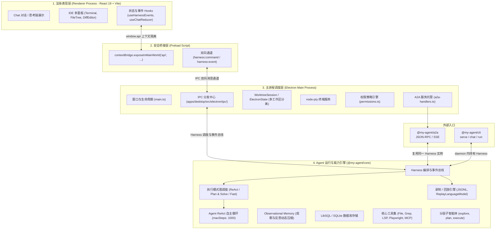
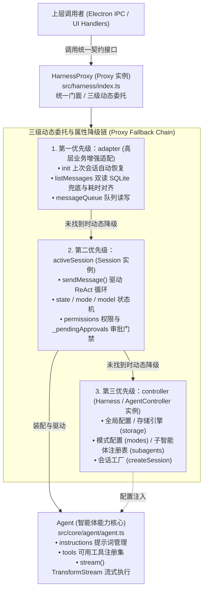
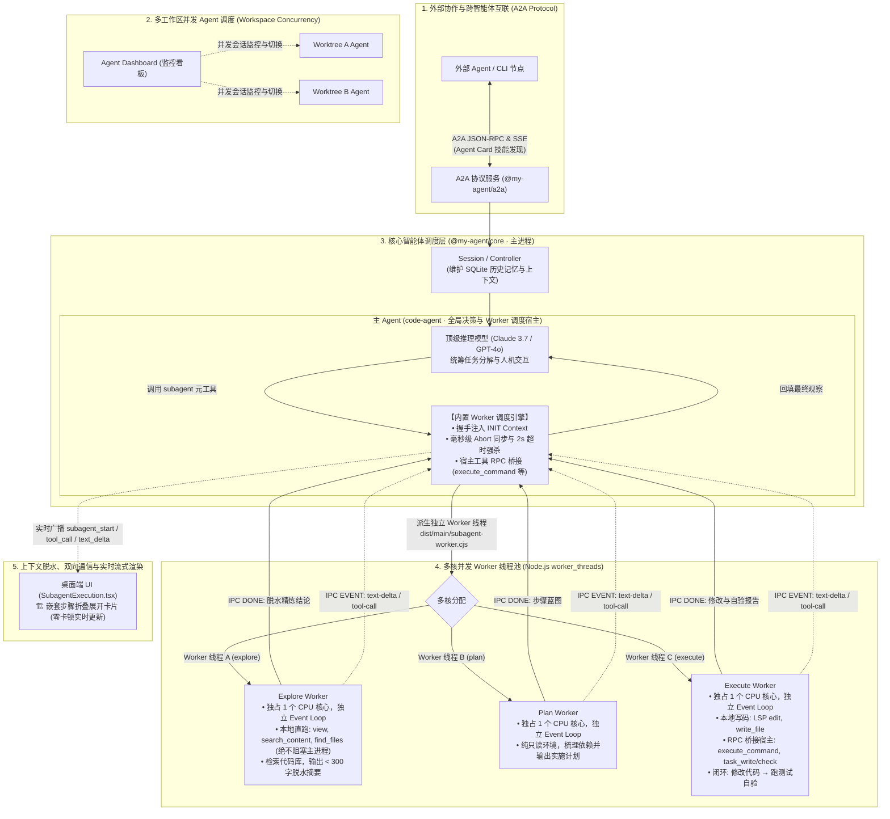
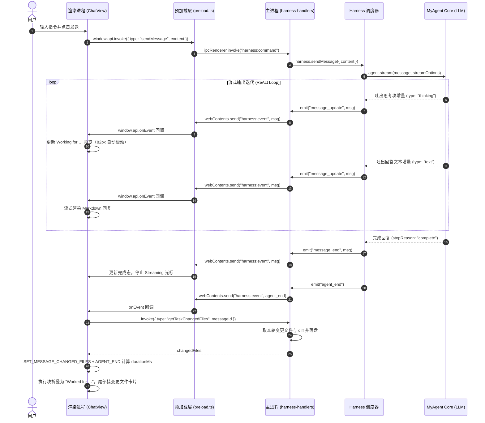
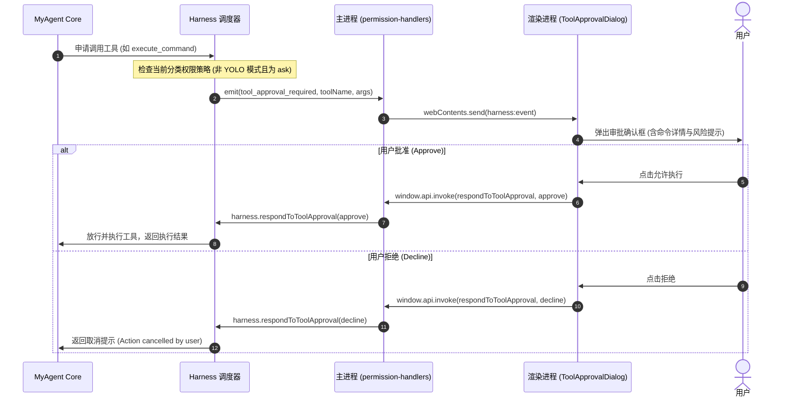
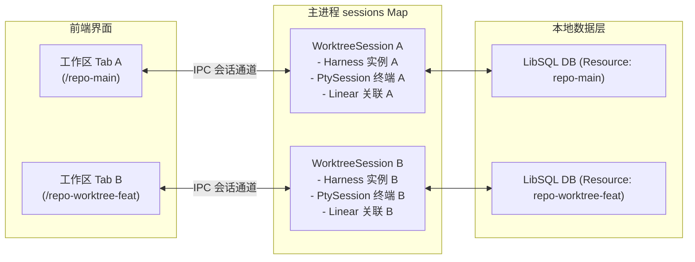
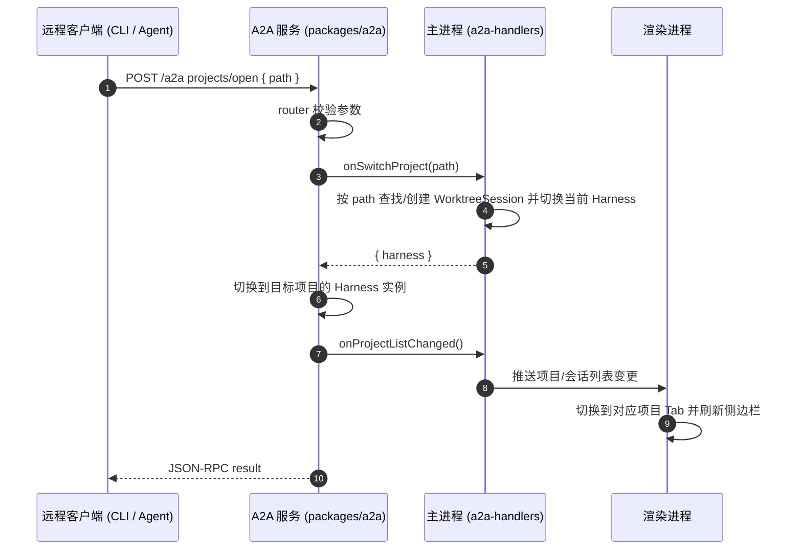
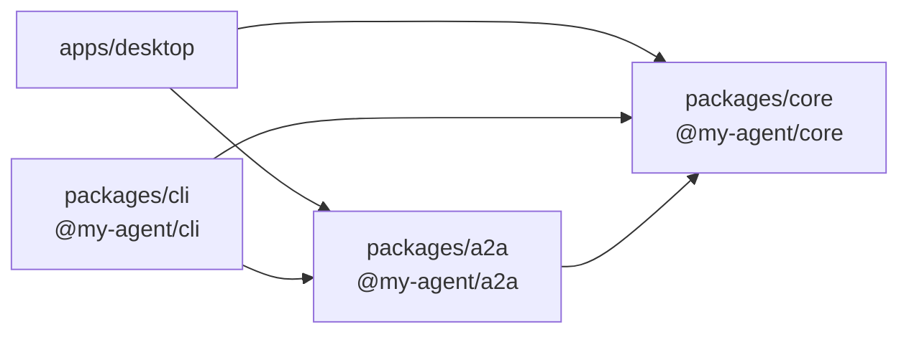

# My Agent 项目架构与模块实现说明

<div align="center">

**简体中文** ｜ [English](README_EN.md)

</div>

本项目是一个基于 **Electron**、**React** 构建的桌面级智能编码助手。项目采用多进程解耦架构，结合现代自主 Agent 的 ReAct 循环与观察性记忆机制，支持多工作区会话隔离、工具流式执行与多面板 IDE 协同交互。

<!-- FEEDBACK_BADGES_START — 与 src/utils/feedback.ts 的 FEEDBACK_BADGES 保持一致 -->

<div align="center">


<sub>每条回复下方都有 复制 · 👍 Helpful · 👎 Bad response。点赞是匿名的：不登录、不落库、不上报身份，只让上面两个公开计数器 +1；重启应用后高亮消失，只留下总数。</sub>

</div>

<!-- FEEDBACK_BADGES_END -->

---

<!-- LATEST_RELEASE_START -->

## 📥 客户端下载与版本日志 (ChangeLog)

<div align="center">

[](https://github.com/kidyfirst/my-agent/releases/latest)
[](https://github.com/kidyfirst/my-agent/releases)
[](LICENSE)
[](#全平台客户端下载)
[](https://kidyfirst.github.io/my-agent/changelog.html)

**当前最新稳定版本：`v0.1.4`**  
🌐 **[访问官方在线下载站 (GitHub Pages)](https://kidyfirst.github.io/my-agent/)** ｜ 📋 **[查看版本更新日志 (ChangeLog)](https://kidyfirst.github.io/my-agent/changelog.html)** ｜ 📦 **[GitHub Releases 资产归档](https://github.com/kidyfirst/my-agent/releases)**

</div>

### 全平台客户端下载

| 操作系统 / 平台 | 架构 / 适用机型 | 安装包格式 | 直接下载链接 (v0.1.4) | 说明 |
| :--- | :--- | :--- | :--- | :--- |
| 🍏 **macOS** | **Apple Silicon** (M1 / M2 / M3 / M4) | `.dmg` 安装镜像 | [my-agent-0.1.4-mac-arm64.dmg](https://github.com/kidyfirst/my-agent/releases/download/v0.1.4/my-agent-0.1.4-mac-arm64.dmg) | 推荐 Mac 用户首选 |
| 🍏 **macOS** | **Apple Silicon** (M1 / M2 / M3 / M4) | `.zip` 免安装包 | [my-agent-0.1.4-mac-arm64.zip](https://github.com/kidyfirst/my-agent/releases/download/v0.1.4/my-agent-0.1.4-mac-arm64.zip) | 解压即用 |
| 🍏 **macOS** | **Intel x86_64** 芯片 | `.dmg` 安装镜像 | [my-agent-0.1.4-mac-x64.dmg](https://github.com/kidyfirst/my-agent/releases/download/v0.1.4/my-agent-0.1.4-mac-x64.dmg) | 适配 Intel 架构 Mac |
| 🍏 **macOS** | **Intel x86_64** 芯片 | `.zip` 免安装包 | [my-agent-0.1.4-mac-x64.zip](https://github.com/kidyfirst/my-agent/releases/download/v0.1.4/my-agent-0.1.4-mac-x64.zip) | 解压即用 |
| 🪟 **Windows** | **Windows 10 / 11** (64 位) | `.exe` 安装程序 | [my-agent-0.1.4-win-x64.exe](https://github.com/kidyfirst/my-agent/releases/download/v0.1.4/my-agent-0.1.4-win-x64.exe) | NSIS 引导向导安装 |
| 🪟 **Windows** | **Windows 10 / 11** (64 位) | `.zip` 免安装便携版 | [my-agent-0.1.4-win-x64.zip](https://github.com/kidyfirst/my-agent/releases/download/v0.1.4/my-agent-0.1.4-win-x64.zip) | 解压即可直接运行 |
| 🐧 **Linux** | **Linux x86_64** (通用) | `.AppImage` 便携镜像 | [my-agent-0.1.4-linux-x86_64.AppImage](https://github.com/kidyfirst/my-agent/releases/download/v0.1.4/my-agent-0.1.4-linux-x86_64.AppImage) | `chmod +x` 后直接双击执行 |
| 🐧 **Linux** | **Debian / Ubuntu / Deepin** | `.deb` 系统软件包 | [my-agent-0.1.4-linux-amd64.deb](https://github.com/kidyfirst/my-agent/releases/download/v0.1.4/my-agent-0.1.4-linux-amd64.deb) | `sudo dpkg -i` 系统级安装 |

> [!IMPORTANT]
> **macOS 首次打开提示“已损坏 / 无法验证开发者”处理方法：**  
> 由于开源社区版本未购买苹果商业开发者签名证书，macOS Gatekeeper 安全机制在从浏览器下载应用后会附带隔离属性。若首次打开提示“已损坏，应移到废纸篓”或“无法打开”，只需在终端执行一次以下命令解除隔离即可正常打开：
>
> ```bash
> xattr -cr "/Applications/My Agent.app"
> ```
>
> 或在系统设置中授权：**【系统设置】->【隐私与安全性】-> 下滑找到并点击【仍要打开】**。

> [!TIP]
>
> - 完整更新履历与历史版本详情请参阅 👉 **[在线 ChangeLog 日志](https://kidyfirst.github.io/my-agent/changelog.html)** 或 **[GitHub Releases 全部发布归档](https://github.com/kidyfirst/my-agent/releases)**。

---
<!-- LATEST_RELEASE_END -->

<!-- TIP_JAR_START — 二维码就是 apps/desktop/src/renderer/assets/alipay-qr.png，同一份文件，别再放副本 -->

## ☕ 打赏猫球

<div align="center">

如果你觉得项目对你有帮助，打赏猫球吧 🐱


<sub>支付宝扫一扫 · 金额随意，不打赏也一样好用</sub>

</div>

<!-- TIP_JAR_END -->

---

## 目录

- [My Agent 项目架构与模块实现说明](#my-agent-项目架构与模块实现说明)
  - [📥 客户端下载与版本日志 (ChangeLog)](#-客户端下载与版本日志-changelog)
    - [全平台客户端下载](#全平台客户端下载)
  - [☕ 打赏猫球](#-打赏猫球)
  - [目录](#目录)
  - [1. 整体架构设计](#1-整体架构设计)
    - [核心设计原则](#核心设计原则)
  - [2. 进程划分与通信机制](#2-进程划分与通信机制)
  - [3. 核心模块实现说明](#3-核心模块实现说明)
    - [3.1 主进程层 (`apps/desktop/src/electron/`)](#31-主进程层-appsdesktopsrcelectron)
    - [3.2 预加载与桥接层 (`apps/desktop/src/electron/preload.ts`)](#32-预加载与桥接层-appsdesktopsrcelectronpreloadts)
    - [3.3 渲染进程 UI 层 (`apps/desktop/src/renderer/`)](#33-渲染进程-ui-层-appsdesktopsrcrenderer)
      - [3.3.1 ChatView 渲染管线](#331-chatview-渲染管线)
      - [3.3.2 运行中与已结束两种展示形态](#332-运行中与已结束两种展示形态)
      - [3.3.3 用户消息吸顶与折叠](#333-用户消息吸顶与折叠)
      - [3.3.4 变更文件卡片与子智能体卡片](#334-变更文件卡片与子智能体卡片)
      - [3.3.5 滚动、空态与层叠](#335-滚动空态与层叠)
    - [3.4 Agent 运行与能力层 (智能体引擎 / `packages/core/`)](#34-agent-运行与能力层-智能体引擎--packagescore)
      - [3.4.1 核心运行时对象体系 (AgentController / Session / Agent / HarnessProxy)](#341-核心运行时对象体系-agentcontroller--session--agent--harnessproxy)
        - [1. 四大核心实体的职责边界与类定义契约](#1-四大核心实体的职责边界与类定义契约)
        - [2. 核心类与接口定义结构](#2-核心类与接口定义结构)
          - [(1) `Agent` 类定义（`packages/core/src/core/agent/agent.ts`）](#1-agent-类定义packagescoresrccoreagentagentts)
          - [(2) `AgentController` 类定义（`packages/core/src/core/controller/controller.ts`）](#2-agentcontroller-类定义packagescoresrccorecontrollercontrollerts)
          - [(3) `Session` (`ActiveSession`) 类定义（`packages/core/src/core/controller/controller.ts`）](#3-session-activesession-类定义packagescoresrccorecontrollercontrollerts324)
          - [(4) `HarnessProxy` 与 `adapter` 门面（`packages/core/src/harness/index.ts`）](#4-harnessproxy-与-adapter-门面packagescoresrcharnessindexts)
        - [3. 为什么要在 `adapter` 外包裹一层 `Proxy`？](#3-为什么要在-adapter-外包裹一层-proxy)
      - [3.4.2 存储引擎与数据库持久化](#342-存储引擎与数据库持久化)
      - [3.4.3 观察性记忆 (Observational Memory)](#343-观察性记忆-observational-memory)
      - [3.4.4 Agent ReAct 循环机制与工具流](#344-agent-react-循环机制与工具流)
      - [3.4.5 扩展工具生态与沙箱安全 (`packages/core/src/tools/`, `lsp/`, `browser/`)](#345-扩展工具生态与沙箱安全-packagescoresrctools-lsp-browser)
      - [3.4.6 分级子智能体与多 Agent 体系 (Subagents & Multi-Agent)](#346-分级子智能体与多-agent-体系-subagents--multi-agent-architecture)
        - [1. 内置子智能体职责与权限梯队](#1-内置子智能体职责与权限梯队)
        - [2. 实现细节：调用链路与运行机制](#2-实现细节调用链路与运行机制)
        - [3. 使用场景与调用建议](#3-使用场景与调用建议)
        - [4. 自定义与扩展](#4-自定义与扩展)
        - [5. 事件流转与 UI 呈现](#5-事件流转与-ui-呈现)
        - [6. 为什么需要多权限 Subagent？（设计优势）](#6-为什么需要多权限-subagent设计优势)
      - [3.4.7 执行模式与图调度 (`packages/core/src/core/graph/`)](#347-执行模式与图调度-packagescoresrccoregraph)
      - [3.4.8 会话录制与离线回放 (`packages/core/src/core/recorder/`)](#348-会话录制与离线回放-packagescoresrccorerecorder)
    - [3.5 Memory 记忆模块 (`packages/core/src/memory/`)](#35-memory-记忆模块-packagescoresrcmemory)
      - [3.5.1 类继承关系与职责边界](#351-类继承关系与职责边界)
      - [3.5.2 存储域适配与线程/消息 CRUD](#352-存储域适配与线程消息-crud)
      - [3.5.3 Observational Memory 参数与触发阈值](#353-observational-memory-参数与触发阈值)
      - [3.5.4 动态 Memory 工厂与模型热切换](#354-动态-memory-工厂与模型热切换)
      - [3.5.5 分词估算与 Working Memory 空实现](#355-分词估算与-working-memory-空实现)
      - [3.5.6 配置入口与测试覆盖](#356-配置入口与测试覆盖)
    - [3.6 A2A 协议服务 (`packages/a2a/`)](#36-a2a-协议服务-packagesa2a)
    - [3.7 CLI 命令行与本地守护进程 (`packages/cli/`)](#37-cli-命令行与本地守护进程-packagescli)
  - [4. 核心业务与数据流时序](#4-核心业务与数据流时序)
    - [4.1 用户消息、思考链与执行块流式时序](#41-用户消息思考链与执行块流式时序)
    - [4.2 工具调用审批与人机协同流程](#42-工具调用审批与人机协同流程)
    - [4.3 Git Worktree 多会话隔离机制](#43-git-worktree-多会话隔离机制)
    - [4.4 A2A 远程会话驱动桌面工作区](#44-a2a-远程会话驱动桌面工作区)
  - [5. 多包目录结构映射](#5-多包目录结构映射)

---

## 1. 整体架构设计

项目以 **pnpm workspace 多包仓库（monorepo）** 组织，分为 `apps/*`（可执行应用）与 `packages/*`（可复用库）两部分：

| 包                  | 路径             | 职责                                                   |
| :------------------ | :--------------- | :----------------------------------------------------- |
| `my-agent`（根）    | `./`             | 构建编排、Electron 打包配置、发布脚本                  |
| `@my-agent/desktop` | `apps/desktop/`  | Electron 桌面客户端（主进程 / preload / React 渲染层） |
| `@my-agent/core`    | `packages/core/` | 无头智能体引擎：图调度、控制器、Harness、存储、工具集  |
| `@my-agent/a2a`     | `packages/a2a/`  | Agent-to-Agent（A2A）JSON-RPC 服务端 / 客户端          |
| `@my-agent/cli`     | `packages/cli/`  | 命令行入口与本地守护进程（daemon）                     |

在运行时，项目采用典型的 **四层分层架构**，由上至下分别为 **UI 渲染表现层**、**安全桥接层**、**主进程调度层** 以及 **Agent 运行时引擎**：



### 核心设计原则

1. **严格的进程隔离（Context Isolation）**：渲染进程不直接接触 Node.js 原生 API 与敏感系统调用，所有能力通过 `preload.ts` 的白名单通道暴露。
2. **多 Worktree 会话隔离（Session Isolation）**：针对同一仓库的多个 Git 分支/工作区（Worktree），主进程分别实例化独立的 `WorktreeSession` 与 `Harness` 实例，保证会话、终端与状态互不干扰。
3. **自主 ReAct 循环而非静态工作流**：摒弃死板的 DAG 工作流，依托 LLM 的推理-行动循环（Think $\to$ Tool Call $\to$ Observe $\to$ Loop），实现灵活的代码检索、规划与改写。
4. **长上下文动态记忆压缩（Observational Memory）**：内置观察者与反思者模型，动态压缩长对话中的大量工具调用日志，防止上下文超出模型限制。
5. **模式即执行图（Mode as Graph）**：ReAct / Plan & Solve / Fast 三套执行模式分别对应独立的图定义，切模式即换整张调度图与工具集，而非只改提示词。
6. **可录制、可回放（Record & Replay）**：每次运行可落盘为紧凑 JSONL，回放时不触网、不落盘改动，配合运行时快照完整还原当时的模型、模式与权限上下文。
7. **引擎与外壳解耦（Headless Core）**：`@my-agent/core` 不依赖 Electron，桌面端、A2A 服务与 CLI 守护进程共用同一套 `Harness` 实例与工具集，新增模型、工具或执行模式只需改一处。
8. **本地优先与回环绑定（Loopback Only）**：A2A 与 CLI 守护进程默认只监听 `127.0.0.1`，CORS 仅对回环来源回显，避免任意网页驱动本地工具执行。

---

## 2. 进程划分与通信机制

Electron 体系中进程通信采用强类型的 IPC 约定：

| 通信通道                | 方向                  | 传输协议                            | 功能说明                                                                 |
| :---------------------- | :-------------------- | :---------------------------------- | :----------------------------------------------------------------------- |
| `harness:command`       | 渲染进程 $\to$ 主进程 | `ipcRenderer.invoke` (双向 Promise) | 前端发送命令，如发送消息、切换模型、切换模式、操作终端、保存设置等       |
| `harness:event`         | 主进程 $\to$ 渲染进程 | `webContents.send` (单向广播)       | 主进程向前端实时推送流式事件（消息流、思考链、工具执行、任务进度、通知） |
| `login:prompt-response` | 渲染进程 $\to$ 主进程 | `ipcRenderer.send` (单向)           | OAuth 登录弹窗/验证响应回调                                              |
| `set-badge-count`       | 渲染进程 $\to$ 主进程 | `ipcRenderer.send` (单向)           | 设置 macOS Dock 栏未读消息徽标                                           |
| `open-url`              | 主进程 $\to$ 渲染进程 | `webContents.send` (单向)           | 拦截外部链接并在应用内置浏览器面板打开                                   |

---

## 3. 核心模块实现说明

### 3.1 主进程层 (`apps/desktop/src/electron/`)

主进程负责操作系统的原生能力对接、窗口管理、会话生命周期维护与安全分发。

- **窗口控制与入口 (`apps/desktop/src/electron/main.ts`)**
  - 调用 `createWindow()` 实例化主窗口，配置 `webPreferences`（关闭 `nodeIntegration`，启用 `contextIsolation` 与 `preload`）。
  - 区分环境加载：开发环境读取 `process.env.ELECTRON_RENDERER_URL`（连接 Vite 开发服务器支持热更新）；生产环境通过 `mainWindow.loadFile` 加载打包后的 `dist/renderer/index.html`。
  - 注册应用全局菜单、macOS Dock 图标、外部链接拦截。
- **IPC 命令调度中心 (`apps/desktop/src/electron/ipc/`)**
  主进程采用模块化 Handler 设计，在 `apps/desktop/src/electron/ipc/index.ts` 中统合分发（21 个子模块）：
  - `harness-handlers.ts`：处理对话消息（`sendMessage`）、任务中断（`abort`）、用户插话（`steer`）、追加任务（`followUp`）、模式/模型切换。
  - `project-handlers.ts`：项目探测、工作区打开、Git Worktree 会话生命周期管理与多工程切换。
  - `repo-handlers.ts`：仓库级操作（最近项目列表、项目级设置与清理）。
  - `permission-handlers.ts`：工具调用审批统一入口 `respondToToolApproval`（含 `decision` / `scope` / `toolCallId`），兼容 `approveToolCall` / `declineToolCall`，并处理人机交互问题应答（`ask_question` / `plan_approval`）。
  - `pty-handlers.ts`：基于 `node-pty` 实现底层伪终端实例的创建、标准输入输出流中继与终端窗口尺寸重置（Resize）。
  - `git-handlers.ts`：处理本地 Git 仓库状态检查、Diff 生成、分支拉取与切换。
  - `file-handlers.ts` / `context-handlers.ts`：为前端编辑器面板提供受控的本地文件读取与上下文（`@` 文件引用）解析服务。
  - `mcp-handlers.ts`：管理 Model Context Protocol（MCP）服务器连接、状态监控与外部工具重载。
  - `settings-handlers.ts`：配置持久化（Thinking 深度等级、通知模式、AST 智能编辑开关等）。
  - `integration-handlers.ts`：负责 Linear 与 GitHub 双向集成（工单拉取、关联提交、状态联动）。
  - `auth-handlers.ts`：Anthropic 及 OpenAI OAuth 鉴权流程控制。
  - `dashboard-handlers.ts`：汇总跨会话的 Token 消耗、执行耗时与任务指标。
  - `a2a-handlers.ts`：托管内置 A2A 服务（`a2a:start` / `a2a:stop` / `a2a:status`），把远程请求路由到当前激活的 `Harness`，并在远程切换项目时同步桌面侧会话与侧边栏。
  - `feedback-handlers.ts` / `logging-handlers.ts` / `update-handlers.ts` / `slash-command-handlers.ts`：用户反馈上报、日志采集、自动更新与 Slash 指令注入。
- **状态隔离与集成上下文 (`apps/desktop/src/electron/electron-state.ts`)**
  - 为每个工作区路径维护一份 `ElectronState`，持久化记录关联的 Linear 任务 ID、GitHub PR 链接及专属凭证。
- **系统原生通知 (`apps/desktop/src/electron/notifications.ts`)**
  - 当主窗口处于非聚焦（后台）状态时，若 Agent 任务完成或需要人工审批，调用系统原生通知与声效提示。
- **任务变更与快照**：`task-changes-store.ts` 记录每个任务的变更文件与 diff；`git-task-snapshot.ts` 在任务开始时打 Git 快照，支持一键回滚（`revertToGitSnapshot`）。

### 3.2 预加载与桥接层 (`apps/desktop/src/electron/preload.ts`)

`preload.ts` 在页面 DOM 加载前执行，依托 `contextBridge` 为网页注入安全的 `window.api` 命名空间：

```ts
// apps/desktop/src/electron/preload.ts
contextBridge.exposeInMainWorld("api", {
  invoke: (command) => ipcRenderer.invoke("harness:command", command),
  onEvent: (callback) => { ... },
  respondToLoginPrompt: (answer) => { ... },
  cancelLoginPrompt: () => { ... },
  setBadgeCount: (count) => { ... },
  onOpenUrl: (callback) => { ... },
  platform: process.platform,
})
```

配合 `apps/desktop/src/renderer/types/ipc.ts` 中的 `declare global { interface Window { api: ElectronAPI } }`，实现全链路的 TypeScript 静态类型推断与代码自动补全。

### 3.3 渲染进程 UI 层 (`apps/desktop/src/renderer/`)

基于 **React 19** + **Vite** 构建的高性能 IDE 级界面，采用单向数据流与响应式订阅驱动：

- **渲染挂载入口 (`apps/desktop/src/renderer/index.html` & `main.tsx`)**
  - `index.html` 提供 `#root` 挂载点，引入 ES Module `main.tsx`，将根组件 `<App />` 渲染到 DOM。
- **事件消费与状态机 (`apps/desktop/src/renderer/hooks/useHarnessEvents.ts` & `types/chat.ts`)**
  - 订阅 `window.api.onEvent`，拦截主进程推送的 Agent 运行时事件。
  - 通过 `useChatReducer` 状态机处理动作：
    - `AGENT_START` / `AGENT_END`：标记全局运行态与加载光标。
    - `MESSAGE_START` / `MESSAGE_UPDATE` / `MESSAGE_END`：流式累加 Token 并实时更新对应消息块。
    - `TOOL_START` / `TOOL_UPDATE` / `TOOL_END`：更新工具调用入参与返回结果。
- **会话消息渲染组件族 (`apps/desktop/src/renderer/components/`)**
  - `ChatView.tsx`：会话渲染管线，负责把 `messages` 归并为「用户消息 / 执行块 / 助手回复 / 子智能体 / 系统提示」五类渲染项，并把同一轮的多段工具调用折叠成一个执行块。
  - `AssistantMessage.tsx`：助手正文渲染，`text` 块走 `react-markdown` 富文本 + 代码高亮，每个代码块带独立复制按钮。
  - `ExecutionBlock.tsx`：执行块（思维链 + 工具调用）的统一展示组件，运行中与已结束两种形态见 [3.3.2](#332-运行中与已结束两种展示形态)。
  - `UserMessage.tsx`：用户消息气泡，支持吸顶、超长折叠、图片预览与一键复制。
  - `FilesChangedBar.tsx` / `SubagentExecution.tsx` / `TodoProgress.tsx`：变更文件卡片、子智能体执行卡片与任务进度条。
- **IDE 多面板组件生态**
  - `TerminalPanel.tsx`：基于 `@xterm/xterm` 与 `@xterm/addon-fit` 实现的高性能 ANSI 终端仿真器。
  - `FileTree.tsx` / `FileEditor.tsx` / `DiffEditor.tsx`：文件树浏览、代码高亮查看与 Git 变更 Side-by-Side 差异对比。
  - `TaskBoard.tsx`：集成 Linear/GitHub 工单看板，支持将 issue 一键绑定当前分支开发。
  - `ToolApprovalCard.tsx` / `PlanApproval.tsx` / `AskQuestionDialog.tsx`：人机交互组件，详见 [4.2](#42-工具调用审批与人机协同流程)。
  - `AppModals.tsx`：模态层统一装配（登录、提问、计划审批、设置、命令面板等）。

#### 3.3.1 ChatView 渲染管线

`ChatView.tsx` 不直接遍历 `messages` 渲染组件，而是先把消息体归并成渲染项（`RenderItem`），再由一个 `switch` 分发到具体组件。这一过程是串行的多轮 `useMemo` 处理，顺序如下：

1. **轮次时长预处理**：以 `user` / `system` 消息切分轮次，收集本轮内所有 assistant 消息 id 与最后一个非空的 `durationMs`，写入 `turnDurationById`。`agent_end` 只会把耗时写在最后一条 assistant 消息上，靠这张表把耗时还原到「本轮的第一个执行块」。
2. **逐消息解析**：先用 `normalizeMessageContent` 归一化 `content`（Agent 传入的可能是字符串、数组或 `parts`）。`tool_result` 块先建 `toolResultsById` 索引；随后按块类型分派：
   - `text` / `output` / `message`（或无 type 但带 `text` / `content` / `value`）：累积正文；
   - `thinking` / `reasoning` / `thought` / `redactedthinking`：生成思维链步骤，耗时优先取块内 `durationSec`，其次按消息耗时折算，最后按文本长度估算；
   - `toolcall` / `tooluse` / `toolinvocation`：生成工具步骤，`isDone` 由 `state === "result"` 或已存在结果判定，工具定义从 `tools` / `subagents` 映射中查名称与图标。
3. **刷新策略**：遇到正文块或子智能体时调用 `flushExecution()`，把当前累积的步骤落成一个执行块；遇到思维链或工具块时调用 `flushText()`，且**只在正文非空（或尾部为错误）时产出 assistant 项**，因此流式过程中不会出现空气泡。
4. **消息收尾**：消息解析完成后再次 flush，并把 `msg.changedFiles` 挂到本轮最后一条 assistant 项上；若没有任何正文项，则补一个只含文件卡片的 assistant 项。
5. **补漏**：状态机里已出现、但消息体中没有对应块的工具会被补进 `live-execution-block`；未渲染过的子智能体补成独立卡片。
6. **占位**：Agent 运行中且最后一项是用户消息时，插入 `active-execution-placeholder`，让 `Working for …` 立刻可见，而不必等第一个工具调用。
7. **收尾归并**：先合并相邻执行块（步骤按 id 去重）、丢弃空且非活跃的块；再做「一轮一个活动块」折叠——游标在 `user` / `system` 项处重置，同一轮后续所有执行块并入第一个块，`isActive` / `startedAt` / `durationMs` / `changedFiles` 取最新值。

第 7 步是「一轮只出现一个 `Worked for …`」的关键：早期实现每个 assistant 消息各带一个执行块，一轮里就会冒出多个标题，现在统一在渲染层折叠。

#### 3.3.2 运行中与已结束两种展示形态

`ExecutionBlock.tsx` 用同一组件承载两种状态，形态由 `isActive` 决定：

- **运行中**：标题为 `Working for 12.3s`（或 `1m 20s`），后面带 `(N steps)` 计数与向下箭头；折叠态下方是 82px 高的步骤预览窗，随新步骤自动滚到底，点击标题或预览窗展开全部步骤。
- **已结束**：整轮只留一行 `Worked for 1m 6s ⌄`，步骤默认完全隐藏，点击才展开；若该块没有任何步骤且非活跃，组件直接返回 `null`。
- **耗时来源**：`agent_end` 时写入消息的 `durationMs`；缺失时回退到 3.3.1 的 `turnDurationById`。数据库中没有耗时列，因此 `chatReducer` 的 `SET_MESSAGES` 会保留内存中的旧耗时，并给历史会话补到本轮最后一条 assistant 消息——更早的历史轮次仍可能只显示不带时长的 `Worked`。
- **时长格式**：不足 60 秒显示一位小数（`12.3s`），超过则显示 `Xm Ys`；运行中由 100ms 定时器按 `startedAt` 刷新。

**运行中标题的逐字入场**：活跃态的标题由 `AnimatedWorkingLabel` 渲染，按字符拆成若干 `<span class="working-char">`，每个字符以 `28ms` 的步长（`WORKING_CHAR_STAGGER_MS`）依次播放 `working-char-in`（`opacity: 0 → 1`，`260ms` ease-out），整行约 350ms 内点亮，让这一行在出现时就显得「在工作」。实现上有三个关键约束：

1. **只在运行中启用**。已结束的 `Worked for …` 走普通文本分支，否则每次滚动或展开都会重播入场动画。
2. **拆成两段渲染**。标题被拆成稳定前缀（`Working`）与跳动的时长（`12.3s`）两段：前缀的 key 恒定，因此时长每 100ms 变化时不会重挂前缀、把整行重新入场；只有时长段里新增的字符获得入场。
3. **字符 key 用下标而非字符本身**。`staggeredChars` 的 key 是索引，所以 `3.4s → 3.5s`、`9.9s → 10.0s` 这类变化只改文本、不重建 DOM 节点——若 key 里带上字符，变化的最后一位会每 100ms 重挂一次，表现为持续闪烁。

`prefers-reduced-motion: reduce` 下 `.working-char` 的动画被显式关闭。

#### 3.3.3 用户消息吸顶与折叠

`UserMessage.tsx` 负责让「当前视口中最新的提问」常驻顶部：

- 未展开时 `position: sticky` + `top: 0` + `zIndex: 20` + 不透明 `var(--bg)` 背景，滚动时停在视口顶端；展开态取消吸顶，恢复普通文档流。
- 内容高度超过阈值（气泡约 80px）时折叠，底部叠 24px 渐变遮罩与 chevron，点击切换展开；若 `window.getSelection()` 显示存在选区则不触发切换，保留「拖选复制」。
- 图片缩略图固定高度 60px、`object-fit: contain`，点击打开 `ImagePreviewModal`；气泡下方是时间戳与复制按钮。
- 布局细节：滚动容器自身不设内边距，内层 800px 列承担 `16px 24px 0`；吸顶容器用负外边距 `-24px` + 等量 padding 把背景铺到列边缘，避免吸顶卡片两侧露出被滚动的正文。

#### 3.3.4 变更文件卡片与子智能体卡片

- **变更文件卡片 (`FilesChangedBar.tsx`)**：`message.changedFiles` 非空时挂在 assistant 消息尾部。头部一行是 `N files changed +X -Y`，点击整行展开；展开后每个文件显示 `basename` + 目录 + 增删行数，`Review` 按钮阻止冒泡并直接打开差异编辑器。行内 diff 懒加载（`getTaskFileDiff`，按 `messageId` 取），`isLive` 表示任务仍在执行。
- **持久化 (`packages/core/src/snapshot/task-changes-store.ts`)**：任务结束时的文件列表与 diff 写入 `<appData>/task-changes.json`（thread → message → files/diff，上限 40 个线程 × 80 个任务、单条 diff 200KB），重启后 `getMessages` 会重新挂回 `changedFiles`，删除线程时同步清理。
- **子智能体卡片 (`SubagentExecution.tsx`)**：整行可点，`🏗️` + `Agent` + 任务描述 + 完成耗时 + ✓/✗/运行中脉冲点；展开后逐条列出子智能体内部工具调用（含失败标记），并以只读文本块展示最终结果（失败时用错误色）。数据来源与事件映射见 [3.4.6 第 5 节](#5-事件流转与-ui-呈现)。

#### 3.3.5 滚动、空态与层叠

- **自动滚动**：用 `isAutoScroll` 标记是否跟随底部（距底小于 100px 视为跟随），新消息与工具更新时先把 `scrollTop` 置到底部，再在下一帧补滚一次，避免 React 提交时机导致的位置偏差。
- **布局**：外层 `flex: 1` / `overflow-y: auto` / `overflow-x: hidden` / `scrollbar-gutter: stable`，内层 `max-width: 800px; margin: 0 auto; flex: 1 0 auto; min-height: 100%`，底部留 16px 占位。
- **空态与进度**：无渲染项且 Agent 空闲时展示 `AsciiLogo`；存在 `todos` 时在列表底部渲染 `TodoProgress`；`system` 消息渲染为带 `System Notice` 标签的提示块；连续重复的用户消息按文本去重。
- **层叠顺序**：吸顶卡片使用 `zIndex: 20`，所有可能下探到聊天区的浮层必须高于它——`OpenInDropdown` 为 400，编辑器内的模型/权限浮层为 200，命令面板与模态框为 1000 以上。

### 3.4 Agent 运行与能力层 (智能体引擎 / `packages/core/`)

项目通过自主研发的智能体运行时架构装配底层能力，由四大核心实体协同工作，实现模型交互、工具受控调用、多会话隔离与事件流式渲染。这些实现全部位于无头包 `@my-agent/core` 中，桌面端（`apps/desktop`）、A2A 服务与 CLI 守护进程共享同一份代码。

#### 3.4.1 核心运行时对象体系 (AgentController / Session / Agent / HarnessProxy)

在运行时架构中，上层（Electron IPC 处理器与前端 UI）并不直接操作单一复杂的底层类，而是通过一个经过代理包装的统一门面对象（`harness`）与整个系统交互。



##### 1. 四大核心实体的职责边界与类定义契约

| 核心实体                              | 源码位置                                                                       | 核心定位与职责                                                                                                                                                                                               |
| :------------------------------------ | :----------------------------------------------------------------------------- | :----------------------------------------------------------------------------------------------------------------------------------------------------------------------------------------------------------- |
| **`Agent`**                           | `packages/core/src/core/agent/agent.ts`                                        | **原子智能体能力封装体**。管理 System Instructions、Model 解析、Tools 列表注入与 Memory 关联，提供基础流式生成 `stream()`。                                                                                  |
| **`AgentController`**                 | `packages/core/src/core/controller/controller.ts:119`                          | **工作区级调度宿主与 Session 工厂**。持有全局存储（Storage）、持久化记忆（Memory）、模式（Modes）、子智能体注册表（Subagents），负责多 Session 生命周期管理。                                                |
| **`Session`** (`ActiveSession`)       | `packages/core/src/core/controller/controller.ts:324`                          | **有状态的单项目/工作区分支执行实例**。每个项目或 Git Worktree 对应一个独立的 Session。管理响应式状态、当前 Model/Mode、历史 Thread、工具审批门禁（`_pendingApprovals`），并承载主执行入口 `sendMessage()`。 |
| **`HarnessProxy`** (`MyAgentHarness`) | `packages/core/src/harness/index.ts:1278`（`createMyAgent` 位于同文件 `:472`） | **高级多态门面代理**。通过 ES6 `Proxy` 动态聚合 `adapter`、`activeSession` 和 `controller`，对外提供全功能、动态延迟绑定、零样板转发的统一接口。                                                             |

---

##### 2. 核心类与接口定义结构

###### (1) `Agent` 类定义（`packages/core/src/core/agent/agent.ts`）

```typescript
export class Agent {
	id: string
	name: string
	description?: string
	instructions?: any // 字符串或返回字符串的动态函数 (args: { requestContext }) => Promise<string>
	model?: any // 语言模型实例或解析函数 (args: { requestContext }) => Promise<LanguageModel>
	tools?: any // 工具映射字典或解析函数 Record<string, Tool>
	memory?: any // 记忆管理模块

	constructor(config: AgentConfig)

	// 获取并解析当前请求上下文的系统提示词
	async getInstructions(args?: {
		requestContext?: RequestContext
	}): Promise<string>
	// 动态获取当前请求上下文使用的语言模型
	async getModel(args?: { requestContext?: RequestContext }): Promise<any>
	// 列出当前所有可用的工具实例
	async listTools(args?: {
		requestContext?: RequestContext
	}): Promise<Record<string, any>>
	// 核心流式执行：调用 Vercel AI SDK 的 streamText，并通过内置 TransformStream 统一规范化输出事件流
	async stream(
		taskOrPrompt: string | any,
		options?: AgentStreamOptions,
	): Promise<{
		fullStream: ReadableStream<any>
		textStream: ReadableStream<string>
		text: Promise<string>
		getFullOutput: () => Promise<{
			text: string
			usage: any
			finishReason: any
		}>
	}>
}
```

###### (2) `AgentController` 类定义（`packages/core/src/core/controller/controller.ts`）

```typescript
export class AgentController<TState = any> {
	readonly id: string
	readonly agent: Agent // 关联的主 Agent 实例
	readonly storage: any // 全局存储引擎 (SQLite / LibSQL)
	readonly memory?: any // 观察性记忆模块 (OM)
	readonly defaultModeId: string // 默认模式 (如 "build")
	readonly modes: AgentMode[] // 注册的工作模式列表 (build, plan 等)
	readonly subagents: HarnessSubagent[] // 注册的子智能体列表 (explore, plan, execute)
	readonly toolCategoryResolver?: (toolName: string) => string // 工具类别解析器

	constructor(config: HarnessConfig<TState>)

	async init(): Promise<void>
	// 会话工厂：创建或获取对应工作区/资源的独立状态会话
	async createSession(options?: {
		resourceId?: string
	}): Promise<Session<TState>>
	getSession(sessionId: string): Session<TState> | undefined
	listModes(): AgentMode[]
	async listAvailableModels(): Promise<AvailableModelItem[]>
}
```

###### (3) `Session` (`ActiveSession`) 类定义（`packages/core/src/core/controller/controller.ts:324`）

```typescript
export class Session<TState = any> {
	readonly id: string
	readonly resourceId: string
	readonly controller: AgentController<TState>

	// 状态机与环境配置访问器
	readonly state: {
		get: () => TState
		set: (patch: Partial<TState>) => Promise<void>
	}
	readonly mode: {
		get: () => string
		switch: (opts: { modeId: string }) => Promise<void>
	}
	readonly model: { get: () => any; switch: (modelId: string) => Promise<void> }

	// 历史会话管理
	readonly thread: {
		getId: () => string
		switch: (opts: { threadId: string }) => Promise<void>
		create: (opts?: {
			title?: string
			metadata?: Record<string, unknown>
		}) => Promise<ThreadLike>
		list: () => Promise<ThreadLike[]>
		listMessages: (opts?: { threadId?: string; limit?: number }) => Promise<any>
		delete: (opts: { threadId: string }) => Promise<void>
	}

	// 权限门禁与人机审批控制
	readonly permissions: {
		getRules: () => {
			categories: Record<string, string>
			tools: Record<string, string>
		}
		setForCategory: (opts: {
			category: ToolCategory
			policy: PermissionPolicy
		}) => void
	}

	// 核心任务驱动：装配工具、注入审批拦截、驱动 streamText 循环并广播事件
	async sendMessage(options: SendMessageOptions): Promise<void>
	// 异步中断正在运行的任务与进程组
	async abort(): Promise<void>
	// 响应工具调用的人工审批 (Approve / Decline)
	respondToToolApproval(opts: {
		decision?: "approve" | "decline"
		toolCallId: string
	}): void
	// 订阅当前会话发出的全量生命周期事件 (tool_start, tool_end, message_delta 等)
	subscribe(listener: (event: HarnessEvent) => void): () => void
}
```

###### (4) `HarnessProxy` 与 `adapter` 门面（`packages/core/src/harness/index.ts`）

```typescript
// 1. adapter: 在会话之上封装高阶业务逻辑与存储兜底
const adapter: MyAgentHarness = {
    id: "myagent-code",
    controller,
    get activeSession() { return activeSession },
    async init() {
        await controller.init()
        const session = activeSession ?? (await sessionReady)
        await session.init?.()
        // 自动恢复上次打开的项目会话 Thread
        ...
    },
    async listMessages(options) {
        // 先读内存 session，随后双查 SQLite 存储补齐精确的执行耗时 durationMs
        ...
    },
    ...
}

// 2. harness: 基于 Proxy 构造三级动态查找链
const harness: MyAgentHarness = new Proxy(adapter, {
    get(target: MyAgentHarness, prop: string | symbol) {
        if (prop in target) {
            return (target as unknown as Record<string | symbol, unknown>)[prop]
        }
        if (activeSession && prop in (activeSession as unknown as object)) {
            const val = (activeSession as unknown as Record<string | symbol, unknown>)[prop]
            return typeof val === "function" ? val.bind(activeSession) : val
        }
        if (prop in (controller as unknown as object)) {
            const val = (controller as unknown as Record<string | symbol, unknown>)[prop]
            return typeof val === "function" ? val.bind(controller) : val
        }
        return undefined
    },
})
```

---

##### 3. 为什么要在 `adapter` 外包裹一层 `Proxy`？

使用 `Proxy` 带来了四个不可替代的核心架构价值：

1. **解决 `activeSession` 异步延迟挂载的时序问题（Late-bound Dynamic Reference）**：
   在 `createMyAgent()` 初始化执行时，`activeSession` 依赖 `controller.createSession(...)` 异步 Promise 创建。若使用传统静态拷贝（如 `Object.assign`），在函数返回瞬间 `activeSession` 依然是 `null`，挂在它上面的方法会全量丢失；而 Proxy 在**属性被访问的瞬间动态求值**，一旦异步创建完毕，外部立刻能够透明访问。
2. **零样板转发（Zero-Boilerplate Delegation）**：
   `Session` 与 `AgentController` 包含了大量的内部方法与深层状态（如 `permissions`, `thread`, `om` 记忆, `storage` 等）。若不使用 Proxy，开发者就必须在 `adapter` 对象上手工手写数十个千篇一律的转发函数（`foo(...args) { return this.activeSession.foo(...args); }`），维护成本极高；通过 Proxy 实现了全量 API 的**透明自动降级委托**。
3. **保证 `this` 上下文绑定（Execution Context Binding）**：
   在属性访问时，Proxy 自动针对函数执行 `.bind(activeSession)` 或 `.bind(controller)`，确保底层方法执行时其内部的 `this` 永远指向原始实例本身，杜绝因上下文丢失导致访问内部私有属性（如 `this._state`, `this._pendingApprovals`）抛出 `TypeError: Cannot read properties of undefined`。
4. **高层业务覆盖优先（Override & Enrichment）**：
   Proxy 优先判断 `if (prop in target)`，这使得 `adapter` 能够精准重写关键业务方法（例如 `listMessages` 的 SQLite 补充查询兜底、`init` 的记忆恢复），未重写的方法则无缝透传到底层实现。

---

#### 3.4.2 存储引擎与数据库持久化

默认自动初始化嵌入式 LibSQL（SQLite）数据库，路径位于系统 AppData 目录，实现 Thread 历史记录、消息列表、Token 用量的本地零配置持久化。

#### 3.4.3 观察性记忆 (Observational Memory)

解决长时间编码对话中上下文窗口爆炸的痛点：

- **Observer 模型**：定期扫描会话中的工具输入与输出，抽取摘要观察记录。
- **Reflector 模型**：对高频事实与架构共识进行反思与提炼，动态维护长期记忆上下文。
- 具体实现见 [3.5 Memory 记忆模块](#35-memory-记忆模块-srcmemory)。

#### 3.4.4 Agent ReAct 循环机制与工具流

- 实例化核心智能体 `codeAgent`，在 `harness.sendMessage()` 中配置 `maxSteps: 1000`。
- 模型依据指令思考并自主决策调用工具；工具在宿主运行后将标准输出或异常反馈回模型，模型持续迭代直至完成整体任务。

#### 3.4.5 扩展工具生态与沙箱安全 (`packages/core/src/tools/`, `lsp/`, `browser/`)

- **基础代码工具**：`view`（查看代码）、`grep`（内容正则搜索）、`glob`（文件匹配）、`execute_command`（受控命令执行）、`write_file`（写文件）。
- **AST 智能编辑**：`string_replace_lsp` 基于 LSP 协议实现精确的语法树级别代码替换。
- **浏览器自动化**：`navigate-browser` 与 `computer` 基于 Playwright 驱动无头/可视化浏览器进行前端界面回归与操作。
- **MCP 外部工具拓展**：动态挂载外部 Model Context Protocol 服务器提供的外部工具。
- **沙箱与路径防护**：所有读写与终端操作强制通过 `assertPathAllowed` 限制在 `projectRoot` 内，越界需经 `request_sandbox_access` 提权确认。

#### 3.4.6 分级子智能体与多 Agent 体系 (Subagents & Multi-Agent Architecture)

项目在架构上支持**纵向分层委派（Hierarchical Subagents）**与**横向跨节点互联（A2A Protocol & Workspace Concurrency）**的完整多 Agent 体系：



##### 1. 内置子智能体职责与权限梯队

主 Agent 通过 `subagent` 元工具（`createSubagentTool`，`packages/core/src/tools/subagent.ts:47`）在需要时派生轻量级 Subagent。三个内置类型在 `packages/core/src/agents/` 中以纯数据定义（`SubagentDefinition`：`id` / `name` / `instructions` / `allowedTools`），由 `agents/index.ts` 的注册表统一检索：

| Subagent 类型 | 角色定位       | 允许工具 (`allowedTools`)                                                                                                 | 默认模型（`subagent.ts:43-45`）                                     | 核心应用场景                                                                 |
| :------------ | :------------- | :------------------------------------------------------------------------------------------------------------------------ | :------------------------------------------------------------------ | :--------------------------------------------------------------------------- |
| **`explore`** | 只读代码探索   | `view`, `search_content`, `find_files`                                                                                    | `google/gemini-2.0-flash`<br/>(极速 / 低单价 / 秒级响应)            | 全仓跨文件大范围检索、查调用点、分析模块结构，避免海量原始代码撑爆主上下文。 |
| **`plan`**    | 架构与方案规划 | `view`, `search_content`, `find_files`                                                                                    | `google/gemini-2.0-flash`<br/>(当前与 explore 共用默认值，可被覆盖) | 大型重构或新功能实施前的方案拆解、依赖关系梳理、产出带步骤的实施蓝图。       |
| **`execute`** | 专注读写执行   | `view`, `search_content`, `find_files`, `string_replace_lsp`, `write_file`, `execute_command`, `task_write`, `task_check` | `google/gemini-2.0-flash`<br/>(同上，建议显式配置为高代码能力模型)  | 聚焦执行单一文件的代码重构、改写，并在封闭循环内自运行测试验证直至通过。     |

##### 2. 实现细节：Agent -> Worker 调度架构与运行机制

**调用链路与多核并发调度**

```
Agent (主进程 ReAct 循环)
  └─ tools.subagent({ agentType, task, modelId? })      packages/core/src/tools/subagent.ts
       ├─ getSubagentDefinition(agentType)              packages/core/src/agents/index.ts
       ├─ 解析模型与快照生成 (ResolvedModelSnapshot)
       ├─ 实例化 SubagentWorkerHost (主进程调度宿主)      packages/core/src/subagent/worker-host.ts
       │    ├─ 多候选路径定位 Worker 入口 (dist/main/subagent-worker.cjs 或 worker-entry.ts)
       │    └─ new Worker(entry) 派生独立工作线程 (独占 CPU 核心与独立 Event Loop)
       │
       ▼ (双向 IPC 消息通信)
Worker 线程 (SubagentWorkerExecutor)                    packages/core/src/subagent/worker-executor.ts
       ├─ 接收 INIT 握手消息 (注入 task, model, projectRoot, allowedTools)
       ├─ 本地独立工具直接执行 (view, search_content, find_files, write_file) → 绝不阻塞主进程
       ├─ 宿主工具通过 RPC 桥接 (TOOL_INVOKE -> execute_command / task_write -> TOOL_RESULT)
       ├─ new Agent({ instructions, model, tools }) 闭环 ReAct
       ├─ subagent.stream(task, { maxSteps: 50, abortSignal })
       │    └─ 实时向 Host 推送 EVENT 消息 (subagent_start, subagent_text_delta, subagent_tool_*)
       └─ 发送 DONE 消息 (含结果文本 + <subagent-meta />)

Host 宿主层 (主进程)
       ├─ 实时转发展示: worker.on('message', EVENT) → harnessContext.emitEvent → 桌面 UI
       ├─ 宿主工具执行: TOOL_INVOKE 经标准 RequestContext 防御性包装执行后回传 TOOL_RESULT
       ├─ 毫秒级中断同步: 收到 abortSignal 立即下发 ABORT 帧，若 2s 未停止强制 worker.terminate()
       ├─ 崩溃安全隔离: Worker 发生异常/退出被捕获，主应用永远不闪退
       └─ 格式化最终输出返回给主 Agent
```

**双向 IPC 消息协议 (`packages/core/src/subagent/protocol.ts`)**

| 方向              | 消息类型 (`type`) | 作用与时机                                     | 关键载荷 (`payload`)                                                                        |
| :---------------- | :---------------- | :--------------------------------------------- | :------------------------------------------------------------------------------------------ |
| **Host → Worker** | `INIT`            | 启动握手，初始化 Worker 执行上下文             | `toolCallId`, `agentType`, `task`, `modelId`, `model` 快照, `allowedTools`, `projectRoot`   |
| **Host → Worker** | `ABORT`           | 用户点击中断或超时，毫秒级终止 Worker 任务     | `toolCallId`, `reason`                                                                      |
| **Host → Worker** | `TOOL_RESULT`     | 主进程完成敏感/单例工具执行后回传结果          | `callId`, `result`, `isError`, `error`                                                      |
| **Worker → Host** | `EVENT`           | 实时流式转发给前端 UI 渲染                     | `toolCallId`, `event` (`subagent_start` / `tool_start` / `tool_end` / `text_delta` / `end`) |
| **Worker → Host** | `TOOL_INVOKE`     | Worker 请求主进程代理执行宿主工具 (如终端命令) | `callId`, `toolName`, `args`                                                                |
| **Worker → Host** | `DONE`            | 任务正常或被取消完成，附带元数据               | `toolCallId`, `resultText`, `toolCallLog`, `durationMs`, `meta`, `isError`                  |
| **Worker → Host** | `ERROR`           | Worker 执行异常报错                            | `toolCallId`, `error`                                                                       |

**架构核心要点：**

- **真正的多核并发与主线程防卡顿**：重度 CPU 密集型工具（`search_content` 递归正则检索、`find_files` 大目录遍历、AST 解析与 Diff 比对）直接在 Worker 的独立线程内部执行，独占操作系统核心，**彻底将高耗时计算从 Electron 主进程剥离**，即使多个 Subagent 同时进行全仓大并发搜索，主进程与桌面 UI 也绝不出现掉帧卡顿。
- **构建原生适配与零运行时开销**：在 `electron.vite.config.ts` 中配置了 `subagent-worker` entry，Vite 打包时直接产出自包含的预编译文件 `dist/main/subagent-worker.cjs`。在 Electron 生产包（asar）和开发环境下均可原生秒级拉起，无需在运行时依赖任何外部 TS 编译 hook。
- **宿主工具 RPC 桥接与上下文防御**：对于需要宿主能力或权限审批的工具（如 `execute_command` 终端执行、任务看板 `task_write`），Worker 通过 `TOOL_INVOKE` 桥接回主进程。Host 收到请求后，通过 `createToolRequestContext` 对上下文做标准的 `RequestContext` 安全防御包装，确保工具内部调用 `toolContext?.requestContext?.get(...)` 始终稳健有效。
- **崩溃物理隔离与容灾**：Worker 线程拥有独立的 V8 Isolate 与内存堆。如果某个 Subagent 意外爆内存（OOM）或发生未捕获异常退出，Host 会在 `worker.on('error')` / `worker.on('exit')` 中安全拦截，仅将该 Subagent 卡片标记为失败，**主应用本体绝对不会闪退**。
- **毫秒级取消与超时强杀保护**：父会话的 `abortSignal` 在触发瞬间毫秒级通过 IPC 推送 `ABORT` 指令给 Worker。若底层被死循环阻塞在 2 秒内未正常退出，Host 会调用 `worker.terminate()` 物理销毁工作线程，杜绝僵尸进程残留。
- **元数据持久化恢复**：完成时在文本尾部追加 `<subagent-meta modelId="…" durationMs="…" tools="view:ok,search_content:err" />`，会话重启后从本地 SQLite 加载历史时，前端仍能无缝重构还原出带有完整耗时、模型和工具执行流水线的 Agent 卡片。

**模型路由优先级（`subagent.ts:120-139`）**

1. 工具调用参数中显式指定的 `modelId`；
2. 持久化配置的按类型子智能体模型：`harness.getSubagentModelId({ agentType })` → `AuthStorage.getSubagentModelId(agentType)`，即 `<dataDir>` 中的 `_subagentModelId_<agentType>`（`packages/core/src/auth/storage.ts:278-297`，写入走 `setSubagentModelId`）；
3. `createSubagentTool({ defaultModelId })` —— 由 `harness/tools.ts:160-164` 传入当前会话模型 ID；
4. 内置兜底：`google/gemini-2.0-flash`。

> 注意：优先级 3 会让未配置第 2 项时子智能体跟随主会话模型，因此"explore 默认便宜小模型"只在父会话未传 `defaultModelId` 时成立；需要固定分级路由时请显式调用 `setSubagentModelId(modelId, agentType)`。

##### 3. 使用场景与调用建议

| 场景                                            | 推荐类型      | 理由                                                      |
| :---------------------------------------------- | :------------ | :-------------------------------------------------------- |
| "X 在哪定义 / 谁调用了 Y / Z 模块怎么跑起来"    | `explore`     | 大量 grep 与文件读取留在子上下文，只回传结论与行号        |
| 跨模块、多子系统的并行排查（前端 + 后端各一路） | `explore` × N | 多路并发，互不污染主上下文                                |
| 大型重构 / 新特性落地前先出方案                 | `plan`        | 只读遍历现有约定，产出「改动文件 + 实施顺序 + 风险」蓝图  |
| 边界清晰、可独立验证的单点改动                  | `execute`     | 具备读写与跑测试的闭环能力，但仍需父 Agent 复核整体一致性 |
| 机械批量改造（如统一重命名、补测试）            | `execute`     | 自带回环验证，父 Agent 只消费最终报告                     |

不适合委派的场景：需要沿主会话上下文追问的对话式任务、需要频繁与用户确认审批的破坏性操作、以及只有一两步就能完成的琐碎查找（直接调 `search_content` 更省时）。

##### 4. 自定义与扩展

当前可用的扩展点只有一个 —— **新增子智能体类型 = 在注册表里加一条定义**：

```ts
// packages/core/src/agents/review.ts
import type { SubagentDefinition } from "./types.js"

export const reviewSubagent: SubagentDefinition = {
	id: "review",
	name: "Review",
	instructions: `你是一名严格的代码评审者……`,
	allowedTools: ["view", "search_content", "find_files", "execute_command"],
}

// packages/core/src/agents/index.ts
const subagentRegistry: Record<string, SubagentDefinition> = {
	explore: exploreSubagent,
	plan: planSubagent,
	execute: executeSubagent,
	review: reviewSubagent, // ← 新增后自动出现在 subagent 工具的枚举与描述中
}
```

注册即刻生效：`getSubagentIds()` 决定 Zod 枚举与工具描述中可用类型的清单，`subagent.ts:53-57` 的 `typeDescriptions` 为其补充说明文案（未覆盖的类型仅显示 `- **id**`）。

尚未接通的配置项（扩展时需留意）：

| 配置项                                        | 位置                                                          | 现状                                                                      |
| :-------------------------------------------- | :------------------------------------------------------------ | :------------------------------------------------------------------------ |
| `MyAgentConfig.subagents` / `HarnessSubagent` | `harness/index.ts:595`、`core/controller/controller.ts:63-71` | 已挂到 `controller.subagents`，但无消费者；改它不会改变可派生类型与工具集 |
| `createSubagentTool({ allowedAgentTypes })`   | `tools/subagent.ts:39,49-51`                                  | 工具侧已支持类型裁剪，但 `harness/tools.ts` 未传入，属于预留能力          |
| `HarnessSubagent.tools` / `model`             | `core/controller/controller.ts:68-69`                         | 未参与注入，子智能体工具始终由 `agents/*.ts` 的 `allowedTools` 决定       |

##### 5. 事件流转与 UI 呈现

`subagent` 工具通过 requestContext 上的 `harness.emitEvent` 实时广播以下事件（`packages/core/src/tools/subagent.ts`），全部携带父级 `toolCallId` 以便归并：

| 事件                  | 触发时机               | 载荷                                      |
| :-------------------- | :--------------------- | :---------------------------------------- |
| `subagent_start`      | 子 Agent 创建后        | `agentType`, `task`, `modelId`            |
| `subagent_tool_start` | 子 Agent 发起工具调用  | `subToolName`, `subToolArgs`              |
| `subagent_tool_end`   | 子 Agent 工具返回      | `subToolName`, `subToolResult`, `isError` |
| `subagent_text_delta` | 子 Agent 流式输出      | `textDelta`（同时累积到 `partialText`）   |
| `subagent_end`        | 正常结束 / 中断 / 失败 | `result`, `isError`, `durationMs`         |

渲染侧链路：`useHarnessEvents.ts:512-554` 将事件转为 `SUBAGENT_START` / `SUBAGENT_TOOL_START` / `SUBAGENT_TOOL_END` / `SUBAGENT_END`（对应 `apps/desktop/src/renderer/types/chat.ts:605-666`），`ChatView` 据此产出独立的 `subagent` 渲染项，由 `SubagentExecution.tsx` 呈现为 `🏗️ Agent + 任务描述 + 耗时 + ✓/✗` 的折叠卡片。若历史记录中缺少实时事件，`ChatView.tsx:713-741` 会依据工具调用参数与结果回退构造卡片。

> `subagent_model_changed` 目前只在渲染进程的事件类型联合（`types/ipc.ts:54`）中声明；`AuthStorage.setSubagentModelId` 尚无对应的 IPC 通道与 UI 入口，修改按类型的子智能体模型需直接写入凭证存储。

##### 6. 为什么需要多权限 Subagent？（设计优势）

1. **最小特权原则与物理防注入（Least Privilege & Security）**：
   - `explore` / `plan` 实例在构建时，危险的 `write_file` 与 `execute_command` 根本不在工具表里（`packages/core/src/tools/subagent.ts:113-118`）。
   - 即使探索第三方开源项目时代码注释中包含恶意 Prompt Injection（如"删除本地文件"），因缺乏工具暴露，模型在物理层面无法发起任何破坏性调用。
2. **保护主会话上下文与信噪比（Context Isolation & Noise Filtering）**：
   - Subagent 拥有完全独立的上下文，不加载父会话的历史记忆。
   - 探索过程中产生的成千上万行 grep 输出和原始文件全被隔离在子上下文内部，角色提示词强制要求（`packages/core/src/agents/explore.ts:38`）输出不超过 300 字的精炼结论（回答、核心文件、行号），避免主会话遭遇上下文爆炸和注意力稀释。
3. **模型分级路由（Cost & Latency Optimization）**：
   - 主会话往往使用顶级推理模型（如 Claude 3.7 Sonnet / GPT-4o），可通过 `setSubagentModelId` 把机械的代码翻找固定到 Gemini 2.0 Flash 等小模型，显著降低开销与首字延迟。
4. **决策聚焦与工具误触消除（Tool Confusion Reduction）**：
   - 将工具决策空间由全量的数十个裁剪至 3 个，大模型的 Tool Calling 准确率大幅提升，降低工具误用。
5. **多路异步并发与统一呈现（Parallel Multitasking）**：
   - 主 Agent 可同时发起多个探索任务（例如前端组件排查与后端路由排查并行），桌面端以彼此独立的 `🏗️ Agent` 卡片流式呈现，互不干扰。

#### 3.4.7 执行模式与图调度 (`packages/core/src/core/graph/`)

同一个模型、同一套工具，可以按任务性质切换三种**执行模式（Execution Mode）**。模式不是提示词开关，而是**整张执行图的替换**：每种模式注册一份独立的 `AgentGraphDefinition`（含拓扑描述 `topology` 与 `buildGraph(ctx)` 工厂），由 `modeId` 在运行时选择。

| 模式 ID | 界面名称         | 执行图形态                                                                                                 | 适用场景                                 |
| :------ | :--------------- | :--------------------------------------------------------------------------------------------------------- | :--------------------------------------- |
| `react` | **ReAct**        | 单图自主循环：LLM 推理 → 工具调用 → 观察反馈 → 再推理，直至产出最终回答                                    | 绝大多数真实改码任务（界面默认）         |
| `plan`  | **Plan & Solve** | 两阶段图：先生成结构化计划（`PlanStep[]` / 任务看板），再逐项执行并按完成度回填状态                        | 大型重构、多文件特性开发，需要先看清路线 |
| `fast`  | **Fast**         | 单节点直连流式响应，仅挂载**只读工具**（读文件 / 代码搜索 / 网页检索），不提供任何写入、编辑或终端执行能力 | 问答、解释代码、查资料等轻量请求         |

实现要点：

- **枚举与别名**：`packages/core/src/core/graph/types.ts` 定义 `ExecutionMode`（`REACT` / `FAST` / `PLAN`）；`GraphRegistry` 把 `build` 注册为 `react` 的别名（注册表自身的兜底 `defaultModeId` 仍是 `"build"`，最终解析到的就是 ReAct 图），因此旧的会话记录与录制文件不会失效。
- **调度入口**：`Harness.sendMessage()` 依据 `modeId` 选择图定义并构建该次运行的 StateGraph，因此 `maxSteps`、可用工具集、是否输出计划都由模式决定（例如 Plan 模式额外挂载任务看板工具）。
- **按线程记忆**：渲染层把所选模式存在 `modesByThread[threadKey]`，并与线程元数据一起持久化；切换线程会自动恢复成该线程上次使用的模式，不会出现「A 线程在 Plan、B 线程被一起改掉」。
- **Fast 的只读边界**：Fast 图用 `selectReadOnlyTools()`（`packages/core/src/core/graph/readonly-tools.ts`）按权限分类过滤工具——只保留 `read` 类，因此 `write_file` / `string_replace_lsp` / `ast_smart_edit` / `execute_command` / MCP 工具都不会出现在模型面前；同时 `describeToolNames("fast")` 只登记 `view` / `search_content` / `find_files` / `request_sandbox_access`，提示词与真实工具集不会漂移。图内以 `stopWhen: stepCountIs(8)` 允许少量工具回合后强制成文。
- **可观测**：Agent Dashboard 与 Context 面板都会读 `modeId`，顶部状态条也实时显示当前模式；录制回放会把模式写进 `RecordedRuntime`，见下节。

#### 3.4.8 会话录制与离线回放 (`packages/core/src/core/recorder/`)

把一次真实运行**完整录制成文件**，之后不调模型、不碰文件系统，原样重放整轮对话——用于问题复现、回归对比与演示。

```
src/core/recorder/
├── session-recorder.ts    # 边写边落盘的 JSONL 记录器
├── recording-manager.ts   # 单例管理器：录制器生命周期 + 录制文件枚举
├── replay.ts              # 录制脚本加载 / 校验 / ReplayLanguageModel
├── replay-runtime.ts      # 回放时的工具与运行时替身
├── types.ts               # SessionEvent / RecordedRuntime / ReplayScript 类型
└── index.ts
```

**录制**

- 触发：Composer 的录制按钮 → IPC `toggleSessionRecording`；执行中不允许开启（否则会录到半截 run），停止时会调用 `validateRecordingFile` 校验文件可用性。
- 落盘位置：`~/.myagent/sessions/<threadId>/<runId>.jsonl`（可用环境变量 `MYAGENT_SESSIONS_DIR` 覆盖）；启动时创建目录，追加写入，崩溃也不会丢已写入的部分。
- 事件流：`session`（版本、cwd、模型、runtime 快照）→ `run/start` → `step/start` → `assistant/stream` → `tool/result` → … → `run/end`。
- **紧凑聚合**：`assistant/stream` 不是逐 chunk 全存，而是按索引聚合为 `text-chunks` / `reasoning-chunks` / `tool-call-chunks`，并记录每个 chunk 之间的毫秒间隔 `dt: number[]`。这样既保留了「打字机节奏」和 DeepSeek 的 `reasoning_content` 思考链，文件体积又只有原始流的零头。
- **环境快照**：`RecordedRuntime` 记录 `modelId`、`modeId`、`permissionMode`、`thinkingLevel`，以及解析后的权限规则（分类策略 + 工具覆盖）与会话授权（`grants`）。没有它，回放会用「当前」的模型/模式/权限去跑，出现 Plan 模式隐藏了录制里用到的写工具、`read-only` 拒绝录制里跑过的命令、`auto-approve` 跳过录制里本该弹的审批等问题。

**回放**

- `ReplayLanguageModel` 实现 `LanguageModelV2` 接口，把录制好的流按原始 `dt` 时序吐给 Agent——**零网络请求、零 token 消耗**；工具调用同样被 `createReplayTools()` 换成录制结果的替身，不会真的改文件或执行命令。
- 支持即时（`instant`）与按倍速播放、`wrap` 循环重复播放。
- 进入回放时按 `RecordedRuntime` 还原模式与权限，并把会话授权注入，避免卡在等待一个不会到人的审批弹窗。
- 界面上通过 `SessionReplayModal` 选择或拖放录制文件即可开始，回放中的标签页会显示 Replay 状态，可随时停止回到正常会话。

### 3.5 Memory 记忆模块 (`packages/core/src/memory/`)

`packages/core/src/memory/` 是项目自研的 `Memory` 实现：它继承 `packages/core/src/core` 的 `MyAgentMemory`，把线程/消息持久化、上下文召回与观察性记忆（OM）压缩统一收敛到一个可直接注入 `AgentController` 的实例中。

```
src/memory/
├── index.ts          # 对外出口：Memory / TokenCounter / 类型
├── memory.ts         # Memory 主类（继承 MyAgentMemory）
├── token-counter.ts  # 轻量分词估算器
├── types.ts          # ObservationalMemoryConfig / MemoryOptions / 构造配置
└── __tests__/memory.test.ts
```

#### 3.5.1 类继承关系与职责边界

| 层                 | 职责                                                                                                            |
| :----------------- | :-------------------------------------------------------------------------------------------------------------- |
| `MyAgentMemory`    | 核心基类，提供 OM 的 Observer/Reflector 编排、观察记录更新与压缩流程、注入系统提示词等全部"智能"部分。          |
| `Memory`（本项目） | 只覆写**存储字段读写**：线程 CRUD、消息读写、召回分页、系统提示取数、分词估算；并把 Working Memory 置为空实现。 |
| `TokenCounter`     | 纯函数式估算器，无外部依赖，避免引入 tiktoken 编码表带来的启动开销。                                            |

设计取向是「贴着存储层重写、把 LLM 侧逻辑留给上游」：OM 的观察抽取/反思合并由基类完成并落库，本类只负责把这些记录从存储层 (SQLiteStore) 里正确地取出、拼装并交给 Agent。

#### 3.5.2 存储域适配与线程/消息 CRUD

所有读写都先经由 `getMemoryStore()` 解析复合存储的 `memory` 域，拿不到 `storage` 或该域缺失时直接抛错，避免静默降级：

- **线程**：`createThread` / `saveThread` 在落库前补 `title`（`"New Thread"`），满足数据库 `NOT NULL` 约束；`getThreadById`、`listThreads`、`updateThread`、`deleteThread` 均直接透传到存储域。`copyThread` / `cloneThread` 用于「从历史会话派生新会话」，对 `threadId` 与 `sourceThreadId` 两种入参做兼容并归一化返回结构。
- **写入消息 (`saveMessages`)**：先用 `MessageList({ generateMessageId }).add(messages, "memory").get.all.db()` 做格式归一化（入参可能是字符串、数组或 parts 结构）；若消息缺 `resourceId` 则回查所属线程补齐；最后批量落库，并按正文长度估算本次写入的 token 用量返回。
- **召回消息 (`recall`)**：默认 `perPage: 100`、`page: 0`；未显式指定 `orderBy` 时按 `createdAt DESC` 取最新一页，再在内存中反转，从而保证「取最新 N 条、但按时间正序返回」。归一化后调用 `filterSystemReminderMessages` 过滤系统提醒与临时信号，附带 `total / page / perPage / hasMore` 分页信息，供 UI 做滚动加载。
- **删除消息 (`deleteMessages`)**：兼容 `string[]`、`{ id }[]`、`{ messageIds: [...] }` 三种入参形态，统一抽取 id 后批量删除。

#### 3.5.3 Observational Memory 参数与触发阈值

OM 的开关与全部阈值集中在 `options.observationalMemory`，类型定义在 `packages/core/src/memory/types.ts`，实际装配在 `packages/core/src/harness/index.ts` 的 `getDynamicMemory`：

```ts
observationalMemory: {
  enabled: true,
  scope,                                  // "thread" | "resource"
  observation: {
    bufferTokens: 1 / 5,                  // 每隔 messageTokens 的 20% 跑一次后台缓冲观察
    bufferActivation: 2000,               // 达到阈值时激活缓冲的比例，其余留作下轮储备
    messageTokens: obsThreshold,          // 观察触发阈值，默认 30_000
    blockAfter: 2,                        // 达到 2×messageTokens 时允许同步阻塞观察
    model: ({ requestContext }) => ...,   // Observer 模型
  },
  reflection: {
    bufferActivation: 1 / 2,
    blockAfter: 1.1,
    observationTokens: refThreshold,      // 反思触发阈值，默认 40_000
    model: ({ requestContext }) => ...,   // Reflector 模型
  },
}
```

- **`scope` 决定记忆可见范围**：`thread`（默认）每条会话独立观察与压缩；`resource` 则在同一 `resourceId` 的所有会话间共享观察记录。解析优先级见 `getOmScope()`（`packages/core/src/utils/project.ts`）：`MYAGENT_OM_SCOPE` 环境变量 → 项目级 `<project>/.myagent/database.json` 的 `omScope` → 全局 `~/.myagent/database.json` → 默认 `thread`。
- **`bufferTokens`**：以「占 `messageTokens` 的比例」表示后台异步缓冲观察的间隔，`1/5` 即每积累到阈值的 20% 就在后台跑一次 Observer，把结果先存进缓冲区，真正越线时可直接激活而不阻塞。
- **`bufferActivation`**：越线时激活多少比例的缓冲观察，小于 1 的部分保留到下一轮，用于维持对话连贯性。
- **`blockAfter`**：允许「同步阻塞观察」的 token 阈值（取 `1 < x < 100` 时按 `messageTokens` 的倍数解析，取 `≥ 100` 时按绝对 token 数解析）。在 `messageTokens` 与 `blockAfter` 之间只跑异步缓冲，未观察消息最多可增长到 `blockAfter`（此处 `2 ×` ≈ 60k tokens）才插入一次同步观察，避免每个 Agent 步骤都被 LLM 观察调用拖慢。
- **双阈值阶梯**：会话增长到 `observationThreshold`（`observation.messageTokens`）时 Observer 抽取观察记录；观察记录本身累积到 `reflectionThreshold`（`reflection.observationTokens`）时 Reflector 把观察反思合并成更凝练的长期记忆（`reflection.blockAfter: 1.1` 表示 110% 阈值时同步反思），如此循环实现长对话的滚动压缩。
- **取数入口 `getSystemMessage()`**：从存储域读取 `activeObservations` 并包装成 `# Observational Memory` 段落，作为系统提示注入下一轮请求；记录不存在或为空时返回 `null`，且整段读取用 `try/catch` 包裹——OM 故障绝不能影响主对话链路。

#### 3.5.4 动态 Memory 工厂与模型热切换

`getDynamicMemory()` 返回的不是实例而是**取实例的函数**（`DynamicArgument`），Agent 每次需要解析 memory 时按当时的 request context 现算：

1. 从 `requestContext` 取 `controller` / `harness` 上的 `HarnessState`，读出 `observationThreshold`、`reflectionThreshold`、`observerModelId`、`reflectorModelId` 与 `projectPath`。
2. 以 `` `${obsThreshold}:${refThreshold}:${omScope}` `` 作为缓存键：只要阈值与作用域不变就复用已构建的实例，避免每轮回调都重建。
3. `observation.model` / `reflection.model` 写成闭包而非固定模型：调用时才读 `state.observerModelId ?? DEFAULT_OM_MODEL_ID`（Reflector 同理）并经 `resolveModel(..., { remapForCodexOAuth: true })` 解析，因此**运行中切换阈值或模型会立即生效**，无需重启会话。

模型变更的三条入口都位于 `apps/desktop/src/electron/helpers.ts`（切换主模型、自动升级模型、切换失败后的回退）：它们会同时把 `observerModelId` / `reflectorModelId` 与 `currentModelId` 一起写入 state，保持三者对齐；渲染层设置面板再通过 `setObserverModel` / `setReflectorModel` 命令 + `harness.switchObserverModel()` / `switchReflectorModel()` 单独覆盖。

#### 3.5.5 分词估算与 Working Memory 空实现

- **`TokenCounter`**：采用 `ceil(len / 4)`（最少 1）的启发式估算，对代码与英文散文平均偏差可接受，且零依赖、零初始化成本；`countMessage()` 兼容 `content` 为字符串或 `{ content }` 结构。`Memory` 覆写 `estimateTokens()` 委托给它，因此 `saveMessages` / `recall` 返回的 `usage.tokens` 同源。
- **`settled()`**：直接 `Promise.resolve()`，即不等待后台 OM 任务（观察/反思）落地，保证本轮结束后 UI 侧的 `agent_end` 立即到达；未完成的观察由下一次 `bufferTokens` 检查或后续步骤自然接续。
- **Working Memory 系列**（`getWorkingMemory`、`getWorkingMemoryTemplate`、`updateWorkingMemory`、`__experimental_updateWorkingMemoryVNext`）：统一返回空值 / 空成功。基类为这些方法提供了默认实现，但本项目不需要「结构化用户画像」这一类工作记忆，长期记忆完全交给 OM 承担，因此显式覆写为空实现，而不是依赖基类可能触发的额外存储读写。

#### 3.5.6 配置入口与测试覆盖

- **UI 配置**：设置面板 `apps/desktop/src/renderer/components/settings/MemorySection.tsx` 提供 Observer 模型、Reflector 模型、Observation threshold、Reflection threshold 四项；阈值变化会改变缓存键，进而触发 Memory 实例重建。
- **默认值**：`packages/core/src/harness/state.ts` 中 `DEFAULT_OBS_THRESHOLD = 30_000`、`DEFAULT_REF_THRESHOLD = 40_000`、`DEFAULT_OM_MODEL_ID = process.env.DEFAULT_OM_MODEL_ID ?? DEFAULT_FALLBACK_MODEL_ID`。
- **测试**：`packages/core/src/memory/__tests__/memory.test.ts` 使用内存态 SQLite（`file::memory:`）覆盖线程 CRUD 与分页、消息保存/召回顺序、系统提醒与信号过滤、召回分页、OM 配置与 `settled()`、`cloneThread`，以及与 `AgentController` 的线程生命周期集成。

### 3.6 A2A 协议服务 (`packages/a2a/`)

`@my-agent/a2a` 把 `packages/core` 的 Harness 暴露为一套标准的 Agent-to-Agent 接口，使外部调用方（CLI、其它 Agent、桌面端自身）能以同一协议驱动会话。

| 层         | 文件                                     | 职责                                                                                                                                   |
| ---------- | ---------------------------------------- | -------------------------------------------------------------------------------------------------------------------------------------- |
| HTTP 入口  | `packages/a2a/src/server/http-server.ts` | `startA2AServer()` 启动监听，`createA2ARequestHandler()` 产出可复用的请求处理器，`A2AServer` 类封装生命周期；默认监听 `127.0.0.1:3888` |
| 路由分发   | `packages/a2a/src/server/router.ts`      | JSON-RPC 2.0 方法表分发，负责参数校验与错误码映射                                                                                      |
| 流式推送   | `packages/a2a/src/server/sse.ts`         | `handleSSEStream()` 订阅 `harness.subscribe(...)`，将引擎事件以 `event: <name>` / `data: <json>` 逐条推给客户端                        |
| 跨域策略   | `packages/a2a/src/server/cors.ts`        | 仅放行本机回环来源（`getLoopbackOrigin`），不使用通配符                                                                                |
| Agent 名片 | `packages/a2a/src/card.ts`               | `createAgentCard()` 生成 `/.well-known/agent-card.json` 描述，声明 JSON-RPC 1.0 绑定与 streaming 能力                                  |
| 客户端     | `packages/a2a/src/client/client.ts`      | 对端 SDK，封装 JSON-RPC 调用与 SSE 消费                                                                                                |

**HTTP 端点**

- `GET /.well-known/agent-card.json`（或 `/agent-card.json`）：Agent 能力名片
- `GET /health`：健康检查
- `GET /a2a/stream`：SSE 事件流
- `POST /a2a`：JSON-RPC 主入口

**JSON-RPC 方法集**

| 方法                                                                 | 说明                                                                                  |
| -------------------------------------------------------------------- | ------------------------------------------------------------------------------------- |
| `projects/list` / `projects/create` / `projects/open`                | 项目枚举、创建与切换（`projects/open` 会触发 `onSwitchProject` 回调，同步桌面端会话） |
| `threads/list` / `threads/create` / `threads/get` / `threads/delete` | 线程全生命周期 CRUD                                                                   |
| `message/send` / `tasks/create`                                      | 发送用户消息、派生任务                                                                |
| `tasks/get` / `tasks/cancel` / `tasks/revert`                        | 任务查询、取消与基于快照的回滚                                                        |
| `approvals/list` / `approvals/submit`                                | 拉取待审批工具调用、提交审批结论（对应人机协同闭环）                                  |

`startA2AServer()` 接受 `getHarness`、`onSwitchProject`、`onProjectListChanged` 三个钩子，使得远程会话切换项目时，桌面端能同步刷新侧边栏并重建 Harness，而不需要重启服务。

### 3.7 CLI 命令行与本地守护进程 (`packages/cli/`)

`@my-agent/cli` 提供 `my-agent` 可执行文件，把同一套引擎带到终端场景。它由两部分组成：

- **命令层** `packages/cli/src/cli.ts`：解析 argv 并分发到 `packages/cli/src/commands/` 下的六个子命令。
- **守护进程层** `packages/cli/src/daemon.ts`：`startDaemon()` 在后台托管一个 A2A 服务实例，并把 `{ pid, port, host, baseUrl, cwd, startedAt }` 写入 `getAppDataDir()/daemon.json`；读取时会用 `process.kill(pid, 0)` 探测进程存活，进程已死则视为无效残留。

| 子命令    | 作用                                                         |
| --------- | ------------------------------------------------------------ |
| `serve`   | 前台启动守护进程与 A2A 服务（`--port` / `--host` / `--cwd`） |
| `run`     | 一次性执行任务并返回结果                                     |
| `chat`    | 交互式多轮对话                                               |
| `project` | 项目枚举与切换                                               |
| `thread`  | 线程的列出、创建、切换与删除                                 |
| `status`  | 查看守护进程状态                                             |

`packages/cli/src/client-runner.ts` 负责把命令翻译成 JSON-RPC 请求发给守护进程，因此 CLI 不直接持有 Harness —— 所有状态都集中在守护进程内，多个终端可以共享同一个会话上下文。

---

## 4. 核心业务与数据流时序

### 4.1 用户消息、思考链与执行块流式时序



### 4.2 工具调用审批与人机协同流程



### 4.3 Git Worktree 多会话隔离机制



- 当切换或打开多个工作区时，主进程维护由项目根路径为键的 `sessions: Map<string, WorktreeSession>`。
- 所有前后台通信事件均携带 `worktreePath` 标识，前端 Hook 会依据当前激活的工作区自动比对，杜绝后台会话消息错位串扰。

### 4.4 A2A 远程会话驱动桌面工作区

当外部客户端（CLI 或其它 Agent）通过 A2A 操作项目时，桌面端必须实时跟随，不能停留在旧项目上。链路如下：



- `getHarness` 钩子让路由层始终取到"当前项目"的 Harness，而不是启动时捕获的旧实例。
- 事件流同样按项目路由：客户端订阅 `/a2a/stream` 后，收到的是当前 Harness 的事件；项目切换后流会继续跟随新实例。
- 审批闭环跨端一致：远程发起的工具调用若需审批，会出现在 `approvals/list` 中，桌面端 `ToolApprovalCard` 与远程 `approvals/submit` 均可提交结论。

---

## 5. 多包目录结构映射

仓库采用 pnpm workspace 的 monorepo 布局（`pnpm-workspace.yaml` 声明 `packages/*` 与 `apps/*`），自研引擎与协议层全部收拢到 `packages/`，桌面端作为唯一 `apps/` 消费方。

```
my-agent/
├── apps/
│   └── desktop/                   # Electron 桌面端 (唯一 GUI 外壳)
│       └── src/
│           ├── index.ts           # 桌面端统一导出
│           ├── types.ts           # 跨进程共享类型
│           ├── electron/          # 主进程层 (Main Process)
│           │   ├── main.ts        # 应用生命周期、窗口创建、Harness 初始化与事件转接
│           │   ├── preload.ts     # contextBridge 安全桥接注入
│           │   ├── electron-state.ts    # 工作区维度集成状态 (Linear/GitHub 绑定)
│           │   ├── notifications.ts     # 原生系统通知与角标
│           │   ├── external-links.ts    # 外链安全拦截与系统浏览器分发
│           │   ├── logging.ts           # 主进程日志落盘
│           │   ├── helpers.ts           # OAuth 校验、对话标题自动生成
│           │   ├── project-threads.ts       # 项目会话索引与持久化
│           │   ├── project-thread-write.ts  # 会话写入通道
│           │   ├── task-changes-store.ts    # 任务变更文件与 diff 持久化
│           │   ├── git-task-snapshot.ts     # Git 变更快照
│           │   ├── updater/       # 应用自更新检查与下载安装
│           │   ├── __tests__/     # 主进程单元测试
│           │   └── ipc/           # 19 个 IPC 业务子模块的路由装配
│           │       ├── index.ts                  # 路由总装与分发入口
│           │       ├── harness-handlers.ts       # 消息收发、模式与模型调度
│           │       ├── project-handlers.ts       # 项目探测、Worktree 切换与会话构建
│           │       ├── repo-handlers.ts          # 仓库信息与远程地址解析
│           │       ├── permission-handlers.ts    # 权限校验、工具审批、提问拦截
│           │       ├── a2a-handlers.ts           # A2A 服务启停与远程会话接入
│           │       ├── pty-handlers.ts           # node-pty 伪终端生命周期与 I/O
│           │       ├── git-handlers.ts           # Git 状态提取与代码差异对比
│           │       ├── file-handlers.ts          # 文件只读读取与编辑器服务
│           │       ├── context-handlers.ts       # 上下文文件/目录的增删与统计
│           │       ├── integration-handlers.ts   # Linear / GitHub 双向集成协议
│           │       ├── mcp-handlers.ts           # MCP 服务连接生命周期管理
│           │       ├── settings-handlers.ts      # 应用偏好与模型参数持久化
│           │       ├── auth-handlers.ts          # OAuth 凭证轮转与回调
│           │       ├── dashboard-handlers.ts     # Token 统计与运行耗时聚合
│           │       ├── slash-command-handlers.ts # Slash 指令加载与动态注入
│           │       ├── feedback-handlers.ts      # 消息反馈上报
│           │       ├── logging-handlers.ts       # 渲染进程日志转发
│           │       ├── update-handlers.ts        # 版本检查与更新状态
│           │       └── types.ts                  # IPC 契约类型
│           └── renderer/          # 渲染进程 UI 层 (React 19 + TypeScript + Vite)
│               ├── index.html     # 页面承载入口
│               ├── main.tsx       # React 挂载入口
│               ├── App.tsx        # 顶层布局骨架、快捷键注册与状态装配
│               ├── components/    # UI 面板与交互组件
│               │   ├── ChatView.tsx           # 会话渲染管线：消息分组、一轮一个执行块
│               │   ├── AssistantMessage.tsx   # 助手正文渲染 (Markdown / 代码高亮)
│               │   ├── ExecutionBlock.tsx     # 执行块：Working for … / Worked for …
│               │   ├── UserMessage.tsx        # 用户消息气泡：吸顶、折叠、图片预览
│               │   ├── ToolExecution.tsx      # 工具执行状态卡片
│               │   ├── ToolApprovalCard.tsx   # 工具审批卡片 (once/conversation/project/global 四级作用域)
│               │   ├── SubagentExecution.tsx  # 子 Agent 执行嵌套可视化
│               │   ├── FilesChangedBar.tsx    # 本轮变更文件卡片与行内 diff
│               │   ├── AppModals.tsx          # 全局模态框集中挂载
│               │   ├── TerminalPanel.tsx      # 基于 xterm.js 的嵌入式终端
│               │   ├── FileEditor.tsx         # 语法高亮代码编辑器/查看器
│               │   ├── DiffEditor.tsx         # 代码变更对比面板
│               │   ├── TaskBoard.tsx          # 任务看板 (Linear / GitHub Issues)
│               │   ├── ProjectList.tsx        # 项目与会话列表 (含 project-list/ 子目录)
│               │   ├── Settings.tsx           # 设置面板 (含 settings/ 子目录)
│               │   ├── ModelSelector.tsx      # 模型切换与鉴权状态
│               │   ├── CommandPalette.tsx     # Cmd+K 全局指令面板
│               │   ├── PlanApproval.tsx       # Plan & Solve 方案审批
│               │   ├── AskQuestionDialog.tsx  # Agent 提问交互
│               │   ├── SessionReplayModal.tsx # 会话录制回放
│               │   └── graph/                 # 基于 @xyflow/react 的流程图可视化
│               ├── hooks/         # 业务 React Hooks
│               │   ├── useHarnessEvents.ts    # IPC 事件总线订阅与状态分发
│               │   ├── useChatReducer.ts      # 对话与工具状态机
│               │   ├── useProjectManager.ts   # 多工程与 Worktree 状态控制
│               │   ├── useProjectThreads.ts   # 项目会话列表与切换
│               │   ├── useThreadActions.ts    # 会话级操作 (重命名/删除/导出)
│               │   ├── useThreadModelPermissions.ts # 会话级模型与权限策略
│               │   ├── useGitOperations.ts    # Git 操作与差异拉取
│               │   ├── useDialogManager.ts    # 模态框栈管理
│               │   ├── useAuthManager.ts      # 登录态与凭证
│               │   ├── useMessageQueue.ts     # 消息排队发送
│               │   ├── useTabManager.ts       # 多标签页管理
│               │   └── useKeyboardShortcuts.ts # 全局快捷键
│               ├── utils/         # 渲染层工具函数
│               ├── types/         # 渲染进程 TypeScript 类型定义
│               ├── styles/        # 全局样式与主题变量
│               ├── assets/        # 静态资源
│               └── __tests__/     # 渲染层测试
│
├── packages/
│   ├── core/                      # @my-agent/core 无头智能体引擎
│   │   └── src/
│   │       ├── index.ts           # 引擎对外统一出口
│   │       ├── client.ts          # 引擎客户端入口
│   │       ├── core/              # 核心运行时
│   │       │   ├── agent/         # Agent 类与 streamText 流式执行管道
│   │       │   ├── controller/    # AgentController 调度容器与 Session 会话类
│   │       │   ├── context/       # RequestContext 请求生命周期上下文
│   │       │   ├── tools/         # 工具适配、参数校验与 JSON Schema 转换
│   │       │   ├── memory/        # 核心 Memory 抽象类
│   │       │   ├── llm/           # 统一语言模型解析与动态包装
│   │       │   ├── graph/         # 执行模式图 (ReAct / Plan & Solve / Fast)
│   │       │   ├── recorder/      # 会话录制 (JSONL) 与离线回放
│   │       │   ├── workspace/     # 工作区解析与环境抽象
│   │       │   ├── base/          # 运行时基类与共享契约
│   │       │   └── logger/        # 结构化日志
│   │       ├── harness/           # 智能体装配与门面代理层
│   │       │   ├── index.ts       # createMyAgent / adapter 装配与 HarnessProxy
│   │       │   ├── instructions.ts    # 动态系统提示词装配
│   │       │   ├── model-resolver.ts  # 模型解析与凭证绑定
│   │       │   ├── subagents.ts       # 默认子智能体装配
│   │       │   ├── tools.ts           # 动态工具组装与模式过滤
│   │       │   ├── thinking.ts        # 思考链解析与标签过滤
│   │       │   ├── settings.ts        # 工作区与用户设置持久化
│   │       │   ├── state.ts           # 会话状态机类型与 Schema
│   │       │   ├── workspace.ts       # Harness 侧工作区上下文
│   │       │   └── project-purge.ts   # 项目数据清理
│   │       ├── agents/            # 分级子智能体 (explore / plan / execute)
│   │       ├── prompts/           # 系统提示词 (base / build / plan / fast)
│   │       ├── tools/             # 宿主扩展工具实现
│   │       │   ├── shell.ts                   # execute_command
│   │       │   ├── file-view.ts               # view
│   │       │   ├── write.ts                   # write_file
│   │       │   ├── file-editor.ts             # 精准文本编辑
│   │       │   ├── grep.ts                    # search_content
│   │       │   ├── glob.ts                    # find_files
│   │       │   ├── string-replace-lsp.ts      # string_replace_lsp
│   │       │   ├── ast-smart-edit.ts          # ast_smart_edit
│   │       │   ├── subagent.ts                # subagent 派生工具
│   │       │   ├── submit-plan.ts             # submit_plan 方案提交
│   │       │   ├── request-sandbox-access.ts  # request_sandbox_access 动态提权
│   │       │   ├── navigate-browser.ts        # 浏览器导航与内容抓取
│   │       │   ├── computer-use.ts            # 无头浏览器视觉操作
│   │       │   ├── web-search.ts              # 联网检索 (Tavily)
│   │       │   ├── wrap-with-confirmation.ts  # 工具确认包装器
│   │       │   └── utils.ts                   # 路径沙箱限制与并发写锁
│   │       ├── store/             # 原生无服务 SQLite 存储 (LibSQL / node:sqlite)
│   │       │   ├── store.ts       # SQLiteStore 主类 (WAL 模式)
│   │       │   ├── memory-store.ts    # 线程/消息与观察性记忆持久化
│   │       │   ├── migrations.ts      # 版本化迁移
│   │       │   ├── schema.ts          # DDL 表结构与索引
│   │       │   ├── types.ts           # 存储配置与领域接口
│   │       │   └── index.ts
│   │       ├── memory/            # 观察性记忆模块
│   │       │   ├── memory.ts      # 消息 CRUD、会话恢复、OM 提示注入
│   │       │   ├── token-counter.ts   # 启发式分词估算
│   │       │   └── types.ts
│   │       ├── mcp/               # MCP 客户端与管理 (Stdio / SSE)
│   │       ├── lsp/               # LSP 客户端、进程管理与 TS/JS 适配
│   │       ├── browser/           # Playwright BrowserManager
│   │       ├── hooks/             # 项目扩展钩子 (HookManager / 阶段自动化)
│   │       ├── acp/               # Agent Client Protocol 终端管理与事件总线
│   │       ├── auth/              # 凭证存储与 OAuth PKCE 适配
│   │       ├── snapshot/          # Git 任务快照与任务变更持久化
│   │       ├── providers/         # 模型供应商适配
│   │       ├── ipc/               # 引擎侧 IPC 契约与事件定义
│   │       ├── constants/         # 全局常量
│   │       ├── utils/             # 项目探测、路径安全、Token 估算、指令加载
│   │       └── permissions.ts     # 工具权限分类策略 (read / edit / execute / mcp / YOLO)
│   │
│   ├── a2a/                       # @my-agent/a2a 协议服务与客户端
│   │   ├── bin/a2a-server.js      # my-agent-a2a 可执行入口
│   │   ├── src/server/http-server.ts  # createA2ARequestHandler / startA2AServer / A2AServer
│   │   ├── src/server/router.ts       # JSON-RPC 分发 (projects / threads / tasks / approvals)
│   │   ├── src/server/sse.ts          # SSE 流式事件推送
│   │   ├── src/server/cors.ts         # 跨域策略
│   │   ├── src/client/client.ts       # A2A 客户端
│   │   └── tests/                     # 协议测试
│   │
│   └── cli/                       # @my-agent/cli 命令行与本地守护进程
│       ├── bin/my-agent.js        # my-agent 可执行入口
│       ├── src/cli.ts             # 参数解析与命令注册
│       ├── src/daemon.ts          # 守护进程：daemon.json 写盘 + A2A 服务托管
│       ├── src/client-runner.ts   # 客户端命令执行器
│       ├── src/commands/          # serve / run / chat / project / thread / status
│       └── tests/                 # CLI 与守护进程测试
│
├── scripts/                       # 构建与发布脚本 (build-dispatch / build-local / update-readme-release)
├── resources/                     # 应用图标等打包资源
├── docs/                          # 补充文档
├── electron.vite.config.ts        # Electron 三进程构建配置
├── tsconfig.base.json             # 跨包共享 TS 配置
└── vitest.config.ts               # 统一测试配置
```

**包依赖方向**（单向向下，无环）：



- `packages/core` 不依赖任何 Electron / DOM API，可在纯 Node 环境运行，这是 CLI 与 A2A 服务能复用同一引擎的前提。
- `packages/a2a` 只依赖 `core`，不感知桌面端；桌面端与 CLI 通过它暴露同一套 JSON-RPC 会话能力。
- `packages/cli` 依赖 `core` 与 `a2a`，既是命令行入口，也是守护进程宿主。
- `apps/desktop` 同时依赖 `core` 与 `a2a`，是唯一的 GUI 消费方。

<!-- 本文档由维护者持续更新，如与代码实现不一致，以代码为准。 -->
