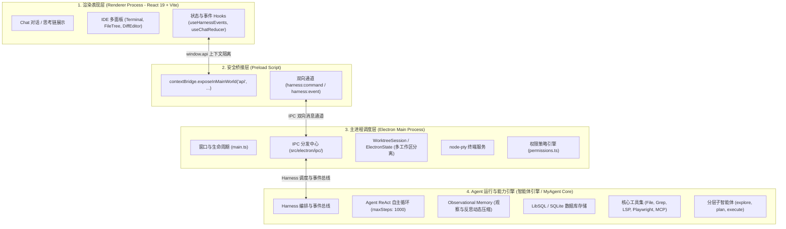
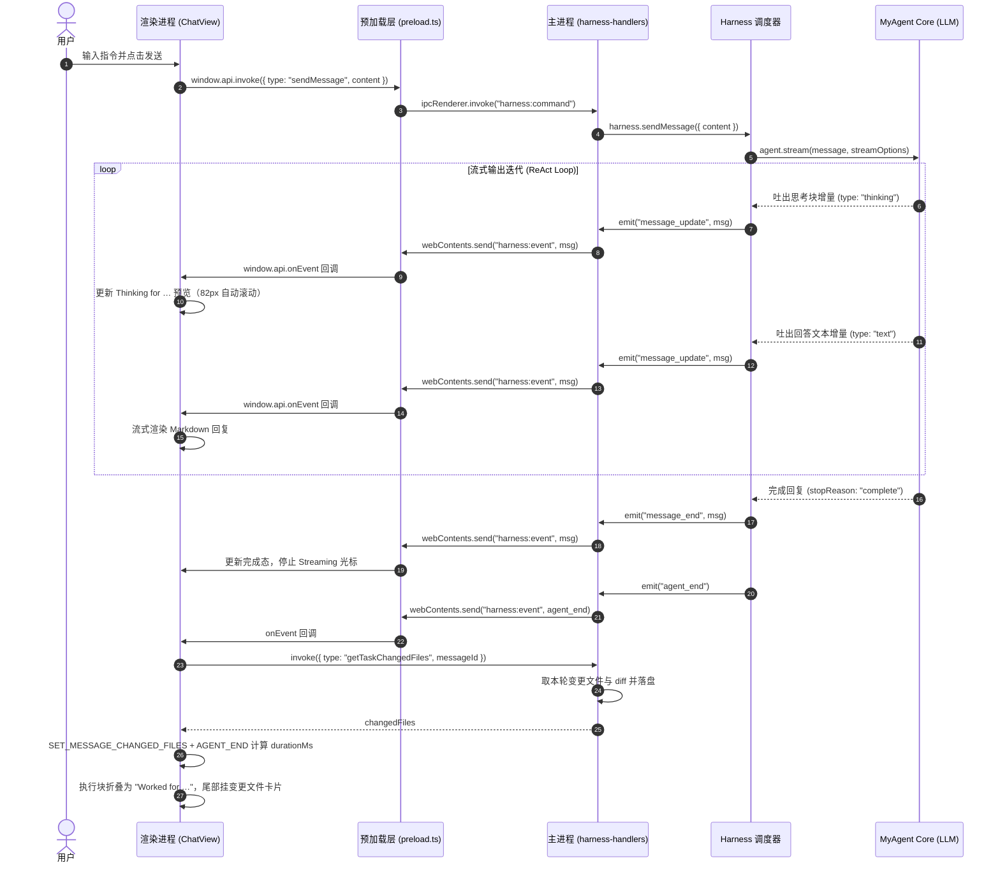
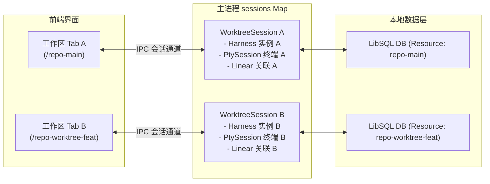

# My Agent 项目架构与模块实现说明

本项目是一个基于 **Electron**、**React** 构建的桌面级智能编码助手。项目采用多进程解耦架构，结合现代自主 Agent 的 ReAct 循环与观察性记忆机制，支持多工作区会话隔离、工具流式执行与多面板 IDE 协同交互。

---

<!-- LATEST_RELEASE_START -->

## 📥 客户端下载与版本日志 (ChangeLog)

<div align="center">

[](https://github.com/kidyfirst/my-agent/releases/latest)
[](https://github.com/kidyfirst/my-agent/releases)
[](LICENSE)
[](#全平台客户端下载)
[](https://kidyfirst.github.io/my-agent/changelog.html)

**当前最新稳定版本：`v0.1.0`**  
🌐 **[访问官方在线下载站 (GitHub Pages)](https://kidyfirst.github.io/my-agent/)** ｜ 📋 **[查看版本更新日志 (ChangeLog)](https://kidyfirst.github.io/my-agent/changelog.html)** ｜ 📦 **[GitHub Releases 资产归档](https://github.com/kidyfirst/my-agent/releases)**

</div>

### 全平台客户端下载

| 操作系统 / 平台 | 架构 / 适用机型                       | 安装包格式           | 直接下载链接 (v0.1.0)                                                                                                                       | 说明                      |
| :-------------- | :------------------------------------ | :------------------- | :------------------------------------------------------------------------------------------------------------------------------------------ | :------------------------ |
| 🍏 **macOS**    | **Apple Silicon** (M1 / M2 / M3 / M4) | `.dmg` 安装镜像      | [my-agent-0.1.0-mac-arm64.dmg](https://github.com/kidyfirst/my-agent/releases/download/v0.1.0/my-agent-0.1.0-mac-arm64.dmg)                 | 推荐 Mac 用户首选         |
| 🍏 **macOS**    | **Apple Silicon** (M1 / M2 / M3 / M4) | `.zip` 免安装包      | [my-agent-0.1.0-mac-arm64.zip](https://github.com/kidyfirst/my-agent/releases/download/v0.1.0/my-agent-0.1.0-mac-arm64.zip)                 | 解压即用                  |
| 🍏 **macOS**    | **Intel x86_64** 芯片                 | `.dmg` 安装镜像      | [my-agent-0.1.0-mac-x64.dmg](https://github.com/kidyfirst/my-agent/releases/download/v0.1.0/my-agent-0.1.0-mac-x64.dmg)                     | 适配 Intel 架构 Mac       |
| 🍏 **macOS**    | **Intel x86_64** 芯片                 | `.zip` 免安装包      | [my-agent-0.1.0-mac-x64.zip](https://github.com/kidyfirst/my-agent/releases/download/v0.1.0/my-agent-0.1.0-mac-x64.zip)                     | 解压即用                  |
| 🪟 **Windows**  | **Windows 10 / 11** (64 位)           | `.exe` 安装程序      | [my-agent-0.1.0-win-x64.exe](https://github.com/kidyfirst/my-agent/releases/download/v0.1.0/my-agent-0.1.0-win-x64.exe)                     | NSIS 引导向导安装         |
| 🪟 **Windows**  | **Windows 10 / 11** (64 位)           | `.zip` 免安装便携版  | [my-agent-0.1.0-win-x64.zip](https://github.com/kidyfirst/my-agent/releases/download/v0.1.0/my-agent-0.1.0-win-x64.zip)                     | 解压即可直接运行          |
| 🐧 **Linux**    | **Linux x86_64** (通用)               | `.AppImage` 便携镜像 | [my-agent-0.1.0-linux-x86_64.AppImage](https://github.com/kidyfirst/my-agent/releases/download/v0.1.0/my-agent-0.1.0-linux-x86_64.AppImage) | `chmod +x` 后直接双击执行 |
| 🐧 **Linux**    | **Debian / Ubuntu / Deepin**          | `.deb` 系统软件包    | [my-agent-0.1.0-linux-amd64.deb](https://github.com/kidyfirst/my-agent/releases/download/v0.1.0/my-agent-0.1.0-linux-amd64.deb)             | `sudo dpkg -i` 系统级安装 |
| 🐧 **Linux**    | **Linux x86_64** (免安装)             | `.zip` 压缩归档包    | [my-agent-0.1.0-linux-x64.zip](https://github.com/kidyfirst/my-agent/releases/download/v0.1.0/my-agent-0.1.0-linux-x64.zip)                 | 适用于无 root 环境        |

> [!IMPORTANT]
> **macOS 首次打开提示“已损坏 / 无法验证开发者”处理方法：**  
> 由于开源社区版本未购买苹果商业开发者签名证书，macOS Gatekeeper 安全机制在从浏览器下载应用后会附带隔离属性。若首次打开提示“已损坏，应移到废纸篓”或“无法打开”，只需在终端执行一次以下命令解除隔离即可正常打开：
>
> ```bash
> xattr -cr "/Applications/My Agent.app"
> ```
>
> 或在系统设置中授权：**【系统设置】->【隐私与安全性】-> 下滑找到并点击【仍要打开】**。

> [!TIP]
>
> - 完整更新履历与历史版本详情请参阅 👉 **[在线 ChangeLog 日志](https://kidyfirst.github.io/my-agent/changelog.html)** 或 **[GitHub Releases 全部发布归档](https://github.com/kidyfirst/my-agent/releases)**。

---

<!-- LATEST_RELEASE_END -->

## 目录

- [📥 客户端下载与版本日志 (ChangeLog)](#-客户端下载与版本日志-changelog)

- [My Agent 项目架构与模块实现说明](#my-agent-项目架构与模块实现说明)
  - [📥 客户端下载与版本日志 (ChangeLog)](#-客户端下载与版本日志-changelog)
    - [全平台客户端下载](#全平台客户端下载)
  - [目录](#目录)
  - [1. 整体架构设计](#1-整体架构设计)
    - [核心设计原则](#核心设计原则)
  - [2. 进程划分与通信机制](#2-进程划分与通信机制)
  - [3. 核心模块实现说明](#3-核心模块实现说明)
    - [3.1 主进程层 (`src/electron/`)](#31-主进程层-srcelectron)
    - [3.2 预加载与桥接层 (`src/electron/preload.ts`)](#32-预加载与桥接层-srcelectronpreloadts)
    - [3.3 渲染进程 UI 层 (`src/renderer/`)](#33-渲染进程-ui-层-srcrenderer)
      - [3.3.1 ChatView 渲染管线](#331-chatview-渲染管线)
      - [3.3.2 运行中与已结束两种展示形态](#332-运行中与已结束两种展示形态)
      - [3.3.3 用户消息吸顶与折叠](#333-用户消息吸顶与折叠)
      - [3.3.4 变更文件卡片与子智能体卡片](#334-变更文件卡片与子智能体卡片)
      - [3.3.5 滚动、空态与层叠](#335-滚动空态与层叠)
    - [3.4 Agent 运行与能力层 (智能体引擎 / `src/tools/`)](#34-agent-运行与能力层-智能体引擎--srctools)
    - [3.5 Memory 记忆模块 (`src/memory/`)](#35-memory-记忆模块-srcmemory)
      - [3.5.1 类继承关系与职责边界](#351-类继承关系与职责边界)
      - [3.5.2 存储域适配与线程/消息 CRUD](#352-存储域适配与线程消息-crud)
      - [3.5.3 Observational Memory 参数与触发阈值](#353-observational-memory-参数与触发阈值)
      - [3.5.4 动态 Memory 工厂与模型热切换](#354-动态-memory-工厂与模型热切换)
      - [3.5.5 分词估算与 Working Memory 空实现](#355-分词估算与-working-memory-空实现)
      - [3.5.6 配置入口与测试覆盖](#356-配置入口与测试覆盖)
  - [4. 核心业务与数据流时序](#4-核心业务与数据流时序)
    - [4.1 用户消息、思考链与执行块流式时序](#41-用户消息思考链与执行块流式时序)
    - [4.2 工具调用审批与人机协同流程](#42-工具调用审批与人机协同流程)
    - [4.3 Git Worktree 多会话隔离机制](#43-git-worktree-多会话隔离机制)
  - [5. 源码目录结构映射](#5-源码目录结构映射)

---

## 1. 整体架构设计

项目采用典型的 **四层分层架构**，由上至下分别为 **UI 渲染表现层**、**安全桥接层**、**主进程调度层** 以及 **Agent 运行时引擎**：



### 核心设计原则

1. **严格的进程隔离（Context Isolation）**：渲染进程不直接接触 Node.js 原生 API 与敏感系统调用，所有能力通过 `preload.ts` 的白名单通道暴露。
2. **多 Worktree 会话隔离（Session Isolation）**：针对同一仓库的多个 Git 分支/工作区（Worktree），主进程分别实例化独立的 `WorktreeSession` 与 `Harness` 实例，保证会话、终端与状态互不干扰。
3. **自主 ReAct 循环而非静态工作流**：摒弃死板的 DAG 工作流，依托 LLM 的推理-行动循环（Think $\to$ Tool Call $\to$ Observe $\to$ Loop），实现灵活的代码检索、规划与改写。
4. **长上下文动态记忆压缩（Observational Memory）**：内置观察者与反思者模型，动态压缩长对话中的大量工具调用日志，防止上下文超出模型限制。

---

## 2. 进程划分与通信机制

Electron 体系中进程通信采用强类型的 IPC 约定：

| 通信通道                | 方向                  | 传输协议                            | 功能说明                                                                 |
| :---------------------- | :-------------------- | :---------------------------------- | :----------------------------------------------------------------------- |
| `harness:command`       | 渲染进程 $\to$ 主进程 | `ipcRenderer.invoke` (双向 Promise) | 前端发送命令，如发送消息、切换模型、切换模式、操作终端、保存设置等       |
| `harness:event`         | 主进程 $\to$ 渲染进程 | `webContents.send` (单向广播)       | 主进程向前端实时推送流式事件（消息流、思考链、工具执行、任务进度、通知） |
| `login:prompt-response` | 渲染进程 $\to$ 主进程 | `ipcRenderer.send` (单向)           | OAuth 登录弹窗/验证响应回调                                              |
| `set-badge-count`       | 渲染进程 $\to$ 主进程 | `ipcRenderer.send` (单向)           | 设置 macOS Dock 栏未读消息徽标                                           |
| `open-url`              | 主进程 $\to$ 渲染进程 | `webContents.send` (单向)           | 拦截外部链接并在应用内置浏览器面板打开                                   |

---

## 3. 核心模块实现说明

### 3.1 主进程层 (`src/electron/`)

主进程负责操作系统的原生能力对接、窗口管理、会话生命周期维护与安全分发。

- **窗口控制与入口 (`src/electron/main.ts`)**
  - 调用 `createWindow()` 实例化主窗口，配置 `webPreferences`（关闭 `nodeIntegration`，启用 `contextIsolation` 与 `preload`）。
  - 区分环境加载：开发环境读取 `process.env.ELECTRON_RENDERER_URL`（连接 Vite 开发服务器支持热更新）；生产环境通过 `mainWindow.loadFile` 加载打包后的 `dist/renderer/index.html`。
  - 注册应用全局菜单、macOS Dock 图标、外部链接拦截。
- **IPC 命令调度中心 (`src/electron/ipc/`)**
  主进程采用模块化 Handler 设计，在 `src/electron/ipc/index.ts` 中统合分发：
  - `harness-handlers.ts`：处理对话消息（`sendMessage`）、任务中断（`abort`）、用户插话（`steer`）、追加任务（`followUp`）、模式/模型切换。
  - `project-handlers.ts`：项目探测、工作区打开、Git Worktree 会话生命周期管理与多工程切换。
  - `permission-handlers.ts`：工具调用审批拦截（同意、拒绝、按类别永久放行）与人机交互问题应答（`ask_question` / `plan_approval`）。
  - `pty-handlers.ts`：基于 `node-pty` 实现底层伪终端实例的创建、标准输入输出流中继与终端窗口尺寸重置（Resize）。
  - `git-handlers.ts`：处理本地 Git 仓库状态检查、Diff 生成、分支拉取与切换。
  - `file-handlers.ts`：为前端编辑器面板提供受控的本地文件读取服务。
  - `mcp-handlers.ts`：管理 Model Context Protocol（MCP）服务器连接、状态监控与外部工具重载。
  - `settings-handlers.ts`：配置持久化（Thinking 深度等级、通知模式、AST 智能编辑开关等）。
  - `integration-handlers.ts`：负责 Linear 与 GitHub 双向集成（工单拉取、关联提交、状态联动）。
  - `auth-handlers.ts`：Anthropic 及 OpenAI OAuth 鉴权流程控制。
  - `dashboard-handlers.ts`：汇总跨会话的 Token 消耗、执行耗时与任务指标。
- **状态隔离与集成上下文 (`src/electron/electron-state.ts`)**
  - 为每个工作区路径维护一份 `ElectronState`，持久化记录关联的 Linear 任务 ID、GitHub PR 链接及专属凭证。
- **系统原生通知 (`src/electron/notifications.ts`)**
  - 当主窗口处于非聚焦（后台）状态时，若 Agent 任务完成或需要人工审批，调用系统原生通知与声效提示。

### 3.2 预加载与桥接层 (`src/electron/preload.ts`)

`preload.ts` 在页面 DOM 加载前执行，依托 `contextBridge` 为网页注入安全的 `window.api` 命名空间：

```ts
// src/electron/preload.ts
contextBridge.exposeInMainWorld("api", {
  invoke: (command) => ipcRenderer.invoke("harness:command", command),
  onEvent: (callback) => { ... },
  respondToLoginPrompt: (answer) => { ... },
  cancelLoginPrompt: () => { ... },
  setBadgeCount: (count) => { ... },
  onOpenUrl: (callback) => { ... },
  platform: process.platform,
})
```

配合 `src/renderer/types/ipc.ts` 中的 `declare global { interface Window { api: ElectronAPI } }`，实现全链路的 TypeScript 静态类型推断与代码自动补全。

### 3.3 渲染进程 UI 层 (`src/renderer/`)

基于 **React 19** + **Vite** 构建的高性能 IDE 级界面，采用单向数据流与响应式订阅驱动：

- **渲染挂载入口 (`src/renderer/index.html` & `main.tsx`)**
  - `index.html` 提供 `#root` 挂载点，引入 ES Module `main.tsx`，将根组件 `<App />` 渲染到 DOM。
- **事件消费与状态机 (`src/renderer/hooks/useHarnessEvents.ts` & `src/renderer/types/chat.ts`)**
  - 订阅 `window.api.onEvent`，拦截主进程推送的 Agent 运行时事件。
  - 通过 `useChatReducer` 状态机处理动作：
    - `AGENT_START` / `AGENT_END`：标记全局运行态与加载光标。
    - `MESSAGE_START` / `MESSAGE_UPDATE` / `MESSAGE_END`：流式累加 Token 并实时更新对应消息块。
    - `TOOL_START` / `TOOL_UPDATE` / `TOOL_END`：更新工具调用入参与返回结果。
- **会话消息渲染组件族 (`src/renderer/components/`)**
  - `ChatView.tsx`：会话渲染管线，负责把 `messages` 归并为「用户消息 / 执行块 / 助手回复 / 子智能体 / 系统提示」五类渲染项，并把同一轮的多段工具调用折叠成一个执行块。
  - `AssistantMessage.tsx`：助手正文渲染，`text` 块走 `react-markdown` 富文本 + 代码高亮，每个代码块带独立复制按钮。
  - `ExecutionBlock.tsx`：执行块（思维链 + 工具调用）的统一展示组件，运行中与已结束两种形态见 [3.3.2](#332-运行中与已结束两种展示形态)。
  - `UserMessage.tsx`：用户消息气泡，支持吸顶、超长折叠、图片预览与一键复制。
  - `FilesChangedBar.tsx` / `SubagentExecution.tsx` / `TodoProgress.tsx`：变更文件卡片、子智能体执行卡片与任务进度条。
- **IDE 多面板组件生态**
  - `TerminalPanel.tsx`：基于 `@xterm/xterm` 与 `@xterm/addon-fit` 实现的高性能 ANSI 终端仿真器。
  - `FileTree.tsx` / `FileEditor.tsx` / `DiffEditor.tsx`：文件树浏览、代码高亮查看与 Git 变更 Side-by-Side 差异对比。
  - `TaskBoard.tsx`：集成 Linear/GitHub 工单看板，支持将 issue 一键绑定当前分支开发。
  - `ToolApprovalDialog.tsx` / `PlanApproval.tsx`：人机交互弹窗，拦截危险操作请求用户确认。

#### 3.3.1 ChatView 渲染管线

`ChatView.tsx` 不直接遍历 `messages` 渲染组件，而是先把消息体归并成渲染项（`RenderItem`），再由一个 `switch` 分发到具体组件。这一过程是串行的多轮 `useMemo` 处理，顺序如下：

1. **轮次时长预处理**：以 `user` / `system` 消息切分轮次，收集本轮内所有 assistant 消息 id 与最后一个非空的 `durationMs`，写入 `turnDurationById`。`agent_end` 只会把耗时写在最后一条 assistant 消息上，靠这张表把耗时还原到「本轮的第一个执行块」。
2. **逐消息解析**：先用 `normalizeMessageContent` 归一化 `content`（Agent 传入的可能是字符串、数组或 `parts`）。`tool_result` 块先建 `toolResultsById` 索引；随后按块类型分派：
   - `text` / `output` / `message`（或无 type 但带 `text` / `content` / `value`）：累积正文；
   - `thinking` / `reasoning` / `thought` / `redactedthinking`：生成思维链步骤，耗时优先取块内 `durationSec`，其次按消息耗时折算，最后按文本长度估算；
   - `toolcall` / `tooluse` / `toolinvocation`：生成工具步骤，`isDone` 由 `state === "result"` 或已存在结果判定，工具定义从 `tools` / `subagents` 映射中查名称与图标。
3. **刷新策略**：遇到正文块或子智能体时调用 `flushExecution()`，把当前累积的步骤落成一个执行块；遇到思维链或工具块时调用 `flushText()`，且**只在正文非空（或尾部为错误）时产出 assistant 项**，因此流式过程中不会出现空气泡。
4. **消息收尾**：消息解析完成后再次 flush，并把 `msg.changedFiles` 挂到本轮最后一条 assistant 项上；若没有任何正文项，则补一个只含文件卡片的 assistant 项。
5. **补漏**：状态机里已出现、但消息体中没有对应块的工具会被补进 `live-execution-block`；未渲染过的子智能体补成独立卡片。
6. **占位**：Agent 运行中且最后一项是用户消息时，插入 `active-execution-placeholder`，让 `Thinking for …` 立刻可见，而不必等第一个工具调用。
7. **收尾归并**：先合并相邻执行块（步骤按 id 去重）、丢弃空且非活跃的块；再做「一轮一个活动块」折叠——游标在 `user` / `system` 项处重置，同一轮后续所有执行块并入第一个块，`isActive` / `startedAt` / `durationMs` / `changedFiles` 取最新值。

第 7 步是「一轮只出现一个 `Worked for …`」的关键：早期实现每个 assistant 消息各带一个执行块，一轮里就会冒出多个标题，现在统一在渲染层折叠。

#### 3.3.2 运行中与已结束两种展示形态

`ExecutionBlock.tsx` 用同一组件承载两种状态，形态由 `isActive` 决定：

- **运行中**：标题为 `Thinking for 12.3s`（或 `1m 20s`），后面带 `(N steps)` 计数与向下箭头；折叠态下方是 82px 高的步骤预览窗，随新步骤自动滚到底，点击标题或预览窗展开全部步骤。
- **已结束**：整轮只留一行 `Worked for 1m 6s ⌄`，步骤默认完全隐藏，点击才展开；若该块没有任何步骤且非活跃，组件直接返回 `null`。
- **耗时来源**：`agent_end` 时写入消息的 `durationMs`；缺失时回退到 3.3.1 的 `turnDurationById`。数据库中没有耗时列，因此 `chatReducer` 的 `SET_MESSAGES` 会保留内存中的旧耗时，并给历史会话补到本轮最后一条 assistant 消息——更早的历史轮次仍可能只显示不带时长的 `Worked`。
- **时长格式**：不足 60 秒显示一位小数（`12.3s`），超过则显示 `Xm Ys`；运行中由 100ms 定时器按 `startedAt` 刷新。

#### 3.3.3 用户消息吸顶与折叠

`UserMessage.tsx` 负责让「当前视口中最新的提问」常驻顶部：

- 未展开时 `position: sticky` + `top: 0` + `zIndex: 20` + 不透明 `var(--bg)` 背景，滚动时停在视口顶端；展开态取消吸顶，恢复普通文档流。
- 内容高度超过阈值（气泡约 80px）时折叠，底部叠 24px 渐变遮罩与 chevron，点击切换展开；若 `window.getSelection()` 显示存在选区则不触发切换，保留「拖选复制」。
- 图片缩略图固定高度 60px、`object-fit: contain`，点击打开 `ImagePreviewModal`；气泡下方是时间戳与复制按钮。
- 布局细节：滚动容器自身不设内边距，内层 800px 列承担 `16px 24px 0`；吸顶容器用负外边距 `-24px` + 等量 padding 把背景铺到列边缘，避免吸顶卡片两侧露出被滚动的正文。

#### 3.3.4 变更文件卡片与子智能体卡片

- **变更文件卡片 (`FilesChangedBar.tsx`)**：`message.changedFiles` 非空时挂在 assistant 消息尾部。头部一行是 `N files changed +X -Y`，点击整行展开；展开后每个文件显示 `basename` + 目录 + 增删行数，`Review` 按钮阻止冒泡并直接打开差异编辑器。行内 diff 懒加载（`getTaskFileDiff`，按 `messageId` 取），`isLive` 表示任务仍在执行。
- **持久化 (`src/electron/task-changes-store.ts`)**：任务结束时的文件列表与 diff 写入 `<appData>/task-changes.json`（thread → message → files/diff，上限 40 个线程 × 80 个任务、单条 diff 200KB），重启后 `getMessages` 会重新挂回 `changedFiles`，删除线程时同步清理。
- **子智能体卡片 (`SubagentExecution.tsx`)**：整行可点，`🏗️` + `Agent` + 任务描述 + 完成耗时 + ✓/✗/运行中脉冲点；展开后展示子智能体内部的工具调用与最终结果。

#### 3.3.5 滚动、空态与层叠

- **自动滚动**：用 `isAutoScroll` 标记是否跟随底部（距底小于 100px 视为跟随），新消息与工具更新时先把 `scrollTop` 置到底部，再在下一帧补滚一次，避免 React 提交时机导致的位置偏差。
- **布局**：外层 `flex: 1` / `overflow-y: auto` / `overflow-x: hidden` / `scrollbar-gutter: stable`，内层 `max-width: 800px; margin: 0 auto; flex: 1 0 auto; min-height: 100%`，底部留 16px 占位。
- **空态与进度**：无渲染项且 Agent 空闲时展示 `AsciiLogo`；存在 `todos` 时在列表底部渲染 `TodoProgress`；`system` 消息渲染为带 `System Notice` 标签的提示块；连续重复的用户消息按文本去重。
- **层叠顺序**：吸顶卡片使用 `zIndex: 20`，所有可能下探到聊天区的浮层必须高于它——`OpenInDropdown` 为 400，编辑器内的模型/权限浮层为 200，命令面板与模态框为 1000 以上。

### 3.4 Agent 运行与能力层 (智能体引擎 / `src/tools/`)

项目通过智能体运行时引擎装配底层 Agent 能力，内部核心组件包括：

- **存储引擎（Storage Engine）**
  - 默认自动初始化嵌入式 LibSQL（SQLite）数据库，路径位于系统 AppData 目录，实现 Thread 历史记录、消息列表、Token 用量的本地零配置持久化。
- **观察性记忆（Observational Memory, OM）**
  - 解决长时间编码对话中上下文窗口爆炸的痛点：
  - **Observer 模型**：定期扫描会话中的工具输入与输出，抽取摘要观察记录。
  - **Reflector 模型**：对高频事实与架构共识进行反思与提炼，动态维护长期记忆上下文。
  - 具体实现见 [3.5 Memory 记忆模块](#35-memory-记忆模块-srcmemory)。
- **Agent ReAct 循环机制**
  - 实例化核心智能体 `codeAgent`，在 `harness.sendMessage()` 中配置 `maxSteps: 1000`。
  - 模型依据指令思考并自主决策调用工具；工具在宿主运行后将标准输出或异常反馈回模型，模型持续迭代直至完成整体任务。
- **扩展工具生态 (`src/tools/`, `src/lsp/`, `src/browser/`)**
  - **基础代码工具**：`view`（查看代码）、`grep`（内容正则搜索）、`glob`（文件匹配）、`execute_command`（受控命令执行）、`write_file`（写文件）。
  - **AST 智能编辑**：`string_replace_lsp` 基于 LSP 协议实现精确的语法树级别代码替换。
  - **浏览器自动化**：`navigate-browser` 与 `computer` 基于 Playwright 驱动无头/可视化浏览器进行前端界面回归与操作。
  - **MCP 外部工具拓展**：动态挂载外部 Model Context Protocol 服务器提供的外部工具。
- **分级子智能体（Subagents）**
  - 内置派生不同权限梯队的轻量 Agent：
    - `explore`：只读探索子智能体，负责代码库检索与依赖分析。
    - `plan`：只读规划子智能体，负责功能设计与实施方案梳理。
    - `execute`：写权限执行子智能体，执行具体代码修改并调用任务看板工具。

### 3.5 Memory 记忆模块 (`src/memory/`)

`src/memory/` 是项目自研的 `Memory` 实现：它继承 `src/core` 的 `MyAgentMemory`，把线程/消息持久化、上下文召回与观察性记忆（OM）压缩统一收敛到一个可直接注入 `AgentController` 的实例中。

```
src/memory/
├── index.ts          # 对外出口：Memory / TokenCounter / 类型
├── memory.ts         # Memory 主类（继承 MyAgentMemory）
├── token-counter.ts  # 轻量分词估算器
├── types.ts          # ObservationalMemoryConfig / MemoryOptions / 构造配置
└── __tests__/memory.test.ts
```

#### 3.5.1 类继承关系与职责边界

| 层                 | 职责                                                                                                            |
| :----------------- | :-------------------------------------------------------------------------------------------------------------- |
| `MyAgentMemory`    | 核心基类，提供 OM 的 Observer/Reflector 编排、观察记录更新与压缩流程、注入系统提示词等全部"智能"部分。          |
| `Memory`（本项目） | 只覆写**存储字段读写**：线程 CRUD、消息读写、召回分页、系统提示取数、分词估算；并把 Working Memory 置为空实现。 |
| `TokenCounter`     | 纯函数式估算器，无外部依赖，避免引入 tiktoken 编码表带来的启动开销。                                            |

设计取向是「贴着存储层重写、把 LLM 侧逻辑留给上游」：OM 的观察抽取/反思合并由基类完成并落库，本类只负责把这些记录从存储层 (SQLiteStore) 里正确地取出、拼装并交给 Agent。

#### 3.5.2 存储域适配与线程/消息 CRUD

所有读写都先经由 `getMemoryStore()` 解析复合存储的 `memory` 域，拿不到 `storage` 或该域缺失时直接抛错，避免静默降级：

- **线程**：`createThread` / `saveThread` 在落库前补 `title`（`"New Thread"`），满足数据库 `NOT NULL` 约束；`getThreadById`、`listThreads`、`updateThread`、`deleteThread` 均直接透传到存储域。`copyThread` / `cloneThread` 用于「从历史会话派生新会话」，对 `threadId` 与 `sourceThreadId` 两种入参做兼容并归一化返回结构。
- **写入消息 (`saveMessages`)**：先用 `MessageList({ generateMessageId }).add(messages, "memory").get.all.db()` 做格式归一化（入参可能是字符串、数组或 parts 结构）；若消息缺 `resourceId` 则回查所属线程补齐；最后批量落库，并按正文长度估算本次写入的 token 用量返回。
- **召回消息 (`recall`)**：默认 `perPage: 100`、`page: 0`；未显式指定 `orderBy` 时按 `createdAt DESC` 取最新一页，再在内存中反转，从而保证「取最新 N 条、但按时间正序返回」。归一化后调用 `filterSystemReminderMessages` 过滤系统提醒与临时信号，附带 `total / page / perPage / hasMore` 分页信息，供 UI 做滚动加载。
- **删除消息 (`deleteMessages`)**：兼容 `string[]`、`{ id }[]`、`{ messageIds: [...] }` 三种入参形态，统一抽取 id 后批量删除。

#### 3.5.3 Observational Memory 参数与触发阈值

OM 的开关与全部阈值集中在 `options.observationalMemory`，类型定义在 `src/memory/types.ts`，实际装配在 `src/harness/index.ts` 的 `getDynamicMemory`：

```ts
observationalMemory: {
  enabled: true,
  scope,                                  // "thread" | "resource"
  observation: {
    bufferTokens: 1 / 5,                  // 每隔 messageTokens 的 20% 跑一次后台缓冲观察
    bufferActivation: 2000,               // 达到阈值时激活缓冲的比例，其余留作下轮储备
    messageTokens: obsThreshold,          // 观察触发阈值，默认 30_000
    blockAfter: 2,                        // 达到 2×messageTokens 时允许同步阻塞观察
    model: ({ requestContext }) => ...,   // Observer 模型
  },
  reflection: {
    bufferActivation: 1 / 2,
    blockAfter: 1.1,
    observationTokens: refThreshold,      // 反思触发阈值，默认 40_000
    model: ({ requestContext }) => ...,   // Reflector 模型
  },
}
```

- **`scope` 决定记忆可见范围**：`thread`（默认）每条会话独立观察与压缩；`resource` 则在同一 `resourceId` 的所有会话间共享观察记录。解析优先级见 `getOmScope()`（`src/utils/project.ts`）：`MYAGENT_OM_SCOPE` 环境变量 → 项目级 `<project>/.myagent/database.json` 的 `omScope` → 全局 `~/.myagent/database.json` → 默认 `thread`。
- **`bufferTokens`**：以「占 `messageTokens` 的比例」表示后台异步缓冲观察的间隔，`1/5` 即每积累到阈值的 20% 就在后台跑一次 Observer，把结果先存进缓冲区，真正越线时可直接激活而不阻塞。
- **`bufferActivation`**：越线时激活多少比例的缓冲观察，小于 1 的部分保留到下一轮，用于维持对话连贯性。
- **`blockAfter`**：允许「同步阻塞观察」的 token 阈值（取 `1 < x < 100` 时按 `messageTokens` 的倍数解析，取 `≥ 100` 时按绝对 token 数解析）。在 `messageTokens` 与 `blockAfter` 之间只跑异步缓冲，未观察消息最多可增长到 `blockAfter`（此处 `2 ×` ≈ 60k tokens）才插入一次同步观察，避免每个 Agent 步骤都被 LLM 观察调用拖慢。
- **双阈值阶梯**：会话增长到 `observationThreshold`（`observation.messageTokens`）时 Observer 抽取观察记录；观察记录本身累积到 `reflectionThreshold`（`reflection.observationTokens`）时 Reflector 把观察反思合并成更凝练的长期记忆（`reflection.blockAfter: 1.1` 表示 110% 阈值时同步反思），如此循环实现长对话的滚动压缩。
- **取数入口 `getSystemMessage()`**：从存储域读取 `activeObservations` 并包装成 `# Observational Memory` 段落，作为系统提示注入下一轮请求；记录不存在或为空时返回 `null`，且整段读取用 `try/catch` 包裹——OM 故障绝不能影响主对话链路。

#### 3.5.4 动态 Memory 工厂与模型热切换

`getDynamicMemory()` 返回的不是实例而是**取实例的函数**（`DynamicArgument`），Agent 每次需要解析 memory 时按当时的 request context 现算：

1. 从 `requestContext` 取 `controller` / `harness` 上的 `HarnessState`，读出 `observationThreshold`、`reflectionThreshold`、`observerModelId`、`reflectorModelId` 与 `projectPath`。
2. 以 `` `${obsThreshold}:${refThreshold}:${omScope}` `` 作为缓存键：只要阈值与作用域不变就复用已构建的实例，避免每轮回调都重建。
3. `observation.model` / `reflection.model` 写成闭包而非固定模型：调用时才读 `state.observerModelId ?? DEFAULT_OM_MODEL_ID`（Reflector 同理）并经 `resolveModel(..., { remapForCodexOAuth: true })` 解析，因此**运行中切换阈值或模型会立即生效**，无需重启会话。

模型变更的三条入口都位于 `src/electron/helpers.ts`（切换主模型、自动升级模型、切换失败后的回退）：它们会同时把 `observerModelId` / `reflectorModelId` 与 `currentModelId` 一起写入 state，保持三者对齐；渲染层设置面板再通过 `setObserverModel` / `setReflectorModel` 命令 + `harness.switchObserverModel()` / `switchReflectorModel()` 单独覆盖。

#### 3.5.5 分词估算与 Working Memory 空实现

- **`TokenCounter`**：采用 `ceil(len / 4)`（最少 1）的启发式估算，对代码与英文散文平均偏差可接受，且零依赖、零初始化成本；`countMessage()` 兼容 `content` 为字符串或 `{ content }` 结构。`Memory` 覆写 `estimateTokens()` 委托给它，因此 `saveMessages` / `recall` 返回的 `usage.tokens` 同源。
- **`settled()`**：直接 `Promise.resolve()`，即不等待后台 OM 任务（观察/反思）落地，保证本轮结束后 UI 侧的 `agent_end` 立即到达；未完成的观察由下一次 `bufferTokens` 检查或后续步骤自然接续。
- **Working Memory 系列**（`getWorkingMemory`、`getWorkingMemoryTemplate`、`updateWorkingMemory`、`__experimental_updateWorkingMemoryVNext`）：统一返回空值 / 空成功。基类为这些方法提供了默认实现，但本项目不需要「结构化用户画像」这一类工作记忆，长期记忆完全交给 OM 承担，因此显式覆写为空实现，而不是依赖基类可能触发的额外存储读写。

#### 3.5.6 配置入口与测试覆盖

- **UI 配置**：设置面板 `src/renderer/components/settings/MemorySection.tsx` 提供 Observer 模型、Reflector 模型、Observation threshold、Reflection threshold 四项；阈值变化会改变缓存键，进而触发 Memory 实例重建。
- **默认值**：`src/harness/state.ts` 中 `DEFAULT_OBS_THRESHOLD = 30_000`、`DEFAULT_REF_THRESHOLD = 40_000`、`DEFAULT_OM_MODEL_ID = process.env.DEFAULT_OM_MODEL_ID ?? DEFAULT_FALLBACK_MODEL_ID`。
- **测试**：`src/memory/__tests__/memory.test.ts` 使用内存态 SQLite（`file::memory:`）覆盖线程 CRUD 与分页、消息保存/召回顺序、系统提醒与信号过滤、召回分页、OM 配置与 `settled()`、`cloneThread`，以及与 `AgentController` 的线程生命周期集成。

---

## 4. 核心业务与数据流时序

### 4.1 用户消息、思考链与执行块流式时序



### 4.2 工具调用审批与人机协同流程


### 4.3 Git Worktree 多会话隔离机制



- 当切换或打开多个工作区时，主进程维护由项目根路径为键的 `sessions: Map<string, WorktreeSession>`。
- 所有前后台通信事件均携带 `worktreePath` 标识，前端 Hook 会依据当前激活的工作区自动比对，杜绝后台会话消息错位串扰。

---

## 5. 源码目录结构映射

```
src/
├── electron/                  # 主进程层 (Main Process)
│   ├── main.ts                # 应用主生命周期、窗口创建、Harness 初始化与事件转接
│   ├── preload.ts             # 安全预加载脚本，实现 contextBridge 注入
│   ├── electron-state.ts      # 工作区维度的集成状态管理 (Linear/GitHub 绑定)
│   ├── notifications.ts       # 原生系统通知与角标更新服务
│   ├── task-changes-store.ts  # 任务变更文件与 diff 的本地持久化 (task-changes.json)
│   ├── helpers.ts             # 会话辅助工具 (OAuth 校验、对话标题自动生成)
│   └── ipc/                   # 模块化 IPC 命令处理器 (14 个业务子模块)
│       ├── harness-handlers.ts       # 消息收发、模式与模型调度
│       ├── project-handlers.ts       # 项目探测、Worktree 切换与会话构建
│       ├── permission-handlers.ts    # 权限校验、工具审批、提问拦截
│       ├── pty-handlers.ts           # node-pty 伪终端生命周期与 I/O
│       ├── git-handlers.ts           # Git 状态提取与代码差异对比
│       ├── file-handlers.ts          # 文件只读读取与编辑器服务
│       ├── integration-handlers.ts   # Linear / GitHub 双向集成协议
│       ├── mcp-handlers.ts           # MCP 服务连接生命周期管理
│       ├── settings-handlers.ts      # 应用偏好与模型参数持久化
│       ├── auth-handlers.ts          # OAuth 身份凭证轮转与回调
│       ├── dashboard-handlers.ts     # Token 统计与 Agent 运行耗时聚合
│       ├── slash-command-handlers.ts # Slash 指令加载与动态注入
│       └── index.ts                  # IPC 路由总装与分发入口
│
├── renderer/                  # 渲染进程 UI 层 (React 19 + TypeScript + Vite)
│   ├── index.html             # 页面承载 HTML 入口
│   ├── main.tsx              # React 挂载入口
│   ├── App.tsx                # 应用顶层布局骨架、快捷键注册与状态装配
│   ├── components/            # 核心 UI 面板与交互组件
│   │   ├── ChatView.tsx              # 会话渲染管线：消息分组、一轮一个执行块、吸顶用户消息
│   │   ├── AssistantMessage.tsx      # 助手正文渲染 (Markdown / 代码高亮 / 复制)
│   │   ├── ExecutionBlock.tsx        # 执行块：运行中 Thinking for … / 结束 Worked for …
│   │   ├── UserMessage.tsx           # 用户消息气泡：吸顶、折叠、图片预览
│   │   ├── FilesChangedBar.tsx       # 本轮变更文件卡片与行内 diff
│   │   ├── TodoProgress.tsx          # 任务进度条
│   │   ├── ToolExecution.tsx         # 工具执行状态卡片组件
│   │   ├── SubagentExecution.tsx     # 子 Agent 执行嵌套可视化组件
│   │   ├── TerminalPanel.tsx         # 基于 xterm.js 的嵌入式终端面板
│   │   ├── FileEditor.tsx            # 语法高亮代码编辑器/查看器
│   │   ├── DiffEditor.tsx            # 代码变更对比面板
│   │   ├── TaskBoard.tsx             # 任务看板 (Linear / GitHub Issues)
│   │   ├── ToolApprovalDialog.tsx    # 工具审批拦截交互模态框
│   │   ├── ModelSelector.tsx         # 模型切换与鉴权状态下拉面板
│   │   └── CommandPalette.tsx        # Cmd+K 全局指令面板
│   ├── hooks/                 # 自定义业务 React Hooks
│   │   ├── useHarnessEvents.ts       # IPC 核心事件总线订阅与状态分发
│   │   ├── useChatReducer.ts         # 对话与工具状态机
│   │   ├── useProjectManager.ts      # 多工程与 Worktree 状态控制
│   │   └── useGitOperations.ts       # Git 操作与差异拉取
│   ├── types/                 # 渲染进程 TypeScript 类型定义
│   └── styles/                # 全局样式与主题变量
│
├── tools/                     # Agent 宿主扩展工具 (Browser / Computer Use)
├── store/                     # 原生无服务 SQLite 存储：SQLiteStore、SQLiteMemoryStore、表结构
│   ├── store.ts               # SQLiteStore 主类（基于 node:sqlite，WAL 模式）
│   ├── memory-store.ts        # SQLiteMemoryStore：线程/消息/观察式记忆持久化
│   ├── schema.ts              # SQLite DDL 表结构与索引定义
│   ├── types.ts               # 存储配置与领域接口定义
│   └── index.ts               # 对外出口
├── memory/                    # 记忆模块：Memory 主类、TokenCounter、OM 配置类型
│   ├── memory.ts              # 继承 MyAgentMemory：线程/消息 CRUD、召回分页、OM 系统提示取数
│   ├── token-counter.ts       # 启发式分词估算 (len / 4)
│   ├── types.ts               # MemoryOptions / ObservationalMemoryConfig
│   └── index.ts               # 对外出口
├── browser/                   # Playwright 浏览器自动化管理器
├── lsp/                       # 语言服务器协议 (LSP) 与 AST 智能改写集成
├── mcp/                       # Model Context Protocol 客户端连接实现
├── auth/                      # 凭证存储 (AuthStorage) 与 OAuth 适配
├── permissions.ts             # 权限分类策略定义 (read / edit / execute / mcp / YOLO)
└── utils/                     # 通用工具函数 (项目探测、路径解析、成本估算)
```
