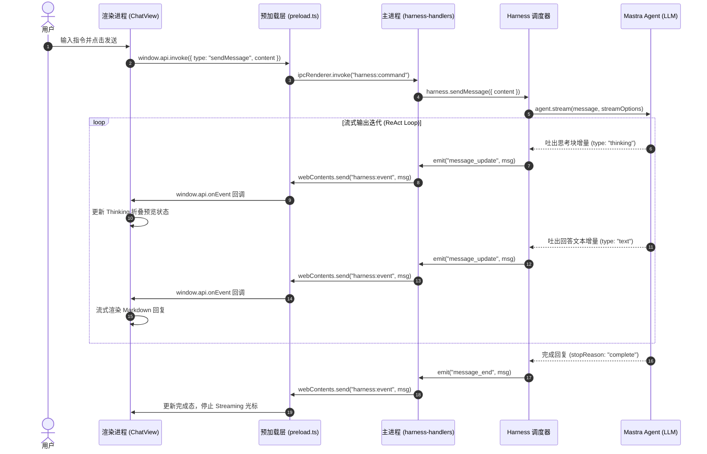
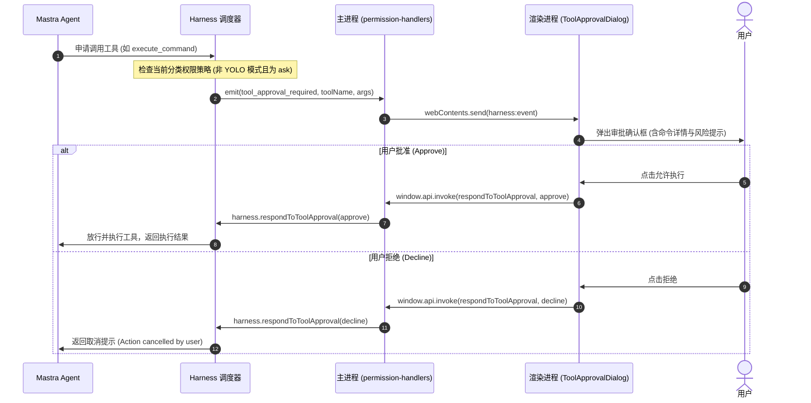
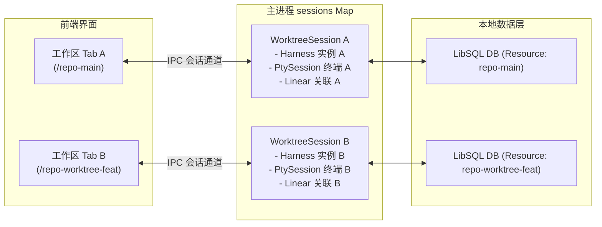

# MyAgent 项目架构与模块实现说明

本项目是一个基于 **Electron**、**React** 构建的桌面级智能编码助手。项目采用多进程解耦架构，结合现代自主 Agent 的 ReAct 循环与观察性记忆机制，支持多工作区会话隔离、工具流式执行与多面板 IDE 协同交互。

---

## 目录

1. [整体架构设计](#1-整体架构设计)
2. [进程划分与通信机制](#2-进程划分与通信机制)
3. [核心模块实现说明](#3-核心模块实现说明)
   - [3.1 主进程层 (`src/electron/`)](#31-主进程层-srcelectron)
   - [3.2 预加载与桥接层 (`src/electron/preload.ts`)](#32-预加载与桥接层-srcelectronpreloadts)
   - [3.3 渲染进程 UI 层 (`src/renderer/`)](#33-渲染进程-ui-层-srcrenderer)
   - [3.4 Agent 运行与能力层 (智能体引擎 / `src/tools/`)](#34-agent-运行与能力层-智能体引擎--srctools)
4. [核心业务与数据流时序](#4-核心业务与数据流时序)
   - [4.1 用户消息与思考链流式响应时序](#41-用户消息与思考链流式响应时序)
   - [4.2 工具调用审批与人机协同流程](#42-工具调用审批与人机协同流程)
   - [4.3 Git Worktree 多会话隔离机制](#43-git-worktree-多会话隔离机制)
5. [源码目录结构映射](#5-源码目录结构映射)

---

## 1. 整体架构设计

项目采用典型的 **四层分层架构**，由上至下分别为 **UI 渲染表现层**、**安全桥接层**、**主进程调度层** 以及 **Agent 运行时引擎**：


### 核心设计原则

1. **严格的进程隔离（Context Isolation）**：渲染进程不直接接触 Node.js 原生 API 与敏感系统调用，所有能力通过 `preload.ts` 的白名单通道暴露。
2. **多 Worktree 会话隔离（Session Isolation）**：针对同一仓库的多个 Git 分支/工作区（Worktree），主进程分别实例化独立的 `WorktreeSession` 与 `Harness` 实例，保证会话、终端与状态互不干扰。
3. **自主 ReAct 循环而非静态工作流**：摒弃死板的 DAG 工作流，依托 LLM 的推理-行动循环（Think $\to$ Tool Call $\to$ Observe $\to$ Loop），实现灵活的代码检索、规划与改写。
4. **长上下文动态记忆压缩（Observational Memory）**：内置观察者与反思者模型，动态压缩长对话中的大量工具调用日志，防止上下文超出模型限制。

---

## 2. 进程划分与通信机制

Electron 体系中进程通信采用强类型的 IPC 约定：

| 通信通道                | 方向                  | 传输协议                            | 功能说明                                                                 |
| :---------------------- | :-------------------- | :---------------------------------- | :----------------------------------------------------------------------- |
| `harness:command`       | 渲染进程 $\to$ 主进程 | `ipcRenderer.invoke` (双向 Promise) | 前端发送命令，如发送消息、切换模型、切换模式、操作终端、保存设置等       |
| `harness:event`         | 主进程 $\to$ 渲染进程 | `webContents.send` (单向广播)       | 主进程向前端实时推送流式事件（消息流、思考链、工具执行、任务进度、通知） |
| `login:prompt-response` | 渲染进程 $\to$ 主进程 | `ipcRenderer.send` (单向)           | OAuth 登录弹窗/验证响应回调                                              |
| `set-badge-count`       | 渲染进程 $\to$ 主进程 | `ipcRenderer.send` (单向)           | 设置 macOS Dock 栏未读消息徽标                                           |
| `open-url`              | 主进程 $\to$ 渲染进程 | `webContents.send` (单向)           | 拦截外部链接并在应用内置浏览器面板打开                                   |

---

## 3. 核心模块实现说明

### 3.1 主进程层 (`src/electron/`)

主进程负责操作系统的原生能力对接、窗口管理、会话生命周期维护与安全分发。

- **窗口控制与入口 (`src/electron/main.ts`)**
  - 调用 `createWindow()` 实例化主窗口，配置 `webPreferences`（关闭 `nodeIntegration`，启用 `contextIsolation` 与 `preload`）。
  - 区分环境加载：开发环境读取 `process.env.ELECTRON_RENDERER_URL`（连接 Vite 开发服务器支持热更新）；生产环境通过 `mainWindow.loadFile` 加载打包后的 `dist/renderer/index.html`。
  - 注册应用全局菜单、macOS Dock 图标、外部链接拦截。
- **IPC 命令调度中心 (`src/electron/ipc/`)**
  主进程采用模块化 Handler 设计，在 `src/electron/ipc/index.ts` 中统合分发：
  - `harness-handlers.ts`：处理对话消息（`sendMessage`）、任务中断（`abort`）、用户插话（`steer`）、追加任务（`followUp`）、模式/模型切换。
  - `project-handlers.ts`：项目探测、工作区打开、Git Worktree 会话生命周期管理与多工程切换。
  - `permission-handlers.ts`：工具调用审批拦截（同意、拒绝、按类别永久放行）与人机交互问题应答（`ask_question` / `plan_approval`）。
  - `pty-handlers.ts`：基于 `node-pty` 实现底层伪终端实例的创建、标准输入输出流中继与终端窗口尺寸重置（Resize）。
  - `git-handlers.ts`：处理本地 Git 仓库状态检查、Diff 生成、分支拉取与切换。
  - `file-handlers.ts`：为前端编辑器面板提供受控的本地文件读取服务。
  - `mcp-handlers.ts`：管理 Model Context Protocol（MCP）服务器连接、状态监控与外部工具重载。
  - `settings-handlers.ts`：配置持久化（Thinking 深度等级、通知模式、AST 智能编辑开关等）。
  - `integration-handlers.ts`：负责 Linear 与 GitHub 双向集成（工单拉取、关联提交、状态联动）。
  - `auth-handlers.ts`：Anthropic 及 OpenAI OAuth 鉴权流程控制。
  - `dashboard-handlers.ts`：汇总跨会话的 Token 消耗、执行耗时与任务指标。
- **状态隔离与集成上下文 (`src/electron/electron-state.ts`)**
  - 为每个工作区路径维护一份 `ElectronState`，持久化记录关联的 Linear 任务 ID、GitHub PR 链接及专属凭证。
- **系统原生通知 (`src/electron/notifications.ts`)**
  - 当主窗口处于非聚焦（后台）状态时，若 Agent 任务完成或需要人工审批，调用系统原生通知与声效提示。

### 3.2 预加载与桥接层 (`src/electron/preload.ts`)

`preload.ts` 在页面 DOM 加载前执行，依托 `contextBridge` 为网页注入安全的 `window.api` 命名空间：

```ts
// src/electron/preload.ts
contextBridge.exposeInMainWorld("api", {
  invoke: (command) => ipcRenderer.invoke("harness:command", command),
  onEvent: (callback) => { ... },
  respondToLoginPrompt: (answer) => { ... },
  cancelLoginPrompt: () => { ... },
  setBadgeCount: (count) => { ... },
  onOpenUrl: (callback) => { ... },
  platform: process.platform,
})
```

配合 `src/renderer/types/ipc.ts` 中的 `declare global { interface Window { api: ElectronAPI } }`，实现全链路的 TypeScript 静态类型推断与代码自动补全。

### 3.3 渲染进程 UI 层 (`src/renderer/`)

基于 **React 19** + **Vite** 构建的高性能 IDE 级界面，采用单向数据流与响应式订阅驱动：

- **渲染挂载入口 (`src/renderer/index.html` & `main.tsx`)**
  - `index.html` 提供 `#root` 挂载点，引入 ES Module `main.tsx`，将根组件 `<App />` 渲染到 DOM。
- **事件消费与状态机 (`src/renderer/hooks/useHarnessEvents.ts` & `src/renderer/types/chat.ts`)**
  - 订阅 `window.api.onEvent`，拦截主进程推送的 Agent 运行时事件。
  - 通过 `useChatReducer` 状态机处理动作：
    - `AGENT_START` / `AGENT_END`：标记全局运行态与加载光标。
    - `MESSAGE_START` / `MESSAGE_UPDATE` / `MESSAGE_END`：流式累加 Token 并实时更新对应消息块。
    - `TOOL_START` / `TOOL_UPDATE` / `TOOL_END`：更新工具调用入参与返回结果。
- **思考与正文分离渲染 (`src/renderer/components/AssistantMessage.tsx`)**
  - 解析消息体内的 `content` 数组：
    - `type === "thinking"`：提取思维链文本，渲染为带 ⚙️ 标识的折叠栏，折叠时显示单行摘要预览，点击展开查看详细思考。
    - `type === "text"`：通过 `react-markdown` 进行富文本与代码高亮渲染。
- **IDE 多面板组件生态**
  - `TerminalPanel.tsx`：基于 `@xterm/xterm` 与 `@xterm/addon-fit` 实现的高性能 ANSI 终端仿真器。
  - `FileTree.tsx` / `FileEditor.tsx` / `DiffEditor.tsx`：文件树浏览、代码高亮查看与 Git 变更 Side-by-Side 差异对比。
  - `TaskBoard.tsx`：集成 Linear/GitHub 工单看板，支持将 issue 一键绑定当前分支开发。
  - `ToolApprovalDialog.tsx` / `PlanApproval.tsx`：人机交互弹窗，拦截危险操作请求用户确认。

### 3.4 Agent 运行与能力层 (智能体引擎 / `src/tools/`)

项目通过智能体运行时引擎装配底层 Agent 能力，内部核心组件包括：

- **存储引擎（Storage Engine）**
  - 默认自动初始化嵌入式 LibSQL（SQLite）数据库，路径位于系统 AppData 目录，实现 Thread 历史记录、消息列表、Token 用量的本地零配置持久化。
- **观察性记忆（Observational Memory, OM）**
  - 解决长时间编码对话中上下文窗口爆炸的痛点：
  - **Observer 模型**：定期扫描会话中的工具输入与输出，抽取摘要观察记录。
  - **Reflector 模型**：对高频事实与架构共识进行反思与提炼，动态维护长期记忆上下文。
- **Agent ReAct 循环机制**
  - 实例化核心智能体 `codeAgent`，在 `harness.sendMessage()` 中配置 `maxSteps: 1000`。
  - 模型依据指令思考并自主决策调用工具；工具在宿主运行后将标准输出或异常反馈回模型，模型持续迭代直至完成整体任务。
- **扩展工具生态 (`src/tools/`, `src/lsp/`, `src/browser/`)**
  - **基础代码工具**：`view`（查看代码）、`grep`（内容正则搜索）、`glob`（文件匹配）、`execute_command`（受控命令执行）、`write_file`（写文件）。
  - **AST 智能编辑**：`string_replace_lsp` 基于 LSP 协议实现精确的语法树级别代码替换。
  - **浏览器自动化**：`navigate-browser` 与 `computer` 基于 Playwright 驱动无头/可视化浏览器进行前端界面回归与操作。
  - **MCP 外部工具拓展**：动态挂载外部 Model Context Protocol 服务器提供的外部工具。
- **分级子智能体（Subagents）**
  - 内置派生不同权限梯队的轻量 Agent：
    - `explore`：只读探索子智能体，负责代码库检索与依赖分析。
    - `plan`：只读规划子智能体，负责功能设计与实施方案梳理。
    - `execute`：写权限执行子智能体，执行具体代码修改并调用任务看板工具。

---

## 4. 核心业务与数据流时序

### 4.1 用户消息与思考链流式响应时序



### 4.2 工具调用审批与人机协同流程



### 4.3 Git Worktree 多会话隔离机制



- 当切换或打开多个工作区时，主进程维护由项目根路径为键的 `sessions: Map<string, WorktreeSession>`。
- 所有前后台通信事件均携带 `worktreePath` 标识，前端 Hook 会依据当前激活的工作区自动比对，杜绝后台会话消息错位串扰。

---

## 5. 源码目录结构映射

```
src/
├── electron/                  # 主进程层 (Main Process)
│   ├── main.ts                # 应用主生命周期、窗口创建、Harness 初始化与事件转接
│   ├── preload.ts             # 安全预加载脚本，实现 contextBridge 注入
│   ├── electron-state.ts      # 工作区维度的集成状态管理 (Linear/GitHub 绑定)
│   ├── notifications.ts       # 原生系统通知与角标更新服务
│   ├── helpers.ts             # 会话辅助工具 (OAuth 校验、对话标题自动生成)
│   └── ipc/                   # 模块化 IPC 命令处理器 (14 个业务子模块)
│       ├── harness-handlers.ts       # 消息收发、模式与模型调度
│       ├── project-handlers.ts       # 项目探测、Worktree 切换与会话构建
│       ├── permission-handlers.ts    # 权限校验、工具审批、提问拦截
│       ├── pty-handlers.ts           # node-pty 伪终端生命周期与 I/O
│       ├── git-handlers.ts           # Git 状态提取与代码差异对比
│       ├── file-handlers.ts          # 文件只读读取与编辑器服务
│       ├── integration-handlers.ts   # Linear / GitHub 双向集成协议
│       ├── mcp-handlers.ts           # MCP 服务连接生命周期管理
│       ├── settings-handlers.ts      # 应用偏好与模型参数持久化
│       ├── auth-handlers.ts          # OAuth 身份凭证轮转与回调
│       ├── dashboard-handlers.ts     # Token 统计与 Agent 运行耗时聚合
│       ├── slash-command-handlers.ts # Slash 指令加载与动态注入
│       └── index.ts                  # IPC 路由总装与分发入口
│
├── renderer/                  # 渲染进程 UI 层 (React 19 + TypeScript + Vite)
│   ├── index.html             # 页面承载 HTML 入口
│   ├── main.tsx              # React 挂载入口
│   ├── App.tsx                # 应用顶层布局骨架、快捷键注册与状态装配
│   ├── components/            # 核心 UI 面板与交互组件
│   │   ├── ChatView.tsx              # 核心对话面板，支持消息流与工具调用树
│   │   ├── AssistantMessage.tsx      # Agent 消息渲染器，含 Thinking 思维链折叠
│   │   ├── ToolExecution.tsx         # 工具执行状态卡片组件
│   │   ├── SubagentExecution.tsx     # 子 Agent 执行嵌套可视化组件
│   │   ├── TerminalPanel.tsx         # 基于 xterm.js 的嵌入式终端面板
│   │   ├── FileEditor.tsx            # 语法高亮代码编辑器/查看器
│   │   ├── DiffEditor.tsx            # 代码变更对比面板
│   │   ├── TaskBoard.tsx             # 任务看板 (Linear / GitHub Issues)
│   │   ├── ToolApprovalDialog.tsx    # 工具审批拦截交互模态框
│   │   ├── ModelSelector.tsx         # 模型切换与鉴权状态下拉面板
│   │   └── CommandPalette.tsx        # Cmd+K 全局指令面板
│   ├── hooks/                 # 自定义业务 React Hooks
│   │   ├── useHarnessEvents.ts       # IPC 核心事件总线订阅与状态分发
│   │   ├── useChatReducer.ts         # 对话与工具状态机
│   │   ├── useProjectManager.ts      # 多工程与 Worktree 状态控制
│   │   └── useGitOperations.ts       # Git 操作与差异拉取
│   ├── types/                 # 渲染进程 TypeScript 类型定义
│   └── styles/                # 全局样式与主题变量
│
├── tools/                     # Agent 宿主扩展工具 (Browser / Computer Use)
├── browser/                   # Playwright 浏览器自动化管理器
├── lsp/                       # 语言服务器协议 (LSP) 与 AST 智能改写集成
├── mcp/                       # Model Context Protocol 客户端连接实现
├── auth/                      # 凭证存储 (AuthStorage) 与 OAuth 适配
├── permissions.ts             # 权限分类策略定义 (read / edit / execute / mcp / YOLO)
└── utils/                     # 通用工具函数 (项目探测、路径解析、成本估算)
```
