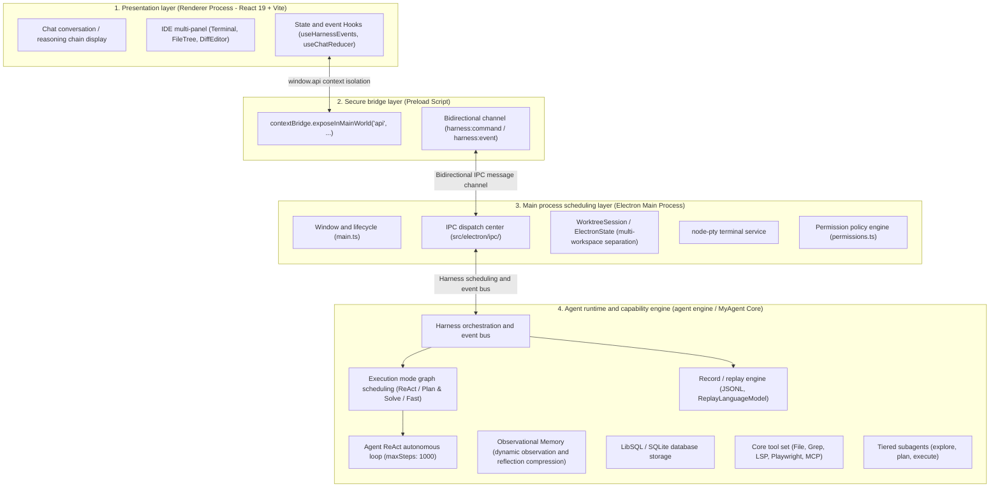
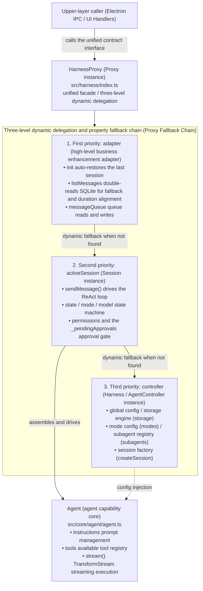
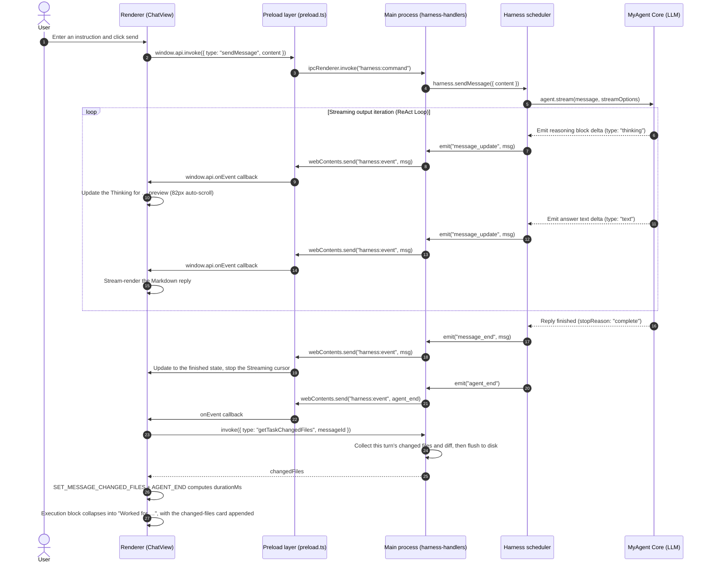
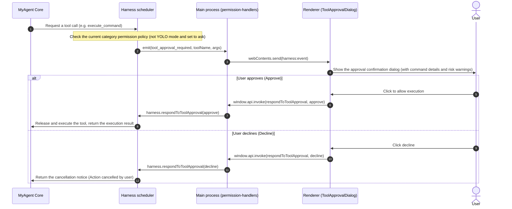
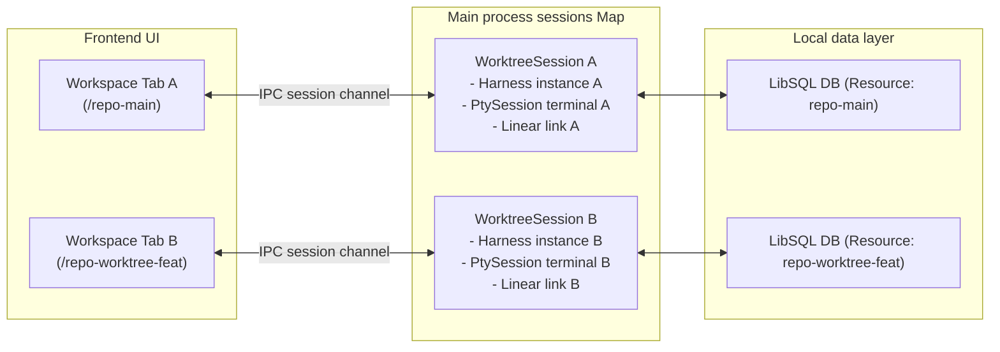

# My Agent — Architecture and Module Design

<div align="center">

[简体中文](README.md) ｜ **English**

<sub>English mirror of README.md. The Chinese edition is the authoritative one.</sub>

</div>

This project is a desktop-grade intelligent coding assistant built on **Electron** and **React**. It adopts a multi-process decoupled architecture, combines the ReAct loop of modern autonomous Agents with observational memory mechanisms, and supports multi-workspace session isolation, streaming tool execution and multi-panel IDE collaborative interaction.

<!-- FEEDBACK_BADGES_START — kept in sync with FEEDBACK_BADGES in src/utils/feedback.ts -->

<div align="center">


<sub>Below every reply you will find Copy · 👍 Helpful · 👎 Bad response. Likes are anonymous: no login, no database write, no identity reported — they simply add +1 to the two public counters above; after the app restarts the highlight disappears and only the totals remain.</sub>

</div>

<!-- FEEDBACK_BADGES_END -->

---

<!-- LATEST_RELEASE_START -->

## 📥 Client downloads and release notes (ChangeLog)

<div align="center">

[](https://github.com/kidyfirst/my-agent/releases/latest)
[](https://github.com/kidyfirst/my-agent/releases)
[](LICENSE)
[](#downloads-for-all-platforms)
[](https://kidyfirst.github.io/my-agent/changelog.html)

**Latest stable version: `v0.1.2`**  
🌐 **[Official download site (GitHub Pages)](https://kidyfirst.github.io/my-agent/)** ｜ 📋 **[Release notes (ChangeLog)](https://kidyfirst.github.io/my-agent/changelog.html)** ｜ 📦 **[GitHub Releases](https://github.com/kidyfirst/my-agent/releases)**

</div>

### Downloads for all platforms

| Platform       | Architecture / device                 | Package                    | Direct download (v0.1.2)                                                                                                                    | Notes                       |
| :------------- | :------------------------------------ | :------------------------- | :------------------------------------------------------------------------------------------------------------------------------------------ | :-------------------------- |
| 🍏 **macOS**   | **Apple Silicon** (M1 / M2 / M3 / M4) | `.dmg` installer           | [my-agent-0.1.2-mac-arm64.dmg](https://github.com/kidyfirst/my-agent/releases/download/v0.1.2/my-agent-0.1.2-mac-arm64.dmg)                 | Recommended for most Macs   |
| 🍏 **macOS**   | **Apple Silicon** (M1 / M2 / M3 / M4) | `.zip` portable build      | [my-agent-0.1.2-mac-arm64.zip](https://github.com/kidyfirst/my-agent/releases/download/v0.1.2/my-agent-0.1.2-mac-arm64.zip)                 | Unzip and run               |
| 🍏 **macOS**   | **Intel x86_64**                      | `.dmg` installer           | [my-agent-0.1.2-mac-x64.dmg](https://github.com/kidyfirst/my-agent/releases/download/v0.1.2/my-agent-0.1.2-mac-x64.dmg)                     | For Intel-based Macs        |
| 🍏 **macOS**   | **Intel x86_64**                      | `.zip` portable build      | [my-agent-0.1.2-mac-x64.zip](https://github.com/kidyfirst/my-agent/releases/download/v0.1.2/my-agent-0.1.2-mac-x64.zip)                     | Unzip and run               |
| 🪟 **Windows** | **Windows 10 / 11** (64-bit)          | `.exe` installer           | [my-agent-0.1.2-win-x64.exe](https://github.com/kidyfirst/my-agent/releases/download/v0.1.2/my-agent-0.1.2-win-x64.exe)                     | NSIS guided setup           |
| 🪟 **Windows** | **Windows 10 / 11** (64-bit)          | `.zip` portable build      | [my-agent-0.1.2-win-x64.zip](https://github.com/kidyfirst/my-agent/releases/download/v0.1.2/my-agent-0.1.2-win-x64.zip)                     | Unzip and run               |
| 🐧 **Linux**   | **Linux x86_64** (generic)            | `.AppImage` portable image | [my-agent-0.1.2-linux-x86_64.AppImage](https://github.com/kidyfirst/my-agent/releases/download/v0.1.2/my-agent-0.1.2-linux-x86_64.AppImage) | `chmod +x`, then run it     |
| 🐧 **Linux**   | **Debian / Ubuntu / Deepin**          | `.deb` package             | [my-agent-0.1.2-linux-amd64.deb](https://github.com/kidyfirst/my-agent/releases/download/v0.1.2/my-agent-0.1.2-linux-amd64.deb)             | Install with `sudo dpkg -i` |
| 🐧 **Linux**   | **Linux x86_64** (no install)         | `.zip` archive             | [my-agent-0.1.2-linux-x64.zip](https://github.com/kidyfirst/my-agent/releases/download/v0.1.2/my-agent-0.1.2-linux-x64.zip)                 | For machines without root   |

> [!IMPORTANT]
> **macOS says the app “is damaged” or “cannot be opened”:**  
> The community build is not signed with a paid Apple Developer certificate, so Gatekeeper tags everything downloaded through a browser. If the first launch is refused, clear the quarantine flag once:
>
> ```bash
> xattr -cr "/Applications/My Agent.app"
> ```
>
> Or allow it in System Settings: **System Settings → Privacy & Security → scroll down and click “Open Anyway”**.

> [!TIP]
>
> - Full history and per-version details: 👉 **[online ChangeLog](https://kidyfirst.github.io/my-agent/changelog.html)** or **[all releases on GitHub](https://github.com/kidyfirst/my-agent/releases)**.

---

<!-- LATEST_RELEASE_END -->

<!-- TIP_JAR_START — the QR is src/renderer/assets/alipay-qr.png itself; do not add a second copy -->

## ☕ Treat the cat

<div align="center">

If this project has been useful to you, treat the cat 🐱


<sub>Scan with Alipay · any amount, and it works just as well without</sub>

</div>

<!-- TIP_JAR_END -->

---

## Table of contents

- [My Agent — Architecture and Module Design](#my-agent--architecture-and-module-design)
  - [📥 Client downloads and release notes (ChangeLog)](#-client-downloads-and-release-notes-changelog)
    - [Downloads for all platforms](#downloads-for-all-platforms)
  - [☕ Treat the cat](#-treat-the-cat)
  - [Table of contents](#table-of-contents)
  - [1. Overall architecture design](#1-overall-architecture-design)
    - [Core design principles](#core-design-principles)
  - [2. Process split and communication](#2-process-split-and-communication)
  - [3. Core module implementation notes](#3-core-module-implementation-notes)
    - [3.1 Main process layer (`src/electron/`)](#31-main-process-layer-srcelectron)
    - [3.2 Preload and bridge layer (`src/electron/preload.ts`)](#32-preload-and-bridge-layer-srcelectronpreloadts)
    - [3.3 Renderer UI layer (`src/renderer/`)](#33-renderer-ui-layer-srcrenderer)
      - [3.3.1 ChatView rendering pipeline](#331-chatview-rendering-pipeline)
      - [3.3.2 The two display states: running and finished](#332-the-two-display-states-running-and-finished)
      - [3.3.3 Sticky and collapsible user messages](#333-sticky-and-collapsible-user-messages)
      - [3.3.4 Changed files cards and subagent cards](#334-changed-files-cards-and-subagent-cards)
      - [3.3.5 Scrolling, empty state and stacking](#335-scrolling-empty-state-and-stacking)
    - [3.4 Agent runtime and capability layer (agent engine / `src/tools/`)](#34-agent-runtime-and-capability-layer-agent-engine--srctools)
      - [3.4.1 Core runtime object system (Harness / HarnessProxy / ActiveSession / Agent)](#341-core-runtime-object-system-harness--harnessproxy--activesession--agent)
        - [1. Responsibility boundaries and class contracts of the four core entities](#1-responsibility-boundaries-and-class-contracts-of-the-four-core-entities)
        - [2. Core class and interface definitions](#2-core-class-and-interface-definitions)
          - [(1) `Agent` class definition](#1-agent-class-definition)
          - [(2) `Harness` / `AgentController` class definition](#2-harness--agentcontroller-class-definition)
          - [(3) `ActiveSession` (`Session<TState>`) class definition](#3-activesession-sessiontstate-class-definition)
          - [(4) `HarnessProxy` and the `adapter` facade](#4-harnessproxy-and-the-adapter-facade)
        - [3. Why wrap a `Proxy` around `adapter`?](#3-why-wrap-a-proxy-around-adapter)
      - [3.4.2 Storage engine and database persistence](#342-storage-engine-and-database-persistence)
      - [3.4.3 Observational Memory](#343-observational-memory)
      - [3.4.4 Agent ReAct loop and tool stream](#344-agent-react-loop-and-tool-stream)
      - [3.4.5 Extended tool ecosystem and sandbox safety (`src/tools/`, `src/lsp/`, `src/browser/`)](#345-extended-tool-ecosystem-and-sandbox-safety-srctools-srclsp-srcbrowser)
      - [3.4.6 Tiered Subagents](#346-tiered-subagents)
      - [3.4.7 Execution modes and graph scheduling (`src/core/graph/`)](#347-execution-modes-and-graph-scheduling-srccoregraph)
      - [3.4.8 Session recording and offline replay (`src/core/recorder/`)](#348-session-recording-and-offline-replay-srccorerecorder)
    - [3.5 Memory module (`src/memory/`)](#35-memory-module-srcmemory)
      - [3.5.1 Class inheritance and responsibility boundaries](#351-class-inheritance-and-responsibility-boundaries)
      - [3.5.2 Storage domain adaptation and thread/message CRUD](#352-storage-domain-adaptation-and-threadmessage-crud)
      - [3.5.3 Observational Memory parameters and trigger thresholds](#353-observational-memory-parameters-and-trigger-thresholds)
      - [3.5.4 Dynamic Memory factory and hot model switching](#354-dynamic-memory-factory-and-hot-model-switching)
      - [3.5.5 Token estimation and empty Working Memory implementation](#355-token-estimation-and-empty-working-memory-implementation)
      - [3.5.6 Configuration entry points and test coverage](#356-configuration-entry-points-and-test-coverage)
  - [4. Core business and data-flow sequences](#4-core-business-and-data-flow-sequences)
    - [4.1 Streaming sequence for user messages, reasoning chains and execution blocks](#41-streaming-sequence-for-user-messages-reasoning-chains-and-execution-blocks)
    - [4.2 Tool-call approval and human-in-the-loop flow](#42-tool-call-approval-and-human-in-the-loop-flow)
    - [4.3 Git Worktree multi-session isolation](#43-git-worktree-multi-session-isolation)
  - [5. Source directory map](#5-source-directory-map)

---

## 1. Overall architecture design

The project adopts a typical **four-layer architecture**, from top to bottom: the **UI presentation layer**, the **secure bridge layer**, the **main process scheduling layer** and the **Agent runtime engine**:



### Core design principles

1. **Strict process isolation (Context Isolation)**: the renderer process never touches Node.js native APIs or sensitive system calls directly; every capability is exposed through the allow-listed channel of `preload.ts`.
2. **Multi-Worktree session isolation**: for several Git branches / workspaces (Worktree) of the same repository, the main process instantiates independent `WorktreeSession` and `Harness` instances, keeping sessions, terminals and state from interfering with each other.
3. **Autonomous ReAct loop instead of a static workflow**: rigid DAG workflows are dropped in favour of the LLM's reason-act loop (Think $\to$ Tool Call $\to$ Observe $\to$ Loop), delivering flexible code retrieval, planning and rewriting.
4. **Dynamic long-context memory compression (Observational Memory)**: built-in observer and reflector models dynamically compress the large volume of tool-call logs produced in long conversations, keeping the context from exceeding model limits.
5. **Mode as graph**: the three execution modes — ReAct / Plan & Solve / Fast — each correspond to an independent graph definition; switching modes swaps the whole scheduling graph and tool set, rather than merely changing the prompt.
6. **Record & replay**: every run can be flushed to disk as compact JSONL; replay touches neither the network nor the file system, and together with the runtime snapshot it fully restores the model, mode and permission context of that moment.

---

## 2. Process split and communication

Inter-process communication in the Electron system follows strongly typed IPC conventions:

| Channel                 | Direction                   | Transport protocol                           | Description                                                                                                                                           |
| :---------------------- | :-------------------------- | :------------------------------------------- | :---------------------------------------------------------------------------------------------------------------------------------------------------- |
| `harness:command`       | Renderer $\to$ main process | `ipcRenderer.invoke` (bidirectional Promise) | The frontend sends commands such as sending a message, switching the model, switching the mode, operating the terminal and saving settings            |
| `harness:event`         | Main process $\to$ renderer | `webContents.send` (one-way broadcast)       | The main process pushes streaming events to the frontend in real time (message stream, reasoning chain, tool execution, task progress, notifications) |
| `login:prompt-response` | Renderer $\to$ main process | `ipcRenderer.send` (one-way)                 | OAuth login dialog / verification response callback                                                                                                   |
| `set-badge-count`       | Renderer $\to$ main process | `ipcRenderer.send` (one-way)                 | Sets the unread message badge on the macOS Dock icon                                                                                                  |
| `open-url`              | Main process $\to$ renderer | `webContents.send` (one-way)                 | Intercepts external links and opens them in the app's built-in browser panel                                                                          |

---

## 3. Core module implementation notes

### 3.1 Main process layer (`src/electron/`)

The main process is responsible for native operating-system capability integration, window management, session lifecycle maintenance and secure dispatch.

- **Window control and entry point (`src/electron/main.ts`)**
  - Calls `createWindow()` to instantiate the main window and configures `webPreferences` (disables `nodeIntegration`, enables `contextIsolation` and `preload`).
  - Environment-aware loading: in development it reads `process.env.ELECTRON_RENDERER_URL` (connecting to the Vite dev server for hot reload); in production it loads the packaged `dist/renderer/index.html` through `mainWindow.loadFile`.
  - Registers the application global menu, the macOS Dock icon and external link interception.
- **IPC command dispatch center (`src/electron/ipc/`)**
  The main process adopts a modular handler design, unified and dispatched in `src/electron/ipc/index.ts`:
  - `harness-handlers.ts`: handles conversation messages (`sendMessage`), task interruption (`abort`), user interjection (`steer`), follow-up tasks (`followUp`), and mode / model switching.
  - `project-handlers.ts`: project detection, workspace opening, Git Worktree session lifecycle management and multi-project switching.
  - `permission-handlers.ts`: tool-call approval interception (approve, decline, permanently allow by category) and human-in-the-loop question answering (`ask_question` / `plan_approval`).
  - `pty-handlers.ts`: built on `node-pty`, creates underlying pseudo-terminal instances, relays standard input/output streams and resets the terminal window size (Resize).
  - `git-handlers.ts`: handles local Git repository status checks, Diff generation, branch fetch and checkout.
  - `file-handlers.ts`: provides a controlled local file read service for the frontend editor panel.
  - `mcp-handlers.ts`: manages Model Context Protocol (MCP) server connections, status monitoring and external tool reloading.
  - `settings-handlers.ts`: configuration persistence (Thinking depth level, notification mode, AST smart editing toggle, etc.).
  - `integration-handlers.ts`: handles the bidirectional Linear and GitHub integrations (ticket fetching, commit association, status synchronisation).
  - `auth-handlers.ts`: Anthropic and OpenAI OAuth authorization flow control.
  - `dashboard-handlers.ts`: aggregates cross-session Token consumption, execution time and task metrics.
- **State isolation and integration context (`src/electron/electron-state.ts`)**
  - Maintains one `ElectronState` per workspace path, persistently recording the associated Linear task IDs, GitHub PR links and dedicated credentials.
- **Native system notifications (`src/electron/notifications.ts`)**
  - When the main window is unfocused (running in the background), if an Agent task finishes or manual approval is required, native system notifications and sound alerts are triggered.

### 3.2 Preload and bridge layer (`src/electron/preload.ts`)

`preload.ts` executes before the page DOM is loaded and relies on `contextBridge` to inject a safe `window.api` namespace into the page:

```ts
// src/electron/preload.ts
contextBridge.exposeInMainWorld("api", {
  invoke: (command) => ipcRenderer.invoke("harness:command", command),
  onEvent: (callback) => { ... },
  respondToLoginPrompt: (answer) => { ... },
  cancelLoginPrompt: () => { ... },
  setBadgeCount: (count) => { ... },
  onOpenUrl: (callback) => { ... },
  platform: process.platform,
})
```

Combined with `declare global { interface Window { api: ElectronAPI } }` in `src/renderer/types/ipc.ts`, this delivers end-to-end TypeScript static type inference and code auto-completion.

### 3.3 Renderer UI layer (`src/renderer/`)

A high-performance IDE-grade interface built with **React 19** + **Vite**, driven by unidirectional data flow and reactive subscriptions:

- **Render entry point (`src/renderer/index.html` & `main.tsx`)**
  - `index.html` provides the `#root` mount point and imports the ES Module `main.tsx`, rendering the root component `<App />` into the DOM.
- **Event consumption and state machine (`src/renderer/hooks/useHarnessEvents.ts` & `src/renderer/types/chat.ts`)**
  - Subscribes to `window.api.onEvent` and intercepts Agent runtime events pushed by the main process.
  - Processes actions through the `useChatReducer` state machine:
    - `AGENT_START` / `AGENT_END`: marks the global running state and the loading cursor.
    - `MESSAGE_START` / `MESSAGE_UPDATE` / `MESSAGE_END`: accumulates Tokens as they stream and updates the corresponding message block in real time.
    - `TOOL_START` / `TOOL_UPDATE` / `TOOL_END`: updates tool-call arguments and returned results.
- **Session message rendering component family (`src/renderer/components/`)**
  - `ChatView.tsx`: the session rendering pipeline, which merges `messages` into five render categories — "user message / execution block / assistant reply / subagent / system notice" — and collapses multiple tool calls of the same turn into a single execution block.
  - `AssistantMessage.tsx`: renders the assistant body; `text` blocks go through `react-markdown` rich text plus code highlighting, and every code block gets its own copy button.
  - `ExecutionBlock.tsx`: the unified display component for execution blocks (reasoning chain + tool calls); the running and finished states are described in [3.3.2](#332-the-two-display-states-running-and-finished).
  - `UserMessage.tsx`: the user message bubble, supporting sticky positioning, collapsing of very long content, image preview and one-click copy.
  - `FilesChangedBar.tsx` / `SubagentExecution.tsx` / `TodoProgress.tsx`: changed files cards, subagent execution cards and the task progress bar.
- **IDE multi-panel component ecosystem**
  - `TerminalPanel.tsx`: a high-performance ANSI terminal emulator built on `@xterm/xterm` and `@xterm/addon-fit`.
  - `FileTree.tsx` / `FileEditor.tsx` / `DiffEditor.tsx`: file tree browsing, syntax-highlighted viewing and side-by-side Git change comparison.
  - `TaskBoard.tsx`: an integrated Linear/GitHub ticket board that supports binding an issue to the current branch with one click.
  - `ToolApprovalDialog.tsx` / `PlanApproval.tsx`: human-in-the-loop dialogs that intercept dangerous operations and ask the user to confirm.

#### 3.3.1 ChatView rendering pipeline

`ChatView.tsx` does not iterate over `messages` and render components directly. Instead it first merges message bodies into render items (`RenderItem`), and then dispatches them to concrete components through a single `switch`. This runs as a serial sequence of `useMemo` passes, in the following order:

1. **Turn duration preprocessing**: turns are split on `user` / `system` messages; all assistant message ids in the current turn and the last non-empty `durationMs` are collected and written into `turnDurationById`. `agent_end` only writes the duration onto the last assistant message, so this table is what restores the duration to "the first execution block of this turn".
2. **Per-message parsing**: first `normalizeMessageContent` normalizes `content` (the Agent may pass a string, an array, or `parts`). `tool_result` blocks first build the `toolResultsById` index; then dispatch happens by block type:
   - `text` / `output` / `message` (or no type but carrying `text` / `content` / `value`): accumulate body text;
   - `thinking` / `reasoning` / `thought` / `redactedthinking`: generate reasoning chain steps; the duration is taken from the block's `durationSec` first, then derived from the message duration, and finally estimated from text length;
   - `toolcall` / `tooluse` / `toolinvocation`: generate tool steps; `isDone` is decided by `state === "result"` or an already existing result, and the tool definition is looked up in the `tools` / `subagents` map for its name and icon.
3. **Flush strategy**: when a body block or subagent is encountered, `flushExecution()` is called to settle the currently accumulated steps into one execution block; when a reasoning chain or tool block is encountered, `flushText()` is called, and **an assistant item is only produced when the body text is non-empty (or the tail is an error)** — so no empty bubbles appear during streaming.
4. **Message finalization**: once a message has been parsed it is flushed again, and `msg.changedFiles` is attached to the last assistant item of this turn; if there is no body item at all, an assistant item containing only the files card is appended.
5. **Gap filling**: tools that already appeared in the state machine but have no matching block in the message body are appended into `live-execution-block`; subagents that were never rendered are filled in as standalone cards.
6. **Placeholder**: while the Agent is running and the last item is a user message, `active-execution-placeholder` is inserted so that `Thinking for …` becomes visible immediately, instead of waiting for the first tool call.
7. **Final merge**: first merge adjacent execution blocks (deduplicating steps by id) and discard blocks that are empty and inactive; then apply the "one active block per turn" collapse — the cursor resets at `user` / `system` items, all subsequent execution blocks of the same turn are merged into the first one, and `isActive` / `startedAt` / `durationMs` / `changedFiles` take the latest values.

Step 7 is the key to "only one `Worked for …` per turn": the early implementation gave every assistant message its own execution block, so several titles would pop up inside a single turn; now they are collapsed uniformly at the render layer.

#### 3.3.2 The two display states: running and finished

`ExecutionBlock.tsx` carries both states in one component; the shape is decided by `isActive`:

- **Running**: the title is `Thinking for 12.3s` (or `1m 20s`), followed by an `(N steps)` count and a downward arrow; in the collapsed state there is an 82px-high step preview pane below that auto-scrolls to the bottom as new steps arrive; click the title or the preview pane to expand all steps.
- **Finished**: only one line remains for the whole turn, `Worked for 1m 6s ⌄`; steps are fully hidden by default and expand only on click; if the block has no steps at all and is not active, the component returns `null` directly.
- **Duration source**: `durationMs` written onto the message at `agent_end`; when it is missing, fall back to `turnDurationById` from 3.3.1. There is no duration column in the database, so `SET_MESSAGES` in `chatReducer` keeps the old duration held in memory and backfills it onto the last assistant message of the turn for historical sessions — earlier historical turns may still show a `Worked` without a duration.
- **Duration format**: under 60 seconds shows one decimal (`12.3s`), above that shows `Xm Ys`; while running, a 100ms timer refreshes it based on `startedAt`.

#### 3.3.3 Sticky and collapsible user messages

`UserMessage.tsx` is responsible for keeping "the latest question in the current viewport" pinned to the top:

- When not expanded, `position: sticky` + `top: 0` + `zIndex: 20` + an opaque `var(--bg)` background keep it at the top of the viewport while scrolling; the expanded state cancels stickiness and restores normal document flow.
- When the content height exceeds the threshold (about 80px for the bubble) it collapses, overlaying a 24px gradient mask and a chevron at the bottom; clicking toggles expansion; if `window.getSelection()` shows there is a selection, the toggle is not triggered, preserving "drag-select to copy".
- Image thumbnails are fixed at 60px high with `object-fit: contain`; clicking opens `ImagePreviewModal`; below the bubble are the timestamp and the copy button.
- Layout details: the scroll container itself has no padding; the inner 800px column carries `16px 24px 0`; the sticky container uses a negative margin of `-24px` plus equal padding to spread the background out to the column edges, so scrolled body text never peeks out on either side of the sticky card.

#### 3.3.4 Changed files cards and subagent cards

- **Changed files card (`FilesChangedBar.tsx`)**: mounted at the tail of the assistant message when `message.changedFiles` is non-empty. The header line is `N files changed +X -Y`, and clicking the whole row expands it; once expanded, each file shows its `basename` + directory + added/removed line counts, and the `Review` button stops event propagation and opens the diff editor directly. Inline diffs are lazy-loaded (`getTaskFileDiff`, keyed by `messageId`), and `isLive` means the task is still running.
- **Persistence (`src/electron/task-changes-store.ts`)**: the file list and diff at task end are written to `<appData>/task-changes.json` (thread → message → files/diff, capped at 40 threads × 80 tasks, 200KB per diff); after a restart `getMessages` re-attaches them to `changedFiles`, and deleting a thread cleans them up at the same time.
- **Subagent card (`SubagentExecution.tsx`)**: the whole row is clickable, showing `🏗️` + `Agent` + task description + completion time + ✓/✗/running pulse dot; expanding reveals the subagent's internal tool calls and final result.

#### 3.3.5 Scrolling, empty state and stacking

- **Auto scroll**: `isAutoScroll` marks whether the view follows the bottom (less than 100px from the bottom counts as following); when new messages or tool updates arrive, `scrollTop` is first pushed to the bottom and then corrected once more on the next frame, avoiding position drift caused by React commit timing.
- **Layout**: the outer layer uses `flex: 1` / `overflow-y: auto` / `overflow-x: hidden` / `scrollbar-gutter: stable`; the inner layer uses `max-width: 800px; margin: 0 auto; flex: 1 0 auto; min-height: 100%`, with a 16px placeholder at the bottom.
- **Empty state and progress**: when there are no render items and the Agent is idle, `AsciiLogo` is shown; when `todos` exist, `TodoProgress` is rendered at the bottom of the list; `system` messages are rendered as a notice block carrying a `System Notice` label; consecutive duplicate user messages are deduplicated by text.
- **Stacking order**: the sticky card uses `zIndex: 20`; every overlay that can reach down into the chat area must sit above it — `OpenInDropdown` is 400, the model/permission overlays inside the editor are 200, and the command palette and modals are above 1000.

### 3.4 Agent runtime and capability layer (agent engine / `src/tools/`)

The project assembles its underlying capabilities through a self-developed agent runtime architecture, in which four core entities cooperate to deliver model interaction, controlled tool invocation, multi-session isolation and event stream rendering.

#### 3.4.1 Core runtime object system (Harness / HarnessProxy / ActiveSession / Agent)

In the runtime architecture, upper layers (Electron IPC handlers and the frontend UI) never operate a single complex low-level class directly. Instead they interact with the whole system through one unified facade object (`harness`) wrapped by a proxy.



##### 1. Responsibility boundaries and class contracts of the four core entities

| Core entity                             | Source location                                                                                                                      | Core positioning and responsibilities                                                                                                                                                                                                                                                                          |
| :-------------------------------------- | ------------------------------------------------------------------------------------------------------------------------------------ | -------------------------------------------------------------------------------------------------------------------------------------------------------------------------------------------------------------------------------------------------------------------------------------------------------------- |
| **`Agent`**                             | [`src/core/agent/agent.ts`](file:///Users/timlyu/gitcode/github/mastra-code-ui/src/core/agent/agent.ts)                              | **Atomic agent capability wrapper**. Manages System Instructions, Model resolution, Tools list injection and Memory association, and provides the basic streaming generation `stream()`.                                                                                                                       |
| **`Harness`** (`AgentController`)       | [`src/core/controller/controller.ts`](file:///Users/timlyu/gitcode/github/mastra-code-ui/src/core/controller/controller.ts)          | **Workspace-level scheduling host and Session factory**. Holds global storage (Storage), persistent memory (Memory), modes (Modes) and the subagent registry (Subagents), and manages the lifecycle of multiple Sessions.                                                                                      |
| **`ActiveSession`** (`Session<TState>`) | [`src/core/controller/controller.ts:296`](file:///Users/timlyu/gitcode/github/mastra-code-ui/src/core/controller/controller.ts#L296) | **Stateful single-project / workspace-branch execution instance**. Each project or Git Worktree maps to an independent Session. Manages reactive state, the current Model/Mode, historical Threads and the tool approval gate (`_pendingApprovals`), and hosts the main execution entry point `sendMessage()`. |
| **`HarnessProxy`** (`MyAgentHarness`)   | [`src/harness/index.ts:1096`](file:///Users/timlyu/gitcode/github/mastra-code-ui/src/harness/index.ts#L1096)                         | **Advanced polymorphic facade proxy**. Dynamically aggregates `adapter`, `activeSession` and `controller` through an ES6 `Proxy`, exposing a unified interface that is fully featured, dynamically late-bound and free of boilerplate forwarding.                                                              |

---

##### 2. Core class and interface definitions

###### (1) `Agent` class definition

```typescript
export class Agent {
	id: string
	name: string
	description?: string
	instructions?: any // a string or a dynamic function returning a string (args: { requestContext }) => Promise<string>
	model?: any // a language model instance or a resolver function (args: { requestContext }) => Promise<LanguageModel>
	tools?: any // a tool map dictionary or resolver function Record<string, Tool>
	memory?: any // the memory management module

	constructor(config: AgentConfig)

	// resolve and return the system prompt for the current request context
	async getInstructions(args?: {
		requestContext?: RequestContext
	}): Promise<string>
	// dynamically resolve the language model used by the current request context
	async getModel(args?: { requestContext?: RequestContext }): Promise<any>
	// list every tool instance currently available
	async listTools(args?: {
		requestContext?: RequestContext
	}): Promise<Record<string, any>>
	// core streaming execution: call the Vercel AI SDK's streamText and normalize the output event stream through a built-in TransformStream
	async stream(
		taskOrPrompt: string | any,
		options?: AgentStreamOptions,
	): Promise<{
		fullStream: ReadableStream<any>
		textStream: ReadableStream<string>
		text: Promise<string>
		getFullOutput: () => Promise<{
			text: string
			usage: any
			finishReason: any
		}>
	}>
}
```

###### (2) `Harness` / `AgentController` class definition

```typescript
export class AgentController<TState = any> {
	readonly id: string
	readonly agent: Agent // the associated primary Agent instance
	readonly storage: any // the global storage engine (SQLite / LibSQL)
	readonly memory?: any // the observational memory module (OM)
	readonly defaultModeId: string // the default mode (e.g. "build")
	readonly modes: AgentMode[] // the list of registered working modes (build, plan, etc.)
	readonly subagents: HarnessSubagent[] // the list of registered subagents (explore, plan, execute)
	readonly toolCategoryResolver?: (toolName: string) => string // the tool category resolver

	constructor(config: HarnessConfig<TState>)

	async init(): Promise<void>
	// session factory: create or fetch the independent state session for the given workspace / resource
	async createSession(options?: {
		resourceId?: string
	}): Promise<Session<TState>>
	getSession(sessionId: string): Session<TState> | undefined
	listModes(): AgentMode[]
	async listAvailableModels(): Promise<AvailableModelItem[]>
}
```

###### (3) `ActiveSession` (`Session<TState>`) class definition

```typescript
export class Session<TState = any> {
	readonly id: string
	readonly resourceId: string
	readonly controller: AgentController<TState>

	// state machine and environment config accessors
	readonly state: {
		get: () => TState
		set: (patch: Partial<TState>) => Promise<void>
	}
	readonly mode: {
		get: () => string
		switch: (opts: { modeId: string }) => Promise<void>
	}
	readonly model: { get: () => any; switch: (modelId: string) => Promise<void> }

	// historical session management
	readonly thread: {
		getId: () => string
		switch: (opts: { threadId: string }) => Promise<void>
		create: (opts?: {
			title?: string
			metadata?: Record<string, unknown>
		}) => Promise<ThreadLike>
		list: () => Promise<ThreadLike[]>
		listMessages: (opts?: { threadId?: string; limit?: number }) => Promise<any>
		delete: (opts: { threadId: string }) => Promise<void>
	}

	// permission gate and human approval control
	readonly permissions: {
		getRules: () => {
			categories: Record<string, string>
			tools: Record<string, string>
		}
		setForCategory: (opts: {
			category: ToolCategory
			policy: PermissionPolicy
		}) => void
	}

	// core task driver: assemble tools, inject approval interception, drive the streamText loop and broadcast events
	async sendMessage(options: SendMessageOptions): Promise<void>
	// asynchronously abort the running task and its process group
	async abort(): Promise<void>
	// respond to the manual approval of a tool call (Approve / Decline)
	respondToToolApproval(opts: {
		decision?: "approve" | "decline"
		toolCallId: string
	}): void
	// subscribe to the full set of lifecycle events emitted by the current session (tool_start, tool_end, message_delta, etc.)
	subscribe(listener: (event: HarnessEvent) => void): () => void
}
```

###### (4) `HarnessProxy` and the `adapter` facade

```typescript
// 1. adapter: wraps high-level business logic and storage fallback on top of the session
const adapter: MyAgentHarness = {
    id: "myagent-code",
    controller,
    get activeSession() { return activeSession },
    async init() {
        await controller.init()
        const session = activeSession ?? (await sessionReady)
        await session.init?.()
        // automatically restore the last opened project session Thread
        ...
    },
    async listMessages(options) {
        // first read the in-memory session, then double-query the SQLite storage to backfill the precise execution duration durationMs
        ...
    },
    ...
}

// 2. harness: build a three-level dynamic lookup chain on top of Proxy
const harness: MyAgentHarness = new Proxy(adapter, {
    get(target: MyAgentHarness, prop: string | symbol) {
        if (prop in target) {
            return (target as unknown as Record<string | symbol, unknown>)[prop]
        }
        if (activeSession && prop in (activeSession as unknown as object)) {
            const val = (activeSession as unknown as Record<string | symbol, unknown>)[prop]
            return typeof val === "function" ? val.bind(activeSession) : val
        }
        if (prop in (controller as unknown as object)) {
            const val = (controller as unknown as Record<string | symbol, unknown>)[prop]
            return typeof val === "function" ? val.bind(controller) : val
        }
        return undefined
    },
})
```

---

##### 3. Why wrap a `Proxy` around `adapter`?

Using `Proxy` delivers four irreplaceable core architectural values:

1. **Solving the timing problem of the asynchronously late-mounted `activeSession` (Late-bound Dynamic Reference)**:
   During `createMyAgent()` initialization, `activeSession` depends on the asynchronous Promise created by `controller.createSession(...)`. With a traditional static copy (such as `Object.assign`), `activeSession` is still `null` the moment the function returns, and every method hanging off it would be lost entirely; the Proxy, by contrast, **evaluates dynamically at the moment the property is accessed**, so once asynchronous creation completes, callers can reach it transparently right away.
2. **Zero-Boilerplate Delegation**:
   `Session` and `AgentController` contain a large number of internal methods and deep state (such as `permissions`, `thread`, `om` memory, `storage`, etc.). Without a Proxy, developers would have to hand-write dozens of identical forwarding functions on the `adapter` object (`foo(...args) { return this.activeSession.foo(...args); }`), which is prohibitively expensive to maintain; the Proxy delivers **transparent automatic fallback delegation** for the entire API surface.
3. **Guaranteed `this` context binding (Execution Context Binding)**:
   On property access, the Proxy automatically runs `.bind(activeSession)` or `.bind(controller)` on functions, ensuring that when the underlying method executes, its internal `this` always points at the original instance, ruling out `TypeError: Cannot read properties of undefined` caused by lost context when accessing internal private properties (such as `this._state`, `this._pendingApprovals`).
4. **High-level business override first (Override & Enrichment)**:
   The Proxy checks `if (prop in target)` first, which lets `adapter` precisely override key business methods (for example the SQLite supplementary-query fallback of `listMessages`, or the memory restoration of `init`); methods that are not overridden pass straight through to the underlying implementation.

---

#### 3.4.2 Storage engine and database persistence

An embedded LibSQL (SQLite) database is initialized automatically by default, located in the system AppData directory, providing zero-configuration local persistence for Thread history, message lists and Token usage.

#### 3.4.3 Observational Memory

Solves the pain point of context-window explosion during long coding conversations:

- **Observer model**: periodically scans tool inputs and outputs in the session and extracts summarized observation records.
- **Reflector model**: reflects on and distills high-frequency facts and architectural consensus, dynamically maintaining the long-term memory context.
- See [3.5 Memory module](#35-memory-module-srcmemory) for the concrete implementation.

#### 3.4.4 Agent ReAct loop and tool stream

- Instantiates the core agent `codeAgent` and configures `maxSteps: 1000` in `harness.sendMessage()`.
- The model reasons from the instructions and autonomously decides which tools to call; after a tool runs on the host, its standard output or exception is fed back to the model, and the model keeps iterating until the overall task is complete.

#### 3.4.5 Extended tool ecosystem and sandbox safety (`src/tools/`, `src/lsp/`, `src/browser/`)

- **Basic code tools**: `view` (view code), `grep` (regex content search), `glob` (file matching), `execute_command` (controlled command execution), `write_file` (write file).
- **AST smart editing**: `string_replace_lsp` implements precise syntax-tree-level code replacement on top of the LSP protocol.
- **Browser automation**: `navigate-browser` and `computer` drive headless / visible browsers with Playwright for frontend UI regression and interaction.
- **MCP external tool extensions**: dynamically mount external tools exposed by external Model Context Protocol servers.
- **Sandbox and path protection**: every read/write and terminal operation is forced through `assertPathAllowed` to stay within `projectRoot`; crossing that boundary requires escalation confirmed by `request_sandbox_access`.

#### 3.4.6 Tiered Subagents

Lightweight Agents derived into different permission tiers are built in:

- `explore`: read-only exploration subagent, responsible for codebase retrieval and dependency analysis.
- `plan`: read-only planning subagent, responsible for feature design and implementation plan breakdown.
- `execute`: write-permission execution subagent, performs the concrete code modifications and calls the task board tools.

#### 3.4.7 Execution modes and graph scheduling (`src/core/graph/`)

With the same model and the same tool set, three **execution modes** can be switched according to the nature of the task. A mode is not a prompt toggle but a **replacement of the entire execution graph**: each mode registers an independent `AgentGraphDefinition` (with a topology description `topology` and a `buildGraph(ctx)` factory), selected at runtime by `modeId`.

| Mode ID | UI name          | Execution graph shape                                                                                                                                                                 | Applicable scenarios                                                                      |
| :------ | ---------------- | ------------------------------------------------------------------------------------------------------------------------------------------------------------------------------------- | ----------------------------------------------------------------------------------------- |
| `react` | **ReAct**        | Single-graph autonomous loop: LLM reasoning → tool call → observation feedback → reasoning again, until the final answer is produced                                                  | The vast majority of real code-changing tasks (the UI default)                            |
| `plan`  | **Plan & Solve** | Two-phase graph: first generate a structured plan (`PlanStep[]` / task board), then execute item by item and backfill status by completion                                            | Large refactors and multi-file feature development, where you need to see the route first |
| `fast`  | **Fast**         | Single-node direct streaming response, mounting only **read-only tools** (read file / code search / web search), and providing no write, edit or terminal execution capability at all | Lightweight requests such as Q&A, explaining code and looking things up                   |

Implementation highlights:

- **Enum and aliases**: `src/core/graph/types.ts` defines `ExecutionMode` (`REACT` / `FAST` / `PLAN`); `GraphRegistry` registers `build` as an alias of `react` (the registry's own fallback `defaultModeId` is still `"build"`, which ultimately resolves to the ReAct graph), so older session records and recordings never become invalid.
- **Scheduling entry**: `Harness.sendMessage()` picks the graph definition according to `modeId` and builds the StateGraph for that run, so `maxSteps`, the available tool set and whether a plan is emitted are all decided by the mode (Plan mode, for example, additionally mounts the task board tools).
- **Remembered per thread**: the renderer stores the selected mode in `modesByThread[threadKey]` and persists it together with the thread metadata; switching threads automatically restores the mode that thread used last, so you never get "thread A is in Plan and thread B gets switched along with it".
- **Fast's read-only boundary**: the Fast graph filters tools by permission category with `selectReadOnlyTools()` (`src/core/graph/readonly-tools.ts`) — only the `read` category is kept, so `write_file` / `string_replace_lsp` / `ast_smart_edit` / `execute_command` / MCP tools never appear in front of the model; at the same time `describeToolNames("fast")` only registers `view` / `search_content` / `find_files` / `request_sandbox_access`, so the prompt and the real tool set cannot drift apart. Inside the graph, `stopWhen: stepCountIs(8)` permits a small number of tool rounds before forcing a written answer.
- **Observable**: both the Agent Dashboard and the Context panel read `modeId`, and the top status bar shows the current mode in real time; recording and replay write the mode into `RecordedRuntime`, see the next section.

#### 3.4.8 Session recording and offline replay (`src/core/recorder/`)

**Record one real run completely to a file**, then replay the whole conversation verbatim without calling the model or touching the file system — used for issue reproduction, regression comparison and demos.

```
src/core/recorder/
├── session-recorder.ts    # JSONL recorder that flushes to disk as it writes
├── recording-manager.ts   # singleton manager: recorder lifecycle + recording file enumeration
├── replay.ts              # recording script loading / validation / ReplayLanguageModel
├── replay-runtime.ts      # tool and runtime stand-ins used during replay
├── types.ts               # SessionEvent / RecordedRuntime / ReplayScript types
└── index.ts
```

**Recording**

- Trigger: the record button in the Composer → IPC `toggleSessionRecording`; it cannot be started while a run is in progress (otherwise a half-finished run would be recorded), and when stopped `validateRecordingFile` is called to verify that the file is usable.
- Output location: `~/.myagent/sessions/<threadId>/<runId>.jsonl` (overridable through the `MYAGENT_SESSIONS_DIR` environment variable); the directory is created at startup, writes are appended, and even a crash will not lose the parts already written.
- Event flow: `session` (version, cwd, model, runtime snapshot) → `run/start` → `step/start` → `assistant/stream` → `tool/result` → … → `run/end`.
- **Compact aggregation**: `assistant/stream` is not stored chunk by chunk; chunks are aggregated by index into `text-chunks` / `reasoning-chunks` / `tool-call-chunks`, and the millisecond interval between chunks is recorded as `dt: number[]`. This preserves both the "typewriter rhythm" and DeepSeek's `reasoning_content` reasoning chain, while keeping the file size to a fraction of the raw stream.
- **Environment snapshot**: `RecordedRuntime` records `modelId`, `modeId`, `permissionMode` and `thinkingLevel`, plus the resolved permission rules (category policies + tool overrides) and session grants (`grants`). Without it, replay would run with the _current_ model / mode / permissions, leading to problems such as Plan mode hiding a write tool the recording used, `read-only` rejecting a command the recording ran, or `auto-approve` skipping an approval that should have been shown.

**Replay**

- `ReplayLanguageModel` implements the `LanguageModelV2` interface and feeds the recorded stream to the Agent following the original `dt` timing — **zero network requests, zero token consumption**; tool calls are likewise swapped by `createReplayTools()` for stand-ins that return the recorded results, so nothing really modifies files or executes commands.
- Supports instant (`instant`) playback as well as speed-multiplied playback, and `wrap` for looping repetition.
- When replay starts, the mode and permissions are restored from `RecordedRuntime` and the session grants are injected, avoiding getting stuck waiting on an approval dialog that no human will ever answer.
- In the UI, choose a recording file or drag and drop it into `SessionReplayModal` to begin; the tab being replayed displays the Replay state, and you can stop at any time to return to the normal session.

### 3.5 Memory module (`src/memory/`)

`src/memory/` is the project's home-grown `Memory` implementation: it extends `MyAgentMemory` from `src/core` and brings thread/message persistence, context recall and observational memory (OM) compression together into a single instance that can be injected straight into `AgentController`.

```
src/memory/
├── index.ts          # public entry point: Memory / TokenCounter / types
├── memory.ts         # Memory main class (extends MyAgentMemory)
├── token-counter.ts  # lightweight tokenization estimator
├── types.ts          # ObservationalMemoryConfig / MemoryOptions / construction config
└── __tests__/memory.test.ts
```

#### 3.5.1 Class inheritance and responsibility boundaries

| Layer                   | Responsibility                                                                                                                                                                                                   |
| :---------------------- | ---------------------------------------------------------------------------------------------------------------------------------------------------------------------------------------------------------------- |
| `MyAgentMemory`         | The core base class, providing all the "intelligent" parts: OM Observer/Reflector orchestration, observation record updates and the compression flow, system prompt injection, etc.                              |
| `Memory` (this project) | Only overrides **storage field reads and writes**: thread CRUD, message reads/writes, recall pagination, system prompt retrieval, tokenization estimation; and leaves Working Memory as an empty implementation. |
| `TokenCounter`          | A purely functional estimator with no external dependencies, avoiding the startup cost of pulling in the tiktoken encoding tables.                                                                               |

The design orientation is "rewrite close to the storage layer, leave the LLM-side logic upstream": OM observation extraction / reflection merging is done by the base class and written to the database, while this class is only responsible for correctly reading those records out of the storage layer (SQLiteStore), assembling them and handing them to the Agent.

#### 3.5.2 Storage domain adaptation and thread/message CRUD

Every read and write first resolves the `memory` domain of the composite storage through `getMemoryStore()`; if `storage` cannot be obtained or the domain is missing it throws immediately, avoiding silent degradation:

- **Threads**: `createThread` / `saveThread` fill in `title` (`"New Thread"`) before writing, satisfying the database `NOT NULL` constraint; `getThreadById`, `listThreads`, `updateThread` and `deleteThread` all pass straight through to the storage domain. `copyThread` / `cloneThread` serve "derive a new session from a historical one", accepting both `threadId` and `sourceThreadId` arguments and normalizing the returned structure.
- **Writing messages (`saveMessages`)**: first normalizes the format with `MessageList({ generateMessageId }).add(messages, "memory").get.all.db()` (the argument may be a string, an array or a parts structure); if a message lacks `resourceId`, the owning thread is looked up to fill it in; finally it writes them to the database in a batch and returns the estimated token usage of this write based on body length.
- **Recalling messages (`recall`)**: defaults to `perPage: 100` and `page: 0`; when `orderBy` is not given explicitly it takes the newest page using `createdAt DESC` and then reverses it in memory, guaranteeing "take the newest N, but return them in chronological order". After normalization it calls `filterSystemReminderMessages` to filter out system reminders and transient signals, and attaches `total / page / perPage / hasMore` pagination info for the UI to implement scroll loading.
- **Deleting messages (`deleteMessages`)**: accepts `string[]`, `{ id }[]` and `{ messageIds: [...] }` argument shapes, extracts the ids uniformly and deletes them in a batch.

#### 3.5.3 Observational Memory parameters and trigger thresholds

The OM switch and all thresholds are centralized in `options.observationalMemory`; the types are defined in `src/memory/types.ts`, and the actual assembly happens in `getDynamicMemory` in `src/harness/index.ts`:

```ts
observationalMemory: {
  enabled: true,
  scope,                                  // "thread" | "resource"
  observation: {
    bufferTokens: 1 / 5,                  // run a background buffered observation every 20% of messageTokens
    bufferActivation: 2000,               // ratio of the buffer activated when the threshold is hit; the rest is kept for the next round
    messageTokens: obsThreshold,          // observation trigger threshold, default 30_000
    blockAfter: 2,                        // allow synchronous blocking observation once 2×messageTokens is reached
    model: ({ requestContext }) => ...,   // Observer model
  },
  reflection: {
    bufferActivation: 1 / 2,
    blockAfter: 1.1,
    observationTokens: refThreshold,      // reflection trigger threshold, default 40_000
    model: ({ requestContext }) => ...,   // Reflector model
  },
}
```

- **`scope` decides how far memory is visible**: `thread` (the default) observes and compresses independently for each session; `resource` shares observation records across all sessions with the same `resourceId`. The resolution order lives in `getOmScope()` (`src/utils/project.ts`): `MYAGENT_OM_SCOPE` environment variable → project-level `<project>/.myagent/database.json` `omScope` → global `~/.myagent/database.json` → default `thread`.
- **`bufferTokens`**: expressed as "a ratio of `messageTokens`", this is the interval for background asynchronous buffered observation; `1/5` means the Observer runs in the background each time 20% of the threshold accumulates, storing results into the buffer so it can be activated directly without blocking when the line is really crossed.
- **`bufferActivation`**: how much of the buffered observation is activated once the line is crossed; the part below 1 is kept for the next round, to keep the conversation coherent.
- **`blockAfter`**: the token threshold that permits "synchronous blocking observation" (with `1 < x < 100` it is resolved as a multiple of `messageTokens`, and with `≥ 100` as an absolute token count). Between `messageTokens` and `blockAfter` only asynchronous buffering runs, so unobserved messages may grow up to `blockAfter` (here `2 ×` ≈ 60k tokens) before a synchronous observation is inserted, preventing every Agent step from being slowed down by LLM observation calls.
- **Two-step threshold ladder**: when the conversation grows to `observationThreshold` (`observation.messageTokens`), the Observer extracts observation records; when the observation records themselves accumulate to `reflectionThreshold` (`reflection.observationTokens`), the Reflector merges the observations through reflection into a more condensed long-term memory (`reflection.blockAfter: 1.1` means synchronous reflection at 110% of the threshold), and the cycle repeats to achieve rolling compression of long conversations.
- **Retrieval entry `getSystemMessage()`**: reads `activeObservations` from the storage domain and wraps it into an `# Observational Memory` section, injected into the next request as a system prompt; when the record does not exist or is empty it returns `null`, and the whole read is wrapped in `try/catch` — an OM failure must never affect the main conversation path.

#### 3.5.4 Dynamic Memory factory and hot model switching

`getDynamicMemory()` returns not an instance but **a function that fetches the instance** (`DynamicArgument`); each time the Agent needs to resolve memory it is computed fresh against the request context of that moment:

1. Read `HarnessState` from `controller` / `harness` on the `requestContext`, and pull out `observationThreshold`, `reflectionThreshold`, `observerModelId`, `reflectorModelId` and `projectPath`.
2. Use `` `${obsThreshold}:${refThreshold}:${omScope}` `` as the cache key: as long as the thresholds and the scope stay the same, the already-built instance is reused, avoiding a rebuild on every callback.
3. `observation.model` / `reflection.model` are written as closures rather than fixed models: at call time they read `state.observerModelId ?? DEFAULT_OM_MODEL_ID` (and likewise for the Reflector) and resolve through `resolveModel(..., { remapForCodexOAuth: true })`, so **switching thresholds or models at runtime takes effect immediately**, with no need to restart the session.

All three entry points for model changes live in `src/electron/helpers.ts` (switching the main model, auto-upgrading the model, and the fallback after a failed switch): they write `observerModelId` / `reflectorModelId` into state together with `currentModelId`, keeping all three aligned; the renderer settings panel can then override them individually through the `setObserverModel` / `setReflectorModel` commands plus `harness.switchObserverModel()` / `switchReflectorModel()`.

#### 3.5.5 Token estimation and empty Working Memory implementation

- **`TokenCounter`**: uses the `ceil(len / 4)` heuristic (minimum 1), whose average deviation on code and English prose is acceptable, with zero dependencies and zero initialization cost; `countMessage()` accepts `content` as either a string or a `{ content }` structure. `Memory` overrides `estimateTokens()` and delegates to it, so the `usage.tokens` returned by `saveMessages` / `recall` come from the same source.
- **`settled()`**: directly returns `Promise.resolve()`, i.e. it does not wait for background OM tasks (observation / reflection) to land, guaranteeing that `agent_end` reaches the UI immediately after the current round ends; unfinished observations are naturally picked up by the next `bufferTokens` check or a later step.
- **Working Memory family** (`getWorkingMemory`, `getWorkingMemoryTemplate`, `updateWorkingMemory`, `__experimental_updateWorkingMemoryVNext`): uniformly return empty values / empty success. The base class provides default implementations for these methods, but this project does not need structured user-profile style working memory — long-term memory is entirely delegated to OM — so they are explicitly overridden as empty implementations instead of relying on the base class, which might trigger extra storage reads and writes.

#### 3.5.6 Configuration entry points and test coverage

- **UI configuration**: the settings panel `src/renderer/components/settings/MemorySection.tsx` offers four items — Observer model, Reflector model, Observation threshold and Reflection threshold; changing a threshold changes the cache key and therefore triggers a rebuild of the Memory instance.
- **Defaults**: in `src/harness/state.ts`, `DEFAULT_OBS_THRESHOLD = 30_000`, `DEFAULT_REF_THRESHOLD = 40_000`, `DEFAULT_OM_MODEL_ID = process.env.DEFAULT_OM_MODEL_ID ?? DEFAULT_FALLBACK_MODEL_ID`.
- **Tests**: `src/memory/__tests__/memory.test.ts` uses in-memory SQLite (`file::memory:`) to cover thread CRUD and pagination, message save / recall ordering, system reminder and signal filtering, recall pagination, OM configuration and `settled()`, `cloneThread`, plus integration with the `AgentController` thread lifecycle.

---

## 4. Core business and data-flow sequences

### 4.1 Streaming sequence for user messages, reasoning chains and execution blocks



### 4.2 Tool-call approval and human-in-the-loop flow



### 4.3 Git Worktree multi-session isolation



- When switching between or opening multiple workspaces, the main process maintains `sessions: Map<string, WorktreeSession>` keyed by project root path.
- All foreground/background communication events carry the `worktreePath` identifier, and frontend Hooks automatically compare it against the currently active workspace, ruling out cross-talk and misplacement of background session messages.

---

## 5. Source directory map

```
src/
├── core/                      # Home-grown agent runtime core
│   ├── agent/                 # Agent class and the streaming streamText pipeline
│   ├── controller/            # AgentController scheduling container and Session class
│   ├── context/               # RequestContext, the request lifecycle context
│   ├── tools/                 # Tool adapters, argument validation and JSON Schema conversion (toModelTool)
│   ├── memory/                # Core Memory abstract class
│   ├── llm/                   # Unified language-model resolution and dynamic wrapping
│   ├── graph/                 # Execution-mode graph definitions (ReAct / Plan & Solve / Fast) and scheduling
│   ├── recorder/              # Session recording (JSONL) and offline replay (ReplayLanguageModel)
│   ├── workspace/             # Workspace resolution and environment abstraction
│   └── index.ts               # Public entry point of the core layer
│
├── harness/                   # Agent assembly and facade proxy (Harness Facade)
│   ├── index.ts               # createMyAgent entry, adapter assembly and the HarnessProxy dynamic proxy
│   ├── instructions.ts        # Dynamic system-prompt assembly (getDynamicInstructions)
│   ├── model-resolver.ts      # Model resolution and credential binding (createModelResolver)
│   ├── subagents.ts           # Default subagents (explore/plan/execute) assembly
│   ├── tools.ts               # Dynamic tool assembly and per-mode filtering
│   ├── thinking.ts            # Reasoning-chain (Thinking/Reasoning) parsing and tag filtering
│   ├── settings.ts            # Workspace and user settings persistence
│   └── state.ts               # Session state-machine types and schemas
│
├── agents/                    # Tiered subagent definitions
│   ├── explore.ts             # Read-only code exploration subagent (search, structural analysis)
│   ├── plan.ts                # Read-only architecture planning subagent (designs the approach)
│   ├── execute.ts             # Implementation subagent with write and terminal access
│   └── index.ts               # Subagent exports
│
├── prompts/                   # System prompt set
│   ├── base.ts                # Shared base prompt (coding rules, Git safety, sandbox limits)
│   ├── build.ts               # ReAct prompt (implement-and-verify loop, modeId=react)
│   ├── plan.ts                # Plan & Solve prompt (plan first, execute after)
│   ├── fast.ts                # Fast prompt (direct streaming + read-only tool boundary)
│   └── index.ts               # buildFullPrompt assembly entry
│
├── tools/                     # Host-side tool implementations
│   ├── shell.ts               # execute_command (process-group control, timeout interception, live streaming)
│   ├── file-view.ts           # view (read-only file inspection, directory tree walk)
│   ├── write.ts               # write_file (writes, overwrites, recursive directory creation)
│   ├── grep.ts                # search_content (ripgrep / regex content search)
│   ├── glob.ts                # find_files (filename and path wildcard matching)
│   ├── string-replace-lsp.ts  # string_replace_lsp (LSP-backed precise replacement with diagnostics)
│   ├── ast-smart-edit.ts      # ast_smart_edit (ast-grep structural refactoring)
│   ├── subagent.ts            # subagent tool (streams child agent events and results)
│   ├── request-sandbox-access.ts # request_sandbox_access (interactive sandbox privilege request)
│   ├── navigate-browser.ts    # Playwright-based page navigation and content extraction
│   ├── computer-use.ts        # Headless-browser visual interaction tool
│   └── utils.ts               # Path sandbox enforcement (assertPathAllowed) and concurrent write locks
│
├── store/                     # Native serverless SQLite storage engine (LibSQL / node:sqlite)
│   ├── store.ts               # SQLiteStore main class (WAL-mode local database)
│   ├── memory-store.ts        # SQLiteMemoryStore (thread/message persistence and observational memory)
│   ├── schema.ts              # SQLite DDL tables and performance indexes
│   ├── types.ts               # Storage configuration and domain interfaces
│   └── index.ts               # Storage-layer exports
│
├── memory/                    # Observational memory module
│   ├── memory.ts              # Extends MyAgentMemory (message CRUD, sub-second session restore, OM prompt injection)
│   ├── token-counter.ts       # Heuristic token estimator (len / 4)
│   ├── types.ts               # ObservationalMemoryConfig / MemoryOptions
│   └── index.ts               # Memory-layer exports
│
├── electron/                  # Main process
│   ├── main.ts                # App lifecycle, window creation, Harness bootstrap and event forwarding
│   ├── preload.ts             # Secure preload script exposing contextBridge
│   ├── electron-state.ts      # Workspace-scoped integration state (Linear/GitHub bindings)
│   ├── harness-handlers.ts       # Message transport, mode and model scheduling
│   ├── project-handlers.ts       # Project detection, worktree switching and session construction
│   ├── permission-handlers.ts    # Permission checks, tool approval, question interception
│   ├── pty-handlers.ts           # node-pty pseudo-terminal lifecycle and I/O
│   ├── git-handlers.ts           # Git status extraction and diff comparison
│   ├── file-handlers.ts          # Read-only file access and editor services
│   ├── integration-handlers.ts   # Linear / GitHub two-way integration protocol
│   ├── mcp-handlers.ts           # MCP server connection lifecycle
│   ├── settings-handlers.ts      # App preference and model parameter persistence
│   ├── auth-handlers.ts          # OAuth credential rotation and callbacks
│   ├── dashboard-handlers.ts     # Token statistics and agent duration aggregation
│   ├── slash-command-handlers.ts # Slash-command loading and dynamic injection
│   └── index.ts                  # IPC routing and dispatch entry
│
├── renderer/                  # Renderer UI layer (React 19 + TypeScript + Vite)
│   ├── index.html             # HTML entry
│   ├── main.tsx              # React mount entry
│   ├── App.tsx                # Top-level layout shell, shortcut registration and state assembly
│   ├── components/            # Core UI panels and interactive components
│   │   ├── ChatView.tsx              # Conversation pipeline: message grouping, one execution block per turn, sticky user messages
│   │   ├── AssistantMessage.tsx      # Assistant body rendering (Markdown / highlighting / copy)
│   │   ├── ExecutionBlock.tsx        # Execution block: "Thinking for …" while running, "Worked for …" when done
│   │   ├── UserMessage.tsx           # User bubble: sticky, collapsible, image preview
│   │   ├── FilesChangedBar.tsx       # Changed-files card and inline diff for the turn
│   │   ├── TodoProgress.tsx          # Task progress bar
│   │   ├── ToolExecution.tsx         # Tool-execution status card
│   │   ├── SubagentExecution.tsx     # Nested subagent execution view
│   │   ├── TerminalPanel.tsx         # Embedded terminal panel built on xterm.js
│   │   ├── FileEditor.tsx            # Syntax-highlighted code editor/viewer
│   │   ├── DiffEditor.tsx            # Diff panel
│   │   ├── TaskBoard.tsx             # Task board (Linear / GitHub Issues)
│   │   ├── ToolApprovalDialog.tsx    # Tool-approval interception modal
│   │   ├── ModelSelector.tsx         # Model switcher and auth-status dropdown
│   │   └── CommandPalette.tsx        # Cmd+K global command palette
│   ├── hooks/                 # Custom business hooks
│   │   ├── useHarnessEvents.ts       # IPC event-bus subscription and state dispatch
│   │   ├── useChatReducer.ts         # Chat and tool state machine
│   │   ├── useProjectManager.ts      # Multi-project and worktree state
│   │   └── useGitOperations.ts       # Git operations and diff fetching
│   ├── types/                 # Renderer TypeScript types
│   └── styles/                # Global styles and theme tokens
│
├── mcp/                       # Model Context Protocol (MCP) client and management
│   ├── client.ts              # MCP protocol client (Stdio / SSE transports)
│   ├── manager.ts             # MCP server discovery, lifecycle and tool injection
│   └── types.ts               # MCP protocol types
│
├── lsp/                       # Language Server Protocol (LSP) and AST-aware edits
│   ├── client.ts              # LSP client and diagnostics collection
│   ├── manager.ts             # Language-server process lifecycle
│   └── server.ts              # TypeScript/JavaScript language-service adapter
│
├── browser/                   # Playwright browser automation manager (BrowserManager)
├── hooks/                     # Project extension hooks (HookManager / phase automation)
├── acp/                       # Agent Client Protocol terminal management and event bus
├── auth/                      # Credential storage (AuthStorage) and OAuth adapters
├── permissions.ts             # Tool permission classes (read / edit / execute / mcp / YOLO)
└── utils/                     # Shared utilities (project detection, path safety, token estimation)
```
